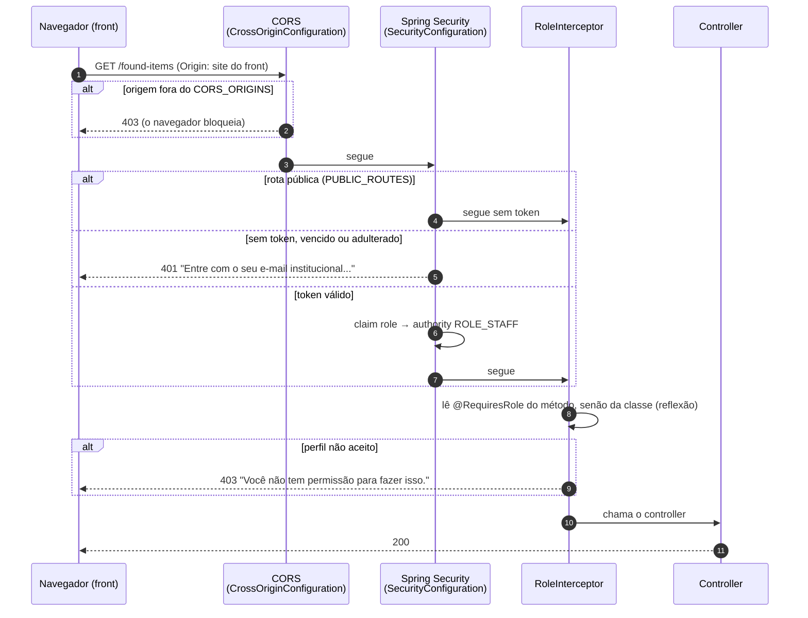
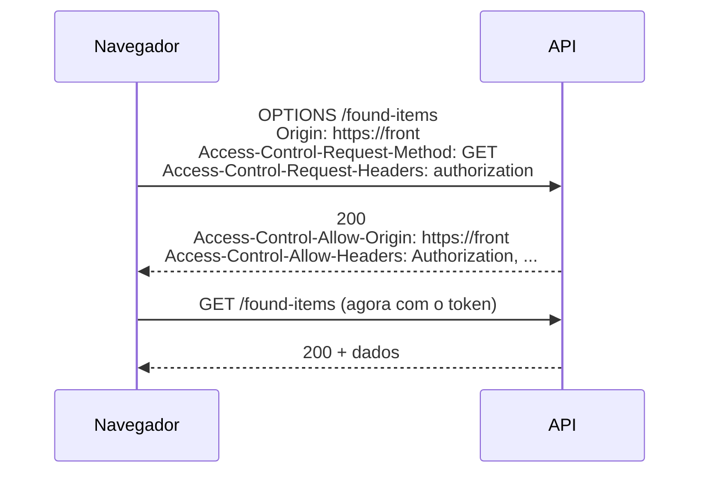
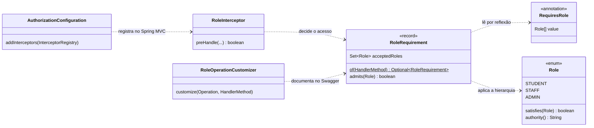

# Autorização por perfil e CORS (`@RequiresRole`)

Como o back-end decide **quem pode chamar cada rota**: o CORS (quais sites podem chamar a API pelo navegador), o token
de acesso (quem é a pessoa) e a anotação `@RequiresRole` (o que o perfil dela pode fazer). As regras vêm do RF02, do
RNF05 e da D09; as escolhas de implementação estão na D19. O login, que emite o token, está em
[login-codigos.md](login-codigos.md).

## 1. A ideia em uma analogia

Pense na API como um prédio com três controles, um depois do outro:

| Controle | No prédio | Na API | Se falhar |
|---|---|---|---|
| 1. CORS | A portaria só deixa entrar visitantes vindos de endereços conhecidos | O navegador só deixa o site do front (Vercel) chamar a API | O navegador bloqueia (403) |
| 2. Token | Na catraca, você mostra o crachá | O JWT no header `Authorization` diz quem é a pessoa e qual o perfil dela | **401** "Entre com o seu e-mail institucional para continuar." |
| 3. `@RequiresRole` | Cada andar tem uma placa dizendo quem pode subir | Cada controller ou método diz quais perfis aceita | **403** "Você não tem permissão para fazer isso." |

O controle 2 já existia desde o ACE-02. O ACE-03 acrescentou o 1 e o 3.

## 2. Perfis e hierarquia

Toda conta tem **um** perfil (`Role`, em `shared.security`). Visitante não tem conta: só usa as rotas públicas.

| Perfil | Quem é | Também conta como |
|---|---|---|
| `STUDENT` | todo login novo (RF01) | — |
| `STAFF` | conta que recebeu o perfil do administrador (RF03) | — |
| `ADMIN` | criado na instalação | `STAFF` |

Isso segue a seção 2 dos requisitos: o administrador faz **tudo do funcionário**, e mais. Mas ninguém herda o
estudante: o funcionário e o administrador não registram perdas. Uma rota que sirva a estudante **e** funcionário lista
os dois.

No código, a hierarquia fica no próprio enum, e não em `if`s espalhados:

```java
public enum Role {
    STUDENT,
    STAFF,
    ADMIN(STAFF);                       // o administrador inclui o funcionário

    public boolean satisfies(Role required) {
        return this == required || includes.contains(required);
    }
}
```

| Perfil do token ↓ / rota exige → | `STUDENT` | `STAFF` | `ADMIN` |
|---|---|---|---|
| `STUDENT` | ✅ | ❌ | ❌ |
| `STAFF` | ❌ | ✅ | ❌ |
| `ADMIN` | ❌ | ✅ | ✅ |

## 3. O caminho de uma requisição



Os dois erros saem como `ProblemDetail` (D17), pelo `ApiExceptionHandler`. O front mostra o campo `detail`.

| Situação | Resposta |
|---|---|
| Site desconhecido chamando pelo navegador | 403, sem os headers de CORS (o navegador nem entrega a resposta ao script) |
| Sem token, token vencido, adulterado ou de outro emissor | 401 + `WWW-Authenticate: Bearer` |
| Token válido, perfil não aceito pela rota | 403 |
| Token válido, perfil aceito | segue para o controller |

## 4. CORS: quem pode chamar a API pelo navegador

### O problema

O front fica na Vercel (`https://...vercel.app`) e o back-end, no túnel (D08). São **origens diferentes**. Por
segurança, o navegador não deixa um site ler a resposta de outra origem, a menos que essa outra origem diga que
permite. O CORS é essa permissão.

### O preflight

Antes de uma requisição com `Authorization`, o navegador manda sozinho um `OPTIONS` perguntando "posso?". É o
**preflight**:



O preflight **não leva token**, então o CORS roda antes da conferência do token. Por isso ele fica dentro do Spring
Security (`http.cors(...)`), e não num controller.

### O que está liberado (`CrossOriginConfiguration`)

| Item | Valor | Por quê |
|---|---|---|
| Origens | as do `CORS_ORIGINS` (separadas por vírgula) | só o front; em desenvolvimento, `http://localhost:4200` |
| Métodos | `GET`, `POST`, `PUT`, `PATCH`, `DELETE` | os que a API usa |
| Headers enviados | `Authorization`, `Content-Type`, `ngrok-skip-browser-warning` | o último faz o ngrok não responder com a página de aviso (D08, D09) |
| Headers expostos | `Retry-After` | sem isso, o navegador esconde o header e o front não sabe quanto esperar no 429 do login |
| Credenciais | não | o token vai no header, nunca em cookie (D09) |
| Cache do preflight | 1 hora | o navegador não repete o `OPTIONS` a cada chamada |

Para liberar outro endereço do front, mude só o `.env` (`CORS_ORIGINS=https://a.vercel.app,https://b.vercel.app`).

> **Atenção:** o CORS protege **o navegador**, não a API. Um `curl` ou o Postman ignoram o CORS. Quem protege os dados
> são o token e a `@RequiresRole`.

## 5. Do token ao perfil

Isso já existia (ACE-02) e só é lembrado aqui. O token emitido no login leva a claim `role`:

```json
{ "iss": "cade-backend", "sub": "id-da-conta", "email": "...@ucsal.edu.br", "role": "STAFF", "exp": ... }
```

Em toda requisição, o `SecurityConfiguration` confere a assinatura, o emissor e a validade, e transforma `"role":
"STAFF"` na *authority* `ROLE_STAFF` do Spring Security. O banco **não** é consultado.

**Consequência:** se o administrador muda o perfil de alguém (ADM-02), a mudança só vale no **próximo login**. O token
antigo continua com o perfil antigo até vencer (8 h).

## 6. A anotação `@RequiresRole`

### Como usar

Na classe, vale para todas as rotas do controller:

```java
@RestController
@RequestMapping("/found-items")
@RequiresRole(Role.STAFF)                 // funcionário e administrador
class FoundItemController implements FoundItemApi { ... }
```

Num método, **substitui** a da classe (não soma):

```java
@RestController
@RequiresRole(Role.STAFF)
class ExampleController {

    @GetMapping("/a")                     // STAFF e ADMIN (veio da classe)
    ... a() { }

    @GetMapping("/b")
    @RequiresRole(Role.ADMIN)             // só ADMIN
    ... b() { }

    @GetMapping("/c")
    @RequiresRole({Role.STUDENT, Role.STAFF})   // STUDENT, STAFF e ADMIN
    ... c() { }
}
```

| Anotação | Perfis aceitos |
|---|---|
| `@RequiresRole(Role.STUDENT)` | STUDENT |
| `@RequiresRole(Role.STAFF)` | STAFF, ADMIN |
| `@RequiresRole(Role.ADMIN)` | ADMIN |
| `@RequiresRole({Role.STUDENT, Role.STAFF})` | STUDENT, STAFF, ADMIN |
| `@RequiresRole({})` | erro: a aplicação recusa, porque fecharia a rota para todos |

### E as rotas públicas?

Rotas abertas sem token (login, Swagger, saúde e, depois, a página pública do M8) ficam listadas, uma a uma, em
`SecurityConfiguration.PUBLIC_ROUTES`, e **não** levam `@RequiresRole`. Nunca use curinga como `/auth/**`: uma rota
nova no mesmo caminho ficaria aberta sem ninguém perceber.

## 7. Por dentro: anotação lida por reflexão

Uma anotação, sozinha, não faz nada: é só uma etiqueta no código. Alguém precisa **ler** a etiqueta enquanto o
programa roda. Isso é **reflexão**: o programa examinar a própria estrutura (classes, métodos, anotações) em tempo de
execução.



Os arquivos ficam em `shared.security` (porque todos os módulos usam, D10):

| Arquivo | Papel |
|---|---|
| `Role` | os perfis e a hierarquia (`satisfies`) |
| `authorization/RequiresRole` | a anotação. `@Retention(RUNTIME)` mantém a anotação no programa em execução; sem isso, a reflexão não a encontraria. `@Target({TYPE, METHOD})` permite usá-la na classe ou no método |
| `authorization/RoleRequirement` | **a leitura por reflexão**: `getAnnotation(RequiresRole.class)` no método e, se não houver, na classe. Devolve os perfis aceitos, já com a hierarquia aplicada |
| `authorization/RoleInterceptor` | roda antes de todo controller, compara o perfil do token com os aceitos e lança `AccessDeniedException` (vira 403) |
| `authorization/AuthorizationConfiguration` | registra o interceptor no Spring MVC |
| `cors/CrossOriginConfiguration`, `cors/CorsProperties` | o CORS da seção 4 |
| `shared.web.openapi/RoleOperationCustomizer` | lê a mesma anotação e escreve **Perfis:** no Swagger |

O trecho central da reflexão, em `RoleRequirement`:

```java
public static Optional<RoleRequirement> of(HandlerMethod handler) {
    return annotationOn(handler.getMethod())               // 1. a anotação do método
            .or(() -> annotationOn(handler.getBeanType()))  // 2. senão, a da classe
            .map(annotation -> fromRequired(annotation.value(), handler));
}

private static Optional<RequiresRole> annotationOn(AnnotatedElement element) {
    return Optional.ofNullable(element.getAnnotation(RequiresRole.class));   // java.lang.reflect
}
```

`HandlerMethod` é como o Spring descreve "o método do controller que vai atender esta requisição"; dele saem o
`Method` e a classe. `AnnotatedElement` é a interface que `Method` e `Class` têm em comum, então o mesmo método serve
para os dois.

**Por que um interceptor e não `@PreAuthorize`?** O Spring Security já tem `@PreAuthorize("hasRole('STAFF')")`, que faria
o mesmo. Mas aí a leitura da anotação seria do Spring, e a nossa regra viraria texto dentro de uma string. Com uma
anotação própria e um interceptor, a reflexão e a hierarquia ficam no nosso código, tipadas pelo enum, e são conteúdo
de POOA (anotações e reflexão) que dá para mostrar no pitch.

## 8. O que garante que ninguém esquece a anotação

Uma rota nova sem `@RequiresRole` aceitaria **qualquer** pessoa logada, inclusive estudantes numa rota de funcionário.
Para isso não depender de memória, o `RouteAuthorizationCoverageTest` percorre todas as rotas registradas no Spring e
**quebra o build** se alguma não estiver em `PUBLIC_ROUTES` nem tiver a anotação:

```
[rotas sem @RequiresRole e fora das públicas]
Expecting empty but was: ["[/found-items] em br.ucsal.cade.founditems.controller...FoundItemController#create(...)"]
```

Como o CI roda os testes em todo PR (D12), uma rota esquecida não chega à `main`.

## 9. Checklist para uma rota nova

1. A rota é pública (visitante sem login)? Acrescente o caminho exato em `SecurityConfiguration.PUBLIC_ROUTES`.
2. Senão, ponha `@RequiresRole(...)` no controller (ou no método, se só ele for diferente).
3. Rode `./mvnw verify`: o `RouteAuthorizationCoverageTest` confere o passo 2.
4. Abra o Swagger: a descrição da rota mostra **Perfis:** e a resposta 403.
5. Se a rota devolve dados de um objeto achado, lembre do RN03: foto, descrição interna, detalhes reservados e local
   exato nunca vão para estudantes. O perfil abre a rota; **o que** ela devolve continua sendo escolha do `service`.

## 10. Perguntas frequentes

**Por que o token não vai num cookie `httpOnly`?** O front (Vercel) e o back (túnel) ficam em sites diferentes. Um cookie
entre sites precisa de `SameSite=None`, e os navegadores bloqueiam ou restringem esse tipo de cookie. Além disso, um
cookie é enviado sozinho pelo navegador, o que traria de volta o risco de CSRF. Com o header, um site de terceiros não
consegue enviar o token. A proteção contra XSS vem do Angular, que escapa o HTML por padrão (D09).

**Um estudante pode trocar o `role` do próprio token para `ADMIN`?** Não. O token é assinado com HMAC-SHA256 e a chave
(`JWT_SECRET`) só existe no servidor. Mudar qualquer caractere invalida a assinatura, e a requisição recebe 401
(testado no `ResourceServerTest`).

**O 403 do CORS e o 403 do perfil são a mesma coisa?** Não. O do CORS acontece no navegador, quando o **site** não é
o front. O do perfil acontece no servidor, quando a **pessoa** não tem o perfil exigido. Só o segundo traz a mensagem
em português.

## 11. Testes

| Teste | O que confere |
|---|---|
| `RoleTest` | a tabela da seção 2 (cada perfil contra cada exigência) e a conversão para `ROLE_...` |
| `RoleRequirementTest` | a leitura na classe, a substituição pelo método, a lista com vários perfis, a ausência de anotação e a recusa de `@RequiresRole({})` |
| `RoleInterceptorTest` | requisições de verdade (MockMvc) com tokens de cada perfil contra rotas de cada perfil; o 403 em português; o 401 antes do 403 |
| `CrossOriginTest` | preflight de origem liberada (com o header do ngrok), de origem desconhecida e com header fora da lista; `Retry-After` exposto |
| `RouteAuthorizationCoverageTest` | toda rota fora das públicas tem `@RequiresRole` |
| `RoleDocumentationTest` | o Swagger mostra **Perfis:** e a resposta 403 |
| `ResourceServerTest` | (do ACE-02) token ausente, adulterado, de outra chave, de outro emissor e vencido |
