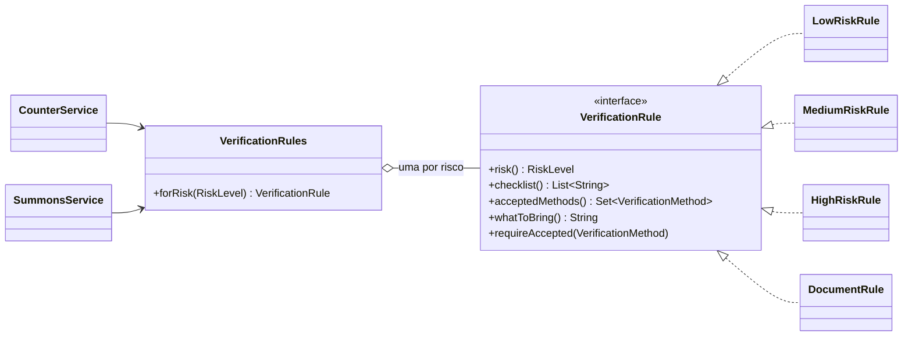

# POOA no Cadê?

Onde os conteúdos de Programação Orientada a Objetos Avançada aparecem no código, **qual problema cada um resolve** e como mostrar na apresentação. O manual do POOALAB dá até 5 pontos de bônus pela "aplicação pertinente e explicada" desses conteúdos, e diz que "a inserção artificial de padrões não gera pontuação". Por isso, cada item abaixo começa pelo problema, e não pelo padrão.

**Para a equipe:** antes da mostra, cada integrante deve conseguir explicar pelo menos os itens marcados com ★, abrindo o arquivo indicado. As perguntas no fim de cada seção são as que o professor provavelmente vai fazer.

**Para manter atualizado:** toda PR que usar um conteúdo de POOA acrescenta uma linha aqui. Os links apontam para os arquivos na `main`.

## Resumo

| Conteúdo | Onde | Problema que resolve | Situação |
|---|---|---|---|
| ★ State | `FoundItemStatus`, `LossReportStatus`, `SuggestionStatus`, `SummonsStatus` | O objeto, o registro de perda, a sugestão e a convocação só mudam de situação pelas transições permitidas (RN01) | Na `main` (ACH-01); perda no PER-01; sugestão no CRU-02; convocação no RET-01; perda Recusada no RET-03 (um estado novo é um record novo, e o `switch` exaustivo aponta cada lugar a ajustar) |
| ★ Observer (eventos) | `EventPublisher`; `LoginCodeRequestedEvent` → `LoginCodeEmailListener`; `AuditEvent` → `AuditRecorder`; `FoundItemRegisteredEvent` e `LossReportRegisteredEvent` → `MatchingListener` | Um módulo avisa que algo aconteceu sem conhecer quem reage | Na `main` (AVI-01, ADM-01); cruzamento no CRU-02 |
| ★ Concorrência: lock otimista | `LossReporter` + `OPTIMISTIC_FORCE_INCREMENT`; `@Version` em `MatchSuggestion`, `FoundItem` e `Summons` | Dois registros simultâneos não passam do limite de 5 em andamento (RN05); duas decisões simultâneas sobre a mesma sugestão não valem as duas; um objeto nunca tem duas convocações ativas (RN18); retirada e recusa da mesma convocação não valem as duas | PER-01; sugestão no CRU-03; convocação no RET-01; balcão no RET-03 |
| ★ Anotações e reflexão | `@RequiresRole`, `RoleRequirement`, `RouteAuthorizationCoverageTest` | Cada rota declara quem pode usá-la, e um teste impede que uma rota fique aberta por esquecimento | Na `main` (ACE-03) |
| Virtual Threads | `AsyncConfiguration` + `spring.threads.virtual.enabled` | O e-mail e o cruzamento rodam sem prender a resposta ao usuário | Na `main` (AVI-01); cruzamento no CRU-02 |
| ★ SOLID: inversão de dependência | `EmailSender`, `PhotoStorage`, `Clock` | Trocar o SMTP ou o disco sem mexer em quem usa; testar prazos sem esperar | Na `main`; `PhotoStorage` na PR #65 |
| SOLID: aberto/fechado | `ApiException` e subclasses; `CompatibilityCriterion` | Um tipo novo de erro não exige mudar o tratador; um critério novo não exige mudar a soma | Na `main`; critérios no CRU-01 |
| SOLID: segregação de interfaces | `AuditRecordRepository` | O histórico não tem método de exclusão (RN19) | Na `main` (ADM-01) |
| Collections e Streams | `RoleRequirement`, `AuthorizationConfiguration`, `FoundItemStatus`, `WordsCriterion`, `LocationCriterion`, `PublicCountsService` | Calcular os perfis aceitos e a hierarquia a partir do enum; as palavras em comum e o melhor local do cruzamento; as contagens da página pública por mês e categoria | Na `main`; cruzamento no CRU-01; página pública no PUB-02 |
| Records e enums com comportamento | `AuditEvent`, `Role`, `RiskLevel`, `LostPeriod`, `LossLocation`, `MatchingProperties`, `CompatibilityBand` | Dados imutáveis validados na criação; regra junto do dado | Na `main`; `RiskLevel` na PR #65; período e local no PER-01; pesos e faixas no CRU-01 |
| GRASP: especialista na informação | `FoundItemStatus`, `RiskLevel.canBeRaisedTo`, `FoundItem.register` | A regra fica na classe que tem os dados para decidir | Na `main`; `FoundItem` na PR #65 |
| Baixo acoplamento (módulos) | `ModuleBoundariesTest` (ArchUnit) | Módulos só se falam pela `api` e nas direções da D10 | Na `main` (GES-01) |
| ★ Strategy + Composite | `CompatibilityCriterion`, `SameCategoryGate`, `SumOfCriteria` | A nota do cruzamento soma critérios configuráveis, e um critério novo (a IA do CRU-05) entra sem mudar os outros (RN07, RF21) | CRU-01 |
| ★ Strategy por risco | `VerificationRule`, `LowRiskRule`, `MediumRiskRule`, `HighRiskRule`, `DocumentRule`, `VerificationRules` | O que conferir no balcão, o que basta para entregar e o que o estudante leva dependem do risco do objeto (RN09); um risco novo é uma classe nova | RET-03 |

---

## ★ State: situações do objeto achado

**Problema.** Um objeto passa por Disponível, Reservado, Devolvido, Não reclamado e Destinado (seção 6.1 dos requisitos), e só pode mudar pelas transições permitidas (RN01). Por exemplo, um objeto Devolvido não pode ser convocado de novo. Com um `if` por situação espalhado pelos serviços, cada regra nova seria um lugar a mais para esquecer.

**Como.** Cada situação é um `record` que implementa a `sealed interface FoundItemStatus` e sabe para onde pode ir. A ação que a situação não permite cai no método padrão da interface, que recusa com `InvalidStatusTransitionException` (HTTP 409).

```java
public sealed interface FoundItemStatus {
    default FoundItemStatus reserve() { throw refused("convocar"); }   // padrão: recusa
    record Available() implements FoundItemStatus {
        @Override public FoundItemStatus reserve() { return RESERVED; } // Disponível pode ser convocado
    }
    record Returned() implements FoundItemStatus { }                     // final: recusa tudo
}
```

O `sealed` faz o compilador conhecer todas as situações: os `switch` de `code()` e `label()` não têm `default`, e uma situação nova faz o compilador apontar cada lugar que precisa tratá-la.

**Onde:** [`FoundItemStatus.java`](../../src/main/java/br/ucsal/cade/founditems/persistence/status/FoundItemStatus.java), [`FoundItemStatusConverter.java`](../../src/main/java/br/ucsal/cade/founditems/persistence/status/FoundItemStatusConverter.java) (grava no banco como texto) e os testes em [`FoundItemStatusTest.java`](../../src/test/java/br/ucsal/cade/founditems/persistence/status/FoundItemStatusTest.java), que cobrem todas as transições, permitidas e proibidas.

**Registro de perda (PER-01):** o [`LossReportStatus`](../../src/main/java/br/ucsal/cade/lossreports/persistence/status/LossReportStatus.java) segue o mesmo modelo para a seção 6.2, e ainda diz se o registro pode ser editado (`isEditable`, RN06) e quais situações contam para o limite de 5 (`ACTIVE`, RN05). Os testes em [`LossReportStatusTest.java`](../../src/test/java/br/ucsal/cade/lossreports/persistence/status/LossReportStatusTest.java) cobrem as 8 transições permitidas e as 34 proibidas.

**Sugestão (CRU-02):** o [`SuggestionStatus`](../../src/main/java/br/ucsal/cade/matching/persistence/status/SuggestionStatus.java) cobre a seção 6.3 (Nova, Em espera, Convocada e os cinco finais). Os testes em [`SuggestionStatusTest.java`](../../src/test/java/br/ucsal/cade/matching/persistence/status/SuggestionStatusTest.java) cobrem as 9 transições permitidas e as 55 proibidas. No CRU-03, o descarte pelo funcionário ([`MatchSuggestion.discard()`](../../src/main/java/br/ucsal/cade/matching/persistence/suggestion/MatchSuggestion.java)) só delega para a situação atual: uma sugestão que não está Nova recusa sozinha, sem `if` no serviço.

**Perguntas prováveis**
- *Por que não um enum com um `switch`?* O enum concentraria todas as transições num método só. Com o State, cada situação guarda as próprias regras, e o `sealed` dá a mesma garantia do enum: não existe situação fora da lista.
- *Por que records?* As situações não guardam dados; record dá `equals` por valor, então duas instâncias de Disponível são iguais.

---

## ★ Observer: eventos entre módulos

**Problema.** Quando um código de login é gerado, alguém precisa enviar o e-mail. Mas o módulo de acesso não deveria conhecer o módulo de avisos, e o envio não deveria atrasar a resposta. O mesmo vale para o histórico (RF43): toda ação relevante precisa ser registrada sem que cada módulo dependa do módulo de administração.

**Como.** Quem faz a ação publica um evento (o sujeito) e não sabe quem ouve. Os ouvintes (os observadores) reagem. Quem publica usa a interface [`EventPublisher`](../../src/main/java/br/ucsal/cade/shared/event/EventPublisher.java) (o `PublicadorEventos` dos requisitos); por trás dela, o Spring faz o papel do registro de observadores (`ApplicationEventPublisher` e `@EventListener`). Se o RabbitMQ entrar, troca só a implementação.

```
LoginService ──publica──► LoginCodeRequestedEvent ──► LoginCodeEmailListener (depois do commit, @Async)
qualquer módulo ──publica──► AuditEvent ──► AuditRecorder (síncrono, na mesma transação)
FoundItemService ──publica──► FoundItemRegisteredEvent ─┐
LossReportService ─publica──► LossReportRegisteredEvent ─┴► MatchingListener (depois do commit, @Async)
```

Os ouvintes mostram as duas formas do padrão: o e-mail e o cruzamento rodam **depois do commit e em outra thread**, porque uma falha neles não pode desfazer o login nem o cadastro (D05, RNF08). Já o histórico roda **na mesma transação**, porque uma ação sem histórico não pode ser gravada (RNF07, complemento da D10).

**Onde:** [`LoginCodeRequestedEvent.java`](../../src/main/java/br/ucsal/cade/access/api/event/LoginCodeRequestedEvent.java), [`LoginCodeEmailListener.java`](../../src/main/java/br/ucsal/cade/notifications/service/login/LoginCodeEmailListener.java), [`AuditEvent.java`](../../src/main/java/br/ucsal/cade/shared/audit/AuditEvent.java), [`AuditRecorder.java`](../../src/main/java/br/ucsal/cade/administration/service/audit/AuditRecorder.java); testes em [`AuditRecorderTest.java`](../../src/test/java/br/ucsal/cade/administration/service/audit/AuditRecorderTest.java) (commit grava, rollback não grava, sem transação falha).

**Cruzamento (CRU-02):** o [`MatchingListener`](../../src/main/java/br/ucsal/cade/matching/service/matching/MatchingListener.java) ouve o `FoundItemRegisteredEvent` e o `LossReportRegisteredEvent` e chama o [`MatchingService`](../../src/main/java/br/ucsal/cade/matching/service/matching/MatchingService.java), que grava as sugestões médias e altas. Pela D10, `founditems` e `lossreports` não podem chamar `matching` (é o cruzamento que depende deles), então o evento é o único caminho. O fluxo, com os casos de falha, está em [`cruzamento.md`](../tecnico/cruzamento.md); o [`MatchingServiceTest.java`](../../src/test/java/br/ucsal/cade/matching/service/matching/MatchingServiceTest.java) confere de ponta a ponta, inclusive que uma falha no cruzamento não desfaz o cadastro.

**Perguntas prováveis**
- *Por que eventos e não chamar o serviço de e-mail direto?* Pela D10, `access` não pode depender de `notifications`. O evento inverte a dependência: quem ouve conhece o evento, e quem publica não conhece ninguém.
- *Por que não RabbitMQ?* A D05 explica: num monólito, os eventos do Spring dão o mesmo desacoplamento sem um serviço a mais para subir na mostra.

---

## ★ Anotações e reflexão: autorização por perfil

**Problema.** Cada rota só pode ser usada por certos perfis (RF02). Por exemplo, um estudante não pode cadastrar objetos. O perigo é esquecer de proteger uma rota nova: ela ficaria aberta para qualquer um com um token.

**Como.**
1. **Uma anotação própria**, `@RequiresRole(Role.STAFF)`, vai na classe ou no método do controller. É o `@RequerPerfil` do RNF05.
2. **Ela é uma meta-anotação de `@PreAuthorize`**, então quem aplica a regra é o Spring Security. O enum `Role` implementa `ExpressionTemplateValueProvider` e vira o texto da expressão (`hasAnyRole('STAFF')`), sem ninguém escrever string à mão.
3. **A leitura por reflexão** fica no `RoleRequirement`, que procura a anotação no método, depois na classe e também nas interfaces.
4. **O teste de cobertura** percorre por reflexão todas as rotas registradas e quebra o build se alguma não for pública nem tiver `@RequiresRole`. O Swagger usa a mesma leitura para mostrar "Perfis:" em cada rota.

```java
@Retention(RetentionPolicy.RUNTIME)                  // sem isso, a reflexão não encontra a anotação
@Target({ElementType.TYPE, ElementType.METHOD})
@PreAuthorize("hasAnyRole({value})")
public @interface RequiresRole { Role[] value(); }
```

**Onde:** [`RequiresRole.java`](../../src/main/java/br/ucsal/cade/shared/security/authorization/RequiresRole.java), [`RoleRequirement.java`](../../src/main/java/br/ucsal/cade/shared/security/authorization/RoleRequirement.java), [`Role.java`](../../src/main/java/br/ucsal/cade/shared/security/Role.java), [`RoleOperationCustomizer.java`](../../src/main/java/br/ucsal/cade/shared/web/openapi/RoleOperationCustomizer.java), [`RouteAuthorizationCoverageTest.java`](../../src/test/java/br/ucsal/cade/shared/security/RouteAuthorizationCoverageTest.java). O passo a passo completo está em [autorizacao.md](../tecnico/autorizacao.md), e a decisão, na D20 (que substitui a D19).

**Perguntas prováveis**
- *Se o Spring já aplica a regra, onde está a reflexão de vocês?* No `RoleRequirement`, usado pelo Swagger e pelo teste que impede rota esquecida. A primeira versão (D19) fazia a checagem com um interceptor próprio; trocamos pelo mecanismo do Spring para não reimplementar segurança, e mantivemos a reflexão onde ela agrega.
- *O que é `RUNTIME`?* A retenção da anotação: sem ela, a anotação some depois da compilação e nem o Spring nem a reflexão a encontram.

---

## ★ Concorrência: lock otimista no limite de registros

**Problema.** Cada estudante pode ter no máximo 5 registros em andamento (RN05). Contar e depois gravar não basta: com 4 registros, duas requisições enviadas juntas contam 4 e gravam, e o estudante fica com 6.

**Como.** Uma linha por estudante (`loss_reporters`) com `@Version`. O registro lê essa linha com `OPTIMISTIC_FORCE_INCREMENT` antes de contar, e o commit sobe a versão. Das duas requisições, a segunda encontra a versão já alterada, falha e é desfeita inteira; o estudante recebe 409 "tente de novo".

**Onde:** [`LossReporter.java`](../../src/main/java/br/ucsal/cade/lossreports/persistence/reporter/LossReporter.java), [`LossReporterRepository.java`](../../src/main/java/br/ucsal/cade/lossreports/persistence/reporter/LossReporterRepository.java), [`LossReportService.java`](../../src/main/java/br/ucsal/cade/lossreports/service/report/LossReportService.java); fluxo com diagramas em [`limite-registros-abertos.md`](../tecnico/limite-registros-abertos.md); testes em [`LossReporterRepositoryTest.java`](../../src/test/java/br/ucsal/cade/lossreports/persistence/reporter/LossReporterRepositoryTest.java) (duas transações intercaladas) e [`LossReportServiceTest.java`](../../src/test/java/br/ucsal/cade/lossreports/service/report/LossReportServiceTest.java) (8 registros simultâneos em Virtual Threads terminam com exatamente 5).

**Perguntas prováveis**
- *Por que otimista e não pessimista?* Conflito de verdade é raro (o mesmo estudante enviando dois registros no mesmo instante). O otimista não deixa ninguém esperando; só quem perde a corrida tenta de novo.
- *Por que não um `@Version` no próprio registro?* Num cadastro, o registro ainda não existe: duas inserções não disputam nada. É preciso uma linha que as duas leiam.

### Uma convocação ativa por objeto (RET-01)

**Problema.** Um objeto pode ter duas sugestões (duas perdas que combinam), e dois funcionários podem convocar ao mesmo tempo, cada um por uma. As duas leem o objeto Disponível; sem proteção, as duas convocam, e o mesmo objeto fica prometido a dois estudantes (RN18).

**Como.** O `FoundItem` tem `@Version`. A convocação reserva o objeto e grava essa mudança antes de mexer nas sugestões e na perda; a segunda convocação espera a linha do objeto, encontra a versão já alterada, falha e é desfeita inteira (409). Gravar o objeto primeiro dá uma ordem fixa de travas, sem deadlock entre as sugestões.

**Onde:** [`SummonsService.java`](../../src/main/java/br/ucsal/cade/pickup/service/summons/SummonsService.java), [`FoundItemReservationsService.java`](../../src/main/java/br/ucsal/cade/founditems/service/item/FoundItemReservationsService.java); fluxo em [`convocacao.md`](../tecnico/convocacao.md); teste em [`SummonsServiceTest.java`](../../src/test/java/br/ucsal/cade/pickup/service/summons/SummonsServiceTest.java) (6 convocações simultâneas do mesmo objeto em Virtual Threads terminam com exatamente uma).

**Perguntas prováveis**
- *Por que a versão do objeto, e não uma restrição única no banco?* A restrição precisaria valer só para convocações ativas (índice parcial), que o `ddl-auto` não cria (D06). A linha do objeto já muda de situação na convocação, então a versão dela resolve sem tabela nova.
- *Por que gravar o objeto antes?* Para que toda convocação do mesmo objeto dispute a mesma linha primeiro (D25).

### Uma decisão por convocação no balcão (RET-03)

**Problema.** Dois funcionários podem decidir sobre a mesma convocação ao mesmo tempo: um registra a retirada e o outro a recusa. Sem proteção, o objeto ficaria Devolvido e Disponível ao mesmo tempo.

**Como.** A `Summons` tem `@Version` e é gravada primeiro, antes de objeto, sugestão e perda. A segunda decisão espera a linha, encontra a versão alterada e é desfeita inteira (409).

**Onde:** [`CounterService.java`](../../src/main/java/br/ucsal/cade/pickup/service/counter/CounterService.java); fluxo em [`retirada.md`](../tecnico/retirada.md); teste `aSimultaneousPickupAndRefusalLetOnlyOnePass` em [`CounterServiceTest.java`](../../src/test/java/br/ucsal/cade/pickup/service/counter/CounterServiceTest.java).

---

## ★ Strategy + Composite: a nota do cruzamento

**Problema.** A compatibilidade entre um objeto e uma perda (RN07) soma critérios de natureza diferente: data, local e palavras em comum, com a categoria como porta (categoria diferente zera tudo). Os pesos precisam ser configuráveis (RF21), e o CRU-05 vai acrescentar a IA como critério extra. Um método único com um `if` por critério cresceria e mudaria a cada ajuste.

**Como.**
- **Strategy:** cada critério implementa [`CompatibilityCriterion`](../../src/main/java/br/ucsal/cade/matching/service/score/criterion/CompatibilityCriterion.java), com um método só, `score(candidato)`: [`DateCriterion`](../../src/main/java/br/ucsal/cade/matching/service/score/criterion/DateCriterion.java), [`LocationCriterion`](../../src/main/java/br/ucsal/cade/matching/service/score/criterion/LocationCriterion.java) e [`WordsCriterion`](../../src/main/java/br/ucsal/cade/matching/service/score/criterion/WordsCriterion.java). Cada um conhece só a própria regra e os próprios pesos.
- **Composite:** [`SumOfCriteria`](../../src/main/java/br/ucsal/cade/matching/service/score/composite/SumOfCriteria.java) soma uma lista de critérios e também é um critério; [`SameCategoryGate`](../../src/main/java/br/ucsal/cade/matching/service/score/composite/SameCategoryGate.java) envolve outro critério e zera a nota quando a categoria é diferente. A nota inteira é uma árvore montada pela [`MatchingConfiguration`](../../src/main/java/br/ucsal/cade/matching/service/score/config/MatchingConfiguration.java), e quem calcula ([`CompatibilityScorer`](../../src/main/java/br/ucsal/cade/matching/service/score/CompatibilityScorer.java)) chama `score` na raiz sem saber quantos critérios existem:

```
SameCategoryGate
└── SumOfCriteria
    ├── DateCriterion       (40 / 20 / 0)
    ├── LocationCriterion   (30 / 15 / 0)
    └── WordsCriterion      (10 por palavra, até 3)
```

- **Pesos configuráveis:** os números da RN07 e as faixas ficam em `cade.matching.*` no `application.yml`, lidos pelo record [`MatchingProperties`](../../src/main/java/br/ucsal/cade/matching/service/score/config/MatchingProperties.java) e conferidos na subida. As regras que a RN07 não detalha (período, sala não informada, palavras que não contam) estão na D22.

**Onde:** os testes em [`CompatibilityScorerTest.java`](../../src/test/java/br/ucsal/cade/matching/service/score/CompatibilityScorerTest.java) usam os pesos do `application.yml` de verdade e conferem os dois exemplos da RN07 (fone na sala 421 = 80, alta; registro só com "iPhone" = 50, média); cada critério tem o próprio teste, e o [`CompositeCriteriaTest.java`](../../src/test/java/br/ucsal/cade/matching/service/score/composite/CompositeCriteriaTest.java) cobre a soma, o teto de 100 e a porta.

**Perguntas prováveis**
- *Por que não um método só?* Funcionaria hoje, mas cada critério novo mexeria no mesmo método. Com o Strategy, a IA do CRU-05 é uma classe nova na lista da `MatchingConfiguration`, e os testes dos outros critérios continuam valendo sem mudança.
- *Onde está o Composite, se a soma tem um nível só?* A raiz já é um composto de compostos: a porta envolve a soma, que contém os critérios. Como `SumOfCriteria` também é um `CompatibilityCriterion`, um grupo de critérios pode entrar dentro de outro (o teste `aNewCriterionEntersWithoutChangingTheOthers` faz isso).
- *Por que a porta da categoria não é um critério que soma 0?* Porque somar não zera: com a porta, categoria diferente dá 0 mesmo que data, local e palavras batam, como a RN07 exige.

---

## ★ Strategy: conferência por risco no balcão (RET-03)

**Problema.** No balcão, o que o funcionário confere depende do risco do objeto (RN09). Um guarda-chuva pede só documento e uma descrição coerente. Um celular pede desbloqueio na frente do funcionário ou uma prova. Um documento só sai para o titular. Para cada risco mudam **três coisas juntas**:
1. o checklist que aparece para o funcionário (RF28);
2. as verificações que bastam para registrar a retirada (RF29);
3. o que o estudante é avisado para levar (RF26).

Com um `switch (risco)` em cada um desses lugares, a regra de um risco ficaria espalhada em três `switch`, e um risco novo ou um ajuste exigiria lembrar de mudar todos.

**Como.** Cada risco é uma classe que implementa [`VerificationRule`](../../src/main/java/br/ucsal/cade/pickup/service/verification/VerificationRule.java) e responde as três perguntas: [`LowRiskRule`](../../src/main/java/br/ucsal/cade/pickup/service/verification/LowRiskRule.java), [`MediumRiskRule`](../../src/main/java/br/ucsal/cade/pickup/service/verification/MediumRiskRule.java), [`HighRiskRule`](../../src/main/java/br/ucsal/cade/pickup/service/verification/HighRiskRule.java) e [`DocumentRule`](../../src/main/java/br/ucsal/cade/pickup/service/verification/DocumentRule.java). O que é comum a todas, o documento com foto e a matrícula primeiro (RN10) e a recusa de uma verificação que não basta, fica nos métodos `default` da interface. O [`VerificationRules`](../../src/main/java/br/ucsal/cade/pickup/service/verification/VerificationRules.java) é o contexto: recebe as regras do Spring, monta um `EnumMap` por risco e entrega a regra certa. Quem usa (o `CounterService` no balcão e o `SummonsService` na convocação) só chama `forRisk(risco)` e não sabe quantos riscos existem.



O fluxo no balcão: o funcionário abre a convocação, e o `CounterService` busca a regra do risco gravado nela. Antes de mudar qualquer coisa, ele confere se a verificação registrada está entre as aceitas (`requireAccepted`). Se não estiver, responde 400 e nada é gravado. Os diagramas de sequência da retirada e da recusa estão em [`retirada.md`](../tecnico/retirada.md).

**SOLID junto.** Aberto/fechado: um risco novo é uma classe `@Component` nova, sem mexer nas outras nem em quem usa, e o `VerificationRules` recusa subir se um valor do `RiskLevel` ficar sem regra. Responsabilidade única: cada regra conhece só o próprio risco. Inversão de dependência: os serviços dependem da interface, não das regras concretas.

**Onde:** pacote [`pickup.service.verification`](../../src/main/java/br/ucsal/cade/pickup/service/verification/); testes em [`VerificationRulesTest.java`](../../src/test/java/br/ucsal/cade/pickup/service/verification/VerificationRulesTest.java) (cada risco, verificações aceitas e recusadas, subida recusada sem regra ou com regra duplicada) e [`CounterServiceTest.java`](../../src/test/java/br/ucsal/cade/pickup/service/counter/CounterServiceTest.java) (verificação insuficiente para risco alto não grava nada).

**Perguntas prováveis**
- *Não era mais simples um `switch`?* Para um texto só, sim, e era o que o RET-01 tinha (`WhatToBring`). Com três coisas que variam juntas por risco, o `switch` se repetiria em três lugares. Com o Strategy, tudo o que vale para o risco alto está numa classe só.
- *Qual a diferença para o Strategy do cruzamento?* No cruzamento, as estratégias **somam** (Composite): todos os critérios valem ao mesmo tempo. No balcão, **uma** estratégia é escolhida pelo risco. É o mesmo padrão em dois usos diferentes.
- *Hoje as regras só devolvem dados. Por que não um `enum` com atributos?* Para os textos e as verificações de hoje, um `enum` também serviria. As classes ficam prontas para regras com comportamento próprio, como as perguntas de conferência por categoria (RF44, ADM-04), que entram no checklist de cada risco sem mexer nos outros, e o `VerificationRules` confere na subida que nenhum risco ficou sem regra.
- *Por que as regras são beans do Spring e não um `Map` montado à mão?* Para que uma regra nova entre só com uma classe anotada. A verificação na subida garante que nenhum risco fica sem regra.
- *Por que o risco vem da convocação, e não do objeto na hora da retirada?* Ele é congelado na convocação (D25), porque o estudante foi avisado do que levar com base nele.

---

## Virtual Threads

**Problema.** Enviar um e-mail pelo Gmail leva alguns segundos. Se isso acontecesse na mesma thread da requisição, o usuário esperaria o e-mail sair para ver a resposta.

**Como.** O `@EnableAsync` liga o `@Async`, e com `spring.threads.virtual.enabled: true` o Spring roda cada tarefa assíncrona (e cada requisição) numa Virtual Thread do Java 21+. Virtual Threads são baratas: dá para ter milhares esperando rede sem gastar uma thread do sistema operacional para cada uma.

**Onde:** [`AsyncConfiguration.java`](../../src/main/java/br/ucsal/cade/shared/event/AsyncConfiguration.java), [`application.yml`](../../src/main/resources/application.yml) (`spring.threads.virtual.enabled`) e o `@Async` do [`LoginCodeEmailListener.java`](../../src/main/java/br/ucsal/cade/notifications/service/login/LoginCodeEmailListener.java).

**Cruzamento (CRU-02):** o [`MatchingListener`](../../src/main/java/br/ucsal/cade/matching/service/matching/MatchingListener.java) roda no mesmo esquema: o funcionário cadastra o próximo objeto sem esperar as sugestões do anterior. O teste `matchesInAVirtualThreadAfterTheCommit` do [`MatchingServiceTest.java`](../../src/test/java/br/ucsal/cade/matching/service/matching/MatchingServiceTest.java) confere que o cruzamento roda numa Virtual Thread (`Thread.isVirtual()`) e já enxerga o objeto confirmado.

---

## ★ SOLID

**Inversão de dependência (D).** As regras dependem de interfaces, e a implementação concreta é injetada pelo Spring:

| Interface | Implementação | O que ganha |
|---|---|---|
| [`EmailSender`](../../src/main/java/br/ucsal/cade/shared/mail/EmailSender.java) (o `ServicoEmail` dos requisitos) | [`SmtpEmailSender`](../../src/main/java/br/ucsal/cade/shared/mail/SmtpEmailSender.java) | Trocar Gmail por Mailpit ou por uma caixa interna no modo demonstração (DEM) sem mexer em quem envia |
| `PhotoStorage` (o `ArmazenamentoFotos`, PR #65) | `LocalPhotoStorage` | Guardar fotos em disco hoje e em outro lugar amanhã |
| [`EventPublisher`](../../src/main/java/br/ucsal/cade/shared/event/EventPublisher.java) (o `PublicadorEventos`, CRU-02) | `SpringEventPublisher` | Trocar os eventos do Spring pelo RabbitMQ sem mexer em quem publica (seção 7.2) |
| `java.time.Clock` ([`TimeConfiguration`](../../src/main/java/br/ucsal/cade/shared/time/TimeConfiguration.java)) | relógio real; nos testes, o `MutableClock` | Testar prazos (10 minutos do código, 90 dias do objeto) sem esperar |

**Aberto/fechado (O).** Todo erro de negócio herda de [`ApiException`](../../src/main/java/br/ucsal/cade/shared/exception/ApiException.java), e cada subclasse diz o próprio status HTTP (`BadRequestException`, `ConflictException`, `TooManyRequestsException`). Um único tratador, o [`ApiExceptionHandler`](../../src/main/java/br/ucsal/cade/shared/web/error/ApiExceptionHandler.java), transforma qualquer uma numa resposta em português. Um erro novo é uma classe nova, sem mudar o tratador.

**Substituição de Liskov (L).** A `InvalidStatusTransitionException` é uma `ConflictException`, que é uma `ApiException`: o tratador trata todas do mesmo jeito, sem `instanceof`.

**Segregação de interfaces (I).** O [`AuditRecordRepository`](../../src/main/java/br/ucsal/cade/administration/persistence/audit/AuditRecordRepository.java) estende `Repository`, e não `JpaRepository`, para expor só gravar e ler. O histórico nunca é apagado (RN19), e um teste confere que não existe nenhum método `delete`.

**Responsabilidade única (S).** O cadastro de objeto (PR #65) separa quem guarda a foto (`PhotoStorage`), quem decide a regra (`FoundItem`), quem coordena a transação (`FoundItemService`) e quem fala HTTP (`FoundItemController`).

**Pergunta provável:** *mostre um lugar onde a inversão de dependência ajudou de verdade.* Nos testes de login: o `MutableClock` adianta o relógio em 10 minutos para conferir que o código venceu, sem o teste esperar 10 minutos.

---

## Collections e Streams

- [`RoleRequirement`](../../src/main/java/br/ucsal/cade/shared/security/authorization/RoleRequirement.java): os perfis aceitos por uma rota, já com a hierarquia, num `EnumSet` montado por stream.
- [`AuthorizationConfiguration`](../../src/main/java/br/ucsal/cade/shared/security/authorization/AuthorizationConfiguration.java): a hierarquia de perfis do Spring (`ROLE_ADMIN > ROLE_STAFF`) gerada a partir do enum com `flatMap`, para a regra ficar num lugar só.
- [`FoundItemStatus.fromCode`](../../src/main/java/br/ucsal/cade/founditems/persistence/status/FoundItemStatus.java): a situação a partir do código gravado no banco.
- [`PublicCountsService`](../../src/main/java/br/ucsal/cade/publicpage/service/counts/PublicCountsService.java) (PUB-02): as contagens chegam como linhas (categoria, mês, quantidade). Um `groupingBy` num `TreeMap` em ordem inversa junta as linhas por mês, do mais recente para o mais antigo. Em cada mês, um `Comparator` composto põe a categoria com mais objetos primeiro, com o nome como desempate, e um `mapToLong(...).sum()` dá o total. É a "contagem da página pública" que a seção 7.3 dos requisitos cita.

**Próximos:** as contagens do painel (ADM-06), no mesmo estilo das da página pública.

---

## Records e enums com comportamento

- **Records** para dados imutáveis, validados no construtor: [`AuditEvent`](../../src/main/java/br/ucsal/cade/shared/audit/AuditEvent.java) recusa autor nulo e motivo vazio; [`LoginCodeRequestedEvent`](../../src/main/java/br/ucsal/cade/access/api/event/LoginCodeRequestedEvent.java) esconde o código no `toString`, para ele não vazar em log. Os DTOs da API também são records.
- **Enums com comportamento:** [`Role`](../../src/main/java/br/ucsal/cade/shared/security/Role.java) sabe a própria hierarquia (`ADMIN(STAFF)` e `satisfies`). Na PR #65, o `RiskLevel` sabe se pode ser aumentado (`canBeRaisedTo`, RN04), e o `PhotoType` reconhece cada formato de foto com um método por constante.

---

## GRASP e baixo acoplamento

- **Especialista na informação:** a regra fica na classe que tem os dados. A situação sabe as próprias transições (`FoundItemStatus`), o risco sabe se pode subir (`RiskLevel`), e o objeto confere a data e o risco ao ser cadastrado (`FoundItem.register`, PR #65).
- **Criador:** métodos de fábrica com nome dizem o que está sendo criado: `User.newStudent`, `User.newAdmin`, `AuditRecord.of` e `FoundItem.register`.
- **Baixo acoplamento:** o sistema é um monólito modular (D10). O [`ModuleBoundariesTest`](../../src/test/java/br/ucsal/cade/architecture/ModuleBoundariesTest.java) (ArchUnit) quebra o build se um módulo usar outro fora do pacote `api`, depender de um módulo não permitido ou criar ciclo.

---

## Planejados (ainda não estão no código)

| Conteúdo | Card | Ideia |
|---|---|---|
| — | — | Nenhum por enquanto: o Strategy por risco entrou no RET-03 |

Se algum desses não entrar até a entrega, esta tabela fica como "limitação declarada", que o manual aceita.

---

## O que não usamos, e por quê

- **Servlets escritos à mão:** a API usa Spring MVC, que roda sobre o `DispatcherServlet`, e a segurança é uma cadeia de filtros de servlet (`SecurityFilterChain`). Não escrevemos servlets diretamente porque o framework já resolve roteamento, conversão de JSON e validação.
- **Clean Architecture:** a D10 explica. O objetivo é separar módulos, e isolar o domínio do Spring dobraria o código para uma equipe de quatro com prazo curto.
