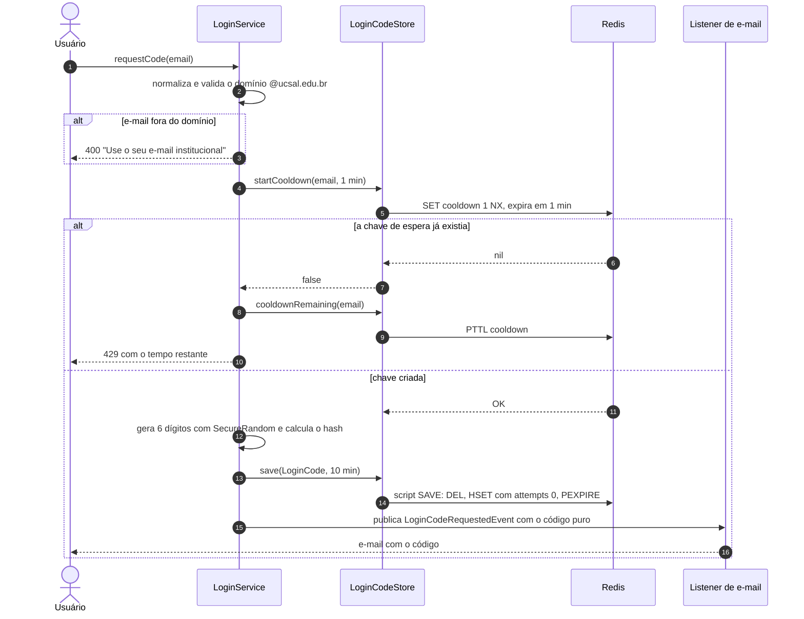
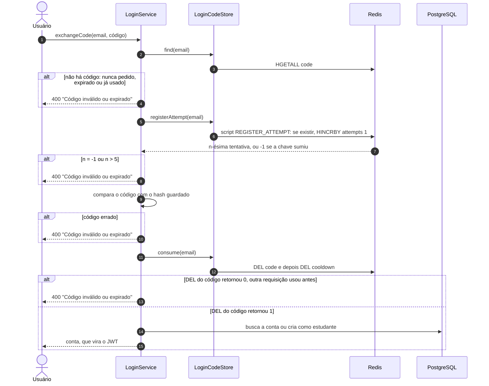
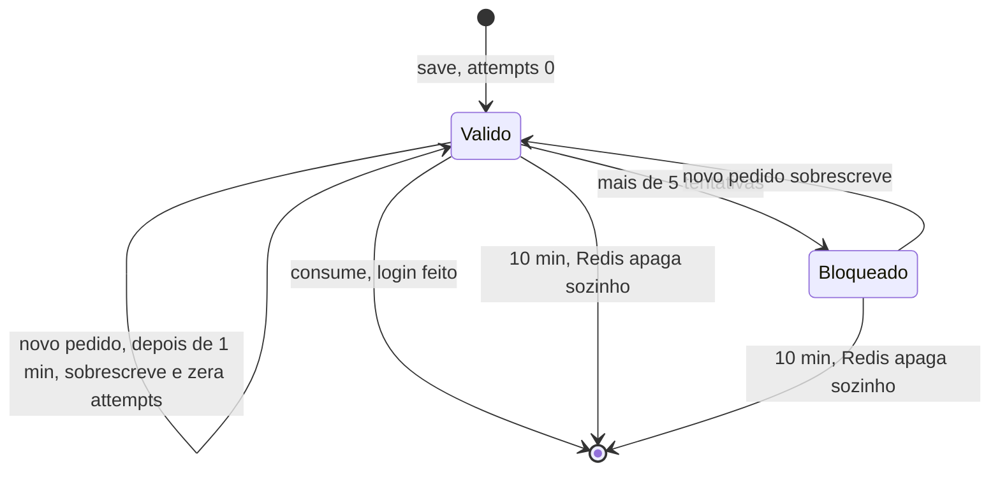
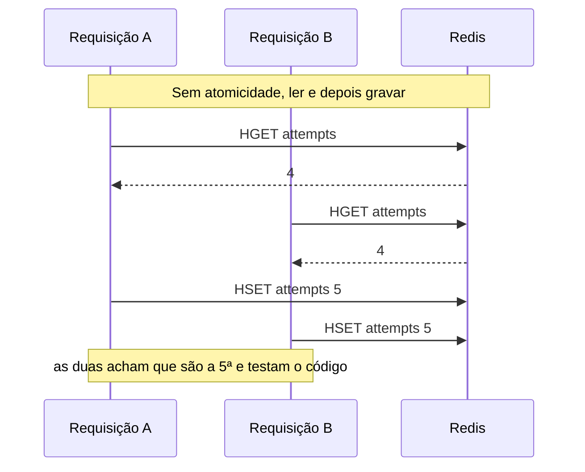

# Códigos de login no Redis (`LoginCodeStore`)

Como o `LoginCodeStore` (`access.persistence.logincode`) guarda os códigos de login, como o `LoginService` usa cada operação e por que algumas delas são scripts Lua. A decisão de usar o Redis está na D16; as regras do código (10 min, uso único, só hash, 5 tentativas, 1 envio por minuto) estão na D03 e em `cade.login-code.*` do `application.yml`.

## 1. O que fica guardado

Por e-mail (já normalizado), existem no máximo duas chaves, as duas com expiração. Por isso nada fica para trás e não existe rotina de limpeza.

| Chave | Tipo | Conteúdo | Expira em |
|---|---|---|---|
| `cade:login-code:<email>` | hash | `codeHash`, `createdAt`, `expiresAt`, `attempts` | 10 min (`ttl`) |
| `cade:login-code-cooldown:<email>` | string | `"1"` | 1 min (`resend-interval`) |

- O código digitado pelo usuário **nunca** é guardado, só o hash gerado pelo `PasswordEncoder`. O código puro só existe na memória e no `LoginCodeRequestedEvent`, que leva o código para o e-mail.
- Um código novo **sobrescreve** o anterior, então só o último enviado vale, e as tentativas voltam a zero.
- Enquanto a chave de espera existir, o e-mail não pode pedir outro código.

## 2. Operações

| Método | Comando no Redis | Atômico? | Usado em |
|---|---|---|---|
| `startCooldown(email, intervalo)` | `SET key 1 NX` com expiração | sim, um comando | `requestCode` |
| `cooldownRemaining(email)` | `PTTL key` | só leitura | `requestCode`, para o `Retry-After` |
| `save(code, ttl)` | script `SAVE`: `DEL` + `HSET` + `PEXPIRE` | sim, script Lua | `requestCode` |
| `find(email)` | `HGETALL key` | só leitura | `exchangeCode` |
| `registerAttempt(email)` | script `REGISTER_ATTEMPT`: `EXISTS` + `HINCRBY` | sim, script Lua | `exchangeCode` |
| `consume(email)` | `DEL` do código e depois `DEL` da espera | o primeiro `DEL` decide | `exchangeCode` |

## 3. Fluxo: pedir um código



A espera começa **antes** de o código ser gerado. Assim, dois pedidos simultâneos do mesmo e-mail não geram dois códigos: só um consegue criar a chave.

## 4. Fluxo: trocar o código pelo acesso



Todas as recusas usam **a mesma mensagem**, para quem tenta adivinhar não saber se o código está errado, expirado ou bloqueado. O motivo real só vai para o log.

## 5. Ciclo de vida da chave do código



"Bloqueado" não é um campo: é a chave existir com `attempts` acima do limite. Ela continua lá até expirar ou até um novo código a sobrescrever.

## 6. Por que scripts Lua: atomicidade

O Redis executa um comando por vez. Um script Lua (`EVAL`/`EVALSHA`) também roda **inteiro, sem nenhum outro comando no meio**. Já uma sequência de comandos enviados pelo Java ("lê, decide, escreve") pode ser intercalada por outra requisição entre um comando e outro. É aí que nascem as condições de corrida.

Onde **um** comando resolve, ele é usado: `SET NX` para a espera e `DEL` para o uso único. O Lua entra só onde é preciso **decidir com base no estado e escrever no mesmo passo**. Um `MULTI`/`EXEC` não serve aqui, porque ele enfileira comandos, mas não deixa usar o resultado de um (`EXISTS`) para decidir o próximo (`HINCRBY`). Isso exigiria `WATCH` e repetições.

O Spring envia o script com `EVALSHA` (o Redis guarda o script pelo SHA1) e só manda o texto inteiro na primeira vez.

### 6.1 `REGISTER_ATTEMPT`: contar a tentativa sem furar o limite

```lua
if redis.call('EXISTS', KEYS[1]) == 0 then
    return -1
end
return redis.call('HINCRBY', KEYS[1], 'attempts', 1)
```

O script resolve dois problemas.

**a) Palpites em paralelo.** Se o Java lesse `attempts`, comparasse com 5 e depois gravasse `attempts + 1`, vinte requisições simultâneas leriam o mesmo valor e passariam juntas pela verificação:



Com `HINCRBY`, cada requisição recebe um número diferente (1, 2, …, 20). Só as 5 primeiras chegam a comparar o código. Como a tentativa é contada **antes** da comparação, não existe janela entre "testei" e "contei". O teste `parallelGuessesCannotGoPastTheAttemptLimit` dispara 20 palpites em paralelo e confere que `attempts` termina em 20 e que o código fica bloqueado.

**b) Chave sem expiração.** O `HINCRBY` sozinho já é atômico, mas **cria a chave** se ela não existir. Se o código expirar entre o `find` e o `HINCRBY`, sobraria uma chave `{attempts: 1}` **sem TTL e sem `codeHash`**. Ela nunca sumiria, e o próximo `find` quebraria ao ler o hash. Com o `EXISTS` no mesmo script, ninguém consegue apagar a chave entre a verificação e o incremento.

### 6.2 `SAVE`: substituir o código e a expiração juntos

```lua
redis.call('DEL', KEYS[1])
redis.call('HSET', KEYS[1], 'codeHash', ARGV[1], 'createdAt', ARGV[2], 'expiresAt', ARGV[3], 'attempts', 0)
return redis.call('PEXPIRE', KEYS[1], ARGV[4])
```

O `HSET` não aceita expiração. Se `HSET` e `PEXPIRE` fossem dois comandos e a aplicação caísse entre eles, ficaria um **código válido para sempre**, o que quebra a regra dos 10 minutos. No script, ou acontece tudo, ou nada. O `DEL` inicial garante que nenhum campo do código anterior sobreviva. E, por rodar no mesmo passo, nenhuma tentativa concorrente vê um estado intermediário, como o hash novo com as tentativas antigas.

### 6.3 Onde um comando só basta

- **`startCooldown` usa `SET ... NX` com expiração.** Criar a chave só se ela não existir e já com expiração é um comando único. Se fosse `EXISTS` e depois `SET`, dois pedidos simultâneos veriam "não existe" e mandariam dois e-mails.
- **`consume` usa `DEL`.** O Redis retorna quantas chaves apagou. Se duas requisições com o código certo chegam juntas, só uma recebe `1`, e só ela faz login. É o que o teste `twoParallelRequestsWithTheRightCodeLogInOnlyOnce` confere. O segundo `DEL`, o da espera, é só limpeza: se falhar, a chave expira em 1 minuto.

## 7. Limitações conhecidas

- **`find` e `registerAttempt` são dois passos.** Se um código novo for salvo entre os dois, a comparação usa o hash do código **anterior** e a tentativa é contada no novo. Só quem recebeu o código anterior, ou seja, o dono do e-mail, se beneficiaria. Por isso foi aceito.
- **Bloqueio por novo pedido.** Depois de 5 erros, um novo pedido (passado 1 minuto) zera as tentativas. O limite é de 5 tentativas **por código**, como pede a D03, e não por e-mail.
- **Dependência do Redis.** Se o Redis cair, ninguém consegue pedir nem trocar código. Quem já está logado continua, porque o JWT não depende dele (D16).

## 8. Testes

- `LoginCodeStoreTest` (`@DataRedisTest` com Redis no Testcontainers): expiração da chave, sobrescrita zerando as tentativas, `registerAttempt` sem criar chave, `consume` retornando `true` uma vez só e a espera.
- `LoginServiceTest` (`@SpringBootTest`): o fluxo completo, incluindo os testes de concorrência das seções 6.1 e 6.3.
