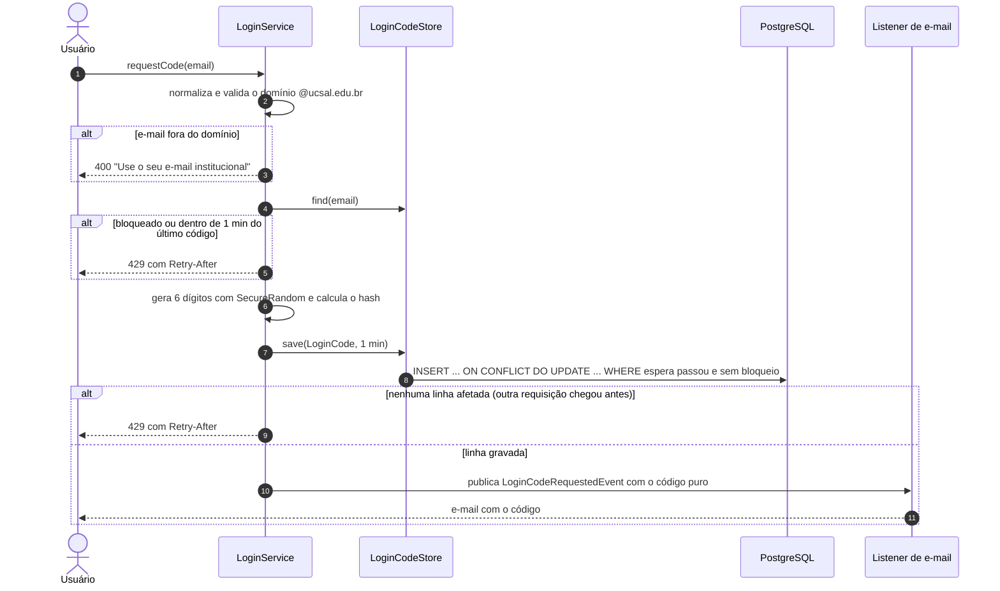
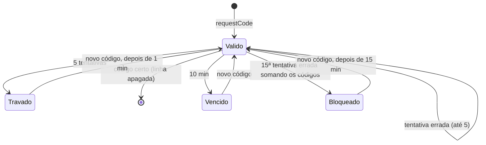

# Códigos de login (`LoginCodeStore`)

Como o `LoginCodeStore` (`access.persistence.logincode`) guarda os códigos de login no PostgreSQL, como o `LoginService` usa cada operação e por que cada regra é um comando SQL só. A decisão está na D18, que substituiu a D16 (Redis). As regras do código (10 min, uso único, só hash, 5 tentativas, 1 envio por minuto) estão na D03; o bloqueio contra força bruta, na D18. Os valores ficam em `cade.login-code.*` do `application.yml`.

## 1. O que fica guardado

Tabela `login_codes`, criada pelo Hibernate a partir da entidade `LoginCode` (D06). Há **no máximo uma linha por e-mail** (o e-mail é a chave primária): um código novo sobrescreve o anterior. Por isso a tabela nunca passa do número de pessoas que já pediram um código e não precisa de rotina de limpeza.

| Coluna | Conteúdo |
|---|---|
| `email` | e-mail normalizado (chave primária) |
| `code_hash` | hash BCrypt do código; o código puro **nunca** é guardado |
| `created_at` | quando o código atual foi emitido; também marca o fim da espera de 1 min |
| `expires_at` | quando o código atual deixa de valer (10 min depois, ou na hora de um bloqueio) |
| `attempts` | tentativas com o código atual, certas ou erradas; volta a 0 a cada código novo |
| `failures` | tentativas **erradas** do e-mail, somando todos os códigos; não volta a 0 com código novo |
| `blocked_until` | fim do bloqueio; vazio quando o e-mail não está bloqueado |

- O código puro só existe na memória e no `LoginCodeRequestedEvent`, que o leva para o e-mail.
- Uma linha vencida não é apagada: ela é ignorada até o próximo pedido sobrescrevê-la.
- Um login válido apaga a linha, o que também zera as tentativas erradas.

## 2. Operações

Toda operação que confere uma regra e altera a linha é **um único comando SQL**. O PostgreSQL trava a linha durante o comando, então duas requisições ao mesmo tempo não passam juntas pela mesma conferência.

| Método | SQL | Usado em |
|---|---|---|
| `find(email)` | `SELECT` | `requestCode` (conferência rápida) e `exchangeCode` |
| `save(code, intervalo)` | `INSERT ... ON CONFLICT (email) DO UPDATE ... WHERE` a espera passou e não há bloqueio | `requestCode` |
| `registerAttempt(email, agora)` | `UPDATE ... SET attempts = attempts + 1 WHERE` o código vale `RETURNING attempts` | `exchangeCode` |
| `registerFailure(email, agora, limite, duração)` | `UPDATE` que soma 1 em `failures` e, ao chegar no limite, bloqueia e encerra o código | `exchangeCode` |
| `consume(email, hash)` | `DELETE ... WHERE email = ? AND code_hash = ?` | `exchangeCode` |

**A hora é sempre um parâmetro**, vinda do `Clock` da aplicação, e nunca o `now()` do banco. Assim os testes adiantam o relógio (`MutableClock`) para conferir expiração, espera e bloqueio sem esperar de verdade.

**Nenhum método abre transação.** Uma tentativa recusada termina com exceção, e um rollback desfaria a tentativa que acabou de ser contada. Cada comando é confirmado sozinho.

## 3. Fluxo: pedir um código



A conferência com `find` antes do hash existe para uma requisição recusada não gastar o BCrypt à toa. Quem decide de verdade é o `save`: se duas requisições passam juntas pela conferência, só uma consegue gravar.

## 4. Fluxo: trocar o código pelo token

```mermaid
sequenceDiagram
    autonumber
    actor U as Usuário
    participant S as LoginService
    participant St as LoginCodeStore
    participant DB as PostgreSQL

    U->>S: exchangeCode(email, código)
    S->>St: find(email)
    alt sem linha, ou código vencido
        S-->>U: 400 "Código inválido ou expirado"
    end
    S->>St: registerAttempt(email, agora)
    St->>DB: UPDATE attempts + 1 WHERE o código vale RETURNING attempts
    alt nenhuma linha, ou mais de 5 tentativas
        S-->>U: 400 "Código inválido ou expirado"
    end
    S->>S: compara o código com o hash (BCrypt)
    alt código errado
        S->>St: registerFailure(email, agora, 15, 15 min)
        St->>DB: UPDATE failures + 1; no limite, bloqueia e encerra o código
        S-->>U: 400 "Código inválido ou expirado"
    end
    S->>St: consume(email, hash)
    St->>DB: DELETE WHERE email e hash conferem
    alt outra requisição apagou antes
        S-->>U: 400 "Código inválido ou expirado"
    else apagou
        S->>DB: busca o usuário ou cria como estudante
        S-->>U: conta (o controller emite o JWT)
    end
```

Toda recusa devolve a **mesma mensagem**, para quem tenta adivinhar não saber se o código está errado, vencido, travado ou bloqueado. O motivo real vai só para o log.

## 5. Estados de um e-mail



## 6. Por que cada regra é um comando só

Se a contagem de tentativas fosse "ler o número, conferir, gravar o número + 1" em passos separados, 20 palpites enviados juntos leriam todos `attempts = 0` e todos seriam comparados. Com `UPDATE ... SET attempts = attempts + 1 ... RETURNING attempts`, o PostgreSQL trava a linha durante o comando: cada requisição recebe um número diferente (1, 2, ..., 20), e só as 5 primeiras chegam a comparar o código.

O mesmo vale para o uso único: o `DELETE` informa quantas linhas apagou. Se duas requisições com o código certo chegam juntas, só uma apaga a linha, e só ela faz login. O `DELETE` também confere o hash: se um código novo substituiu o antigo no meio da conferência, o antigo não apaga o novo.

No bloqueio, o `UPDATE` usa `CASE` nas três colunas (`failures`, `blocked_until`, `expires_at`). No PostgreSQL, o lado direito do `SET` sempre lê os valores de antes da alteração, então as três colunas veem o mesmo `failures`.

## 7. Limitações conhecidas

- **Bloqueio por e-mail, não por IP.** Quem sabe o e-mail de alguém pode errar o código de propósito e bloquear essa pessoa por 15 minutos. Pedir códigos seguidos também invalida o código da vítima. Para o MVP, a proteção contra adivinhação vale mais que esse incômodo.
- **Tentativas restantes.** Cada ciclo permite 15 palpites (3 códigos de 5) e custa uns 17 minutos (2 min de espera entre os códigos e 15 min de bloqueio). São cerca de 1.300 palpites por dia contra um e-mail, ou 0,13% de chance de acertar um código de 6 dígitos. Sem o bloqueio, eram cerca de 7.200 palpites por dia (0,72%).

## 8. Testes

- `LoginCodeStoreTest` (`@DataJpaTest` com PostgreSQL no Testcontainers): gravação, espera de 1 min, sobrescrita mantendo as tentativas erradas, tentativa só com código válido, bloqueio no limite, e-mail bloqueado sem código novo e `consume` uma vez só e só com o hash conferido.
- `LoginServiceTest`: as regras da D03 e da D18 pelo serviço, incluindo 20 palpites em paralelo, 2 acertos simultâneos, bloqueio depois de 3 códigos travados e fim do bloqueio depois de 15 min.
- `AuthControllerTest`: os mesmos casos pelos endpoints, com as respostas HTTP.
