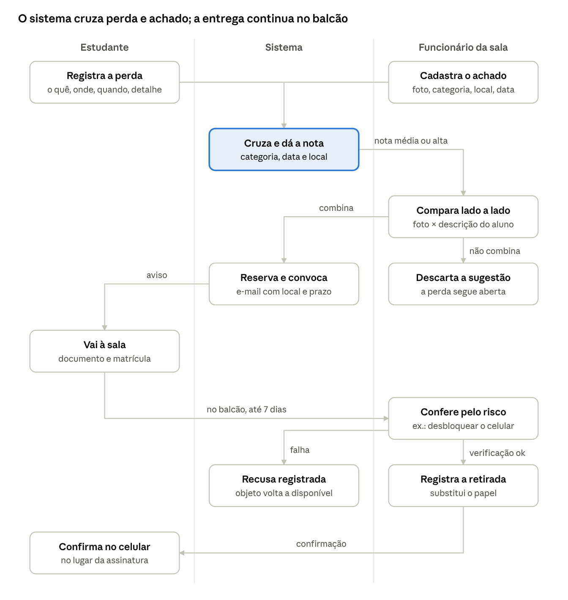

# Requisitos v3 — Cadê? Achados e Perdidos UCSal

> Versão em Markdown do documento de requisitos v3 (o .docx original fica com a equipe). As decisões tomadas depois desta versão estão em [DECISOES.md](DECISOES.md); em caso de conflito, vale a decisão mais recente. Os nomes de classes citados aqui estão em português; os nomes usados no código estão no [GLOSSARIO.md](GLOSSARIO.md) (D11).

Nov 10, 2026 · @Robson Santos

## 1. Introdução

O sistema liga o estudante que perdeu um objeto à sala de achados e perdidos da UCSal sem que ele precise ir até lá só para perguntar. O estudante registra a perda online, a sala cadastra o que chega, o sistema cruza os dois e a sala só chama o estudante quando há chance real de o objeto ser dele. A conferência e a entrega continuam presenciais.

A v2 (05/11) substituiu o rascunho de 15/10 e foi reescrita a partir das três conversas de campo; cada requisito aponta a evidência que o justifica. Esta v3 (10/11) revisa a stack: Java 25 no lugar de Kotlin, login por código enviado ao e-mail institucional no lugar do Google, eventos do Spring no lugar do RabbitMQ, e back-end e front-end em repositórios separados. O problema, as evidências e as regras de negócio não mudaram.

**Prazo:** desenvolvimento e entrega final até 23/11/2026. Mostra em 01/12 (ADS) e 03/12 (BES).

### 1.1 Problema

> **Para** estudantes da UCSal que perdem objetos no campus, e para os funcionários da sala de achados e perdidos que os guardam, **o problema é que** os objetos ficam registrados só numa etiqueta presa a eles, em caixas organizadas por mês, sem lista pesquisável, e muitos dos que perdem algo nem sabem que a sala existe. **Isso acontece** quando alguém procura um objeto sem lembrar onde o perdeu, ou quando a sala precisa conferir se o objeto é mesmo de quem o pede. **A consequência é** que objetos se acumulam por anos sem dono, a busca depende de revirar caixas e da memória das pessoas, e já houve entrega à pessoa errada. **Hoje se resolve** com etiqueta no objeto, perguntas de dia, local e características, desbloqueio do celular, formulário de papel na retirada e avisos nos grupos de WhatsApp feitos por quem achou o objeto.

### 1.2 Evidências de campo

Os códigos da coluna Ref. são usados nos requisitos (seção 4) para mostrar de onde cada um vem.

| Ref. | Fonte | O que vimos ou ouvimos |
|---|---|---|
| S1 | Sala, 29/10 | Não existe lista dos objetos; só uma etiqueta no objeto com local e data. Guarda em caixas por mês. |
| S2 | Sala, 29/10 | Verificação por perguntas: dia, sala e descrição. Celular: o dono desbloqueia na frente do funcionário. |
| S3 | Sala, 29/10 | Já houve entrega à pessoa errada (C1, C2) e disputa de um dicionário resolvida por uma anotação que só o dono conhecia (C3). |
| S4 | Sala, 29/10 | Maior dificuldade: saber onde o objeto foi perdido ou achado; as informações não batem (C4, C5). |
| S5 | Sala, 29/10 | Contra mostrar foto e características ao público: "chega um esperto e diz que é dele". Aceitam só o tipo genérico. |
| S6 | Sala, 29/10 | Muitos dos que perdem algo não sabem que a sala existe; quem acha costuma levar à sala e avisar no grupo da turma. Divulgar a sala é o objetivo principal para os funcionários. |
| S7 | Sala, 29/10 | Pouco tempo para cadastrar ("se eu tiver tempo, eu faço"). A equipe circula pelo campus. Querem agilidade. |
| S8 | Sala, 29/10 | Pico de perdas no início e no fim do semestre. Mais comuns: celular, garrafa, fone, carregador, guarda-chuva, casaco, óculos, documentos. |
| A1 | Administrador, 29/10 | Quer rastreabilidade: quem trouxe, quem recebeu, quem retirou, com assinatura. |
| A2 | Administrador, 29/10 | Não há prazo de guarda; há objetos de 2024. Pediu prazo e descarte definidos. |
| A3 | Administrador, 29/10 | Aceita o aluno mandar características e prova a distância; celular sempre presencial para desbloquear. |
| E1 | Estudantes, 04/11 | Guarda-chuva nunca recuperado; outro devolvido só pela descrição, o que o próprio aluno achou "suspeito". |
| E2 | Estudantes, 04/11 | Fone guardado na biblioteca; o dono teve de voltar no dia seguinte para buscar. |
| E3 | Estudantes, 04/11 | Sugeriram "abrir um chamado" com objeto, características, sala e horário, e a sala responde. |
| E4 | Estudantes, 04/11 | Medo de fraude ("tem um iPhone aí pra mim?"). Login institucional obrigatório. Retirada com documento e matrícula. |
| E5 | Estudantes, 04/11 | Visitantes ficam fora: "não dá pra abraçar todo mundo". |

Registros completos: `contexto-entrevista-sala-achados-perdidos.md` e `contexto-conversa-alunos.md`, no projeto.

## 2. Usuários, perfis e premissas

O sistema tem quatro perfis. Cada conta tem um único perfil. O público principal é a sala (funcionários); o estudante é o público que ganha a distância.

| Perfil | Como acessa | O que pode fazer |
|---|---|---|
| Visitante | Sem login | Ver a página pública: onde fica a sala, horário, como funciona e contagens genéricas por categoria e mês |
| Estudante | Código enviado ao e-mail @ucsal.edu.br | Registrar perdas, acompanhar seus registros, receber convocações, confirmar a retirada |
| Funcionário | Código enviado ao e-mail @ucsal.edu.br, perfil dado pelo administrador | Cadastrar achados, buscar, analisar sugestões de cruzamento, convocar estudantes, registrar retiradas |
| Administrador | Conta criada na instalação | Tudo do funcionário, mais: gerenciar funcionários, categorias e prazos; registrar destino de não reclamados; ver painel e histórico |

- Não há senha: o usuário informa o e-mail, recebe um código de uso único e, ao validá-lo, recebe um token de acesso (JWT). Todo novo login válido entra como estudante. O domínio @ucsal.edu.br é validado no back-end (E4).
- Quem não tem conta (visitante, ex-aluno) continua sendo atendido no balcão, como hoje. O funcionário registra essa retirada com nome e documento (E5).

### Premissas

- **PR1.** A sala física continua sendo o lugar de guarda e entrega. O sistema complementa a sala, não a substitui (S1).
- **PR2.** Só funcionários cadastram objetos achados.
- **PR3.** A entrega é sempre presencial, com documento e conferência da posse (S2, A3, E4).
- **PR4.** A comunidade nunca vê foto, descrição nem local exato de um objeto achado (S5, E4).
- **PR5.** O sistema reduz o risco de entrega indevida, mas não o elimina. A decisão é sempre de um funcionário.
- **PR6.** O MVP cobre só a sala de achados e perdidos. Outros pontos de guarda, como a biblioteca (E2), ficam fora.
- **PR7.** A demonstração usa apenas dados fictícios, conforme o manual do PooaLab.

## 3. Visão do MVP e fluxo principal

O coração do MVP é o cruzamento: o sistema compara cada perda registrada com cada objeto achado e mostra ao funcionário só os pares prováveis. Assim o estudante resolve a distância e o funcionário não precisa conversar com ninguém nem revirar caixas.

### 3.1 Módulos

| Módulo | O que faz | Quem usa |
|---|---|---|
| M1 Acesso | Login por código no e-mail institucional, perfis e autorização | Todos |
| M2 Achados | Cadastro rápido do objeto pelo celular e busca interna | Funcionário |
| M3 Perdas | Registro da perda pelo estudante e acompanhamento | Estudante |
| M4 Cruzamento | Sugere pares objeto × perda por categoria, data, local e palavras | Sistema, funcionário |
| M5 Convocação e retirada | Chama o estudante à sala e registra a entrega, no lugar do formulário de papel | Funcionário, estudante |
| M6 Avisos | Código de login e e-mails de convocação, prazos e confirmações | Sistema |
| M7 Prazos e destino | Marca objetos não reclamados e registra doação ou descarte | Sistema, administrador |
| M8 Página pública | Divulga a sala e mostra só contagens genéricas | Visitante |
| M9 Administração | Funcionários, categorias, prazos, painel e histórico | Administrador |
| M10 Modo demonstração | Usuários fictícios e caixa interna de e-mails | Equipe na mostra |

### 3.2 Fluxo principal

1. O funcionário recebe um objeto, tira uma foto, escolhe a categoria, o local e a data. O sistema sugere a caixa do mês. Tempo-alvo: menos de 1 minuto.
1. O estudante, de casa, registra a perda: categoria, características, onde e quando acha que perdeu, e um detalhe que só ele conhece.
1. A cada cadastro de objeto ou de perda, o sistema calcula a compatibilidade e cria sugestões.
1. O funcionário abre uma sugestão e compara lado a lado a foto e os dados do objeto com o que o estudante escreveu.
1. Se combina, o funcionário convoca o estudante. O objeto fica reservado e o estudante recebe um e-mail com local, horário e o que levar. Se não combina, descarta a sugestão, e a perda continua aberta.
1. No balcão, o funcionário confere documento e matrícula e faz a verificação exigida pelo risco do objeto (por exemplo, desbloquear o celular).
1. O funcionário registra a retirada e o estudante confirma no próprio celular. O registro substitui a assinatura no papel.

O estudante e o funcionário nunca precisam conversar: o sistema junta os dois lados, e só o funcionário decide convocar e entregar.

**Exemplo:** às 10h de terça, a limpeza traz um fone preto achado na sala 421. O funcionário cadastra "Fone · Bloco 400, sala 421 · 04/11 · Caixa Novembro". À noite, uma estudante registra "fone JBL preto, adesivo de estrela, salas 420 a 422, terça de manhã". Na manhã seguinte o funcionário vê a sugestão com compatibilidade alta, confere a foto, convoca, e ela retira no intervalo mostrando a carteirinha e dizendo onde está o adesivo.

**Atalho de balcão:** quem vai direto à sala, sem registro, é atendido como hoje. O funcionário busca o objeto no sistema e registra a retirada da mesma forma.

## 4. Requisitos funcionais

O MVP completo tem 47 requisitos. A prioridade define a ordem de corte (seção 9): **P1** é o núcleo sem o qual a demonstração não existe, **P2** completa o MVP, **P3** sai primeiro se o prazo apertar. A coluna Ref. aponta a evidência da seção 1.2.

### M1 Acesso

| Código | Requisito | Prior. | Ref. |
|---|---|---|---|
| RF01 | O usuário informa o e-mail e entra com um código de uso único enviado a ele; o back-end aceita só e-mails @ucsal.edu.br e devolve um token JWT | P1 | E4 |
| RF02 | O sistema reconhece visitante, estudante, funcionário e administrador e limita as ações de cada um | P1 | — |
| RF03 | O administrador dá e retira o perfil de funcionário de uma conta existente | P1 | — |

### M2 Achados

| Código | Requisito | Prior. | Ref. |
|---|---|---|---|
| RF04 | O funcionário cadastra um objeto pelo celular com foto, categoria, local onde foi achado (bloco e sala) e data; só esses campos são obrigatórios | P1 | S1, S7 |
| RF05 | O sistema sugere o local de guarda pela data (ex.: "Caixa Novembro/2026"); o funcionário pode trocar | P1 | S1 |
| RF06 | O funcionário pode acrescentar descrição interna (cor, marca) e detalhes reservados, que só funcionários veem | P1 | S3 |
| RF07 | O funcionário pode registrar quem trouxe o objeto (nome e matrícula ou "equipe de limpeza"); campo opcional | P2 | A1 |
| RF08 | O funcionário pode marcar o objeto como identificado (nome, e-mail ou documento encontrado nele) | P2 | S3 |
| RF09 | Objeto identificado com e-mail @ucsal.edu.br: o sistema avisa o titular por e-mail | P3 | S3 |
| RF10 | O funcionário busca objetos por texto, categoria, período, local e situação, com miniatura da foto | P1 | S1, S4 |
| RF11 | O funcionário corrige dados de um objeto; cada alteração fica no histórico | P2 | A1 |
| RF12 | Todo objeto tem uma situação clara, conforme os estados da seção 6 | P1 | — |

### M3 Perdas

| Código | Requisito | Prior. | Ref. |
|---|---|---|---|
| RF13 | O estudante registra uma perda: categoria, descrição com características, onde acha que perdeu (um ou mais blocos ou salas) e quando (data ou período, turno) | P1 | E3 |
| RF14 | O estudante pode informar um detalhe que só o dono conhece (adesivo, arranhão, nome gravado); ele nunca é mostrado a outros estudantes | P1 | S3, E3 |
| RF15 | O estudante pode anexar uma prova (foto antiga, nota fiscal, número de série) | P2 | A3 |
| RF16 | O estudante acompanha seus registros e a situação de cada um, em linguagem simples | P1 | E2 |
| RF17 | O estudante cancela um registro ("já achei") | P2 | E1 |
| RF18 | O estudante responde a um pedido de mais informações do funcionário | P2 | A3 |
| RF19 | O registro vence depois do prazo (RN14); o estudante é avisado antes e pode renovar | P2 | — |

### M4 Cruzamento

| Código | Requisito | Prior. | Ref. |
|---|---|---|---|
| RF20 | A cada objeto ou perda cadastrados, o sistema calcula a compatibilidade com os registros abertos do outro lado | P1 | S4, E3 |
| RF21 | A compatibilidade combina critérios configuráveis: categoria igual (obrigatório), data, local e palavras em comum (RN07) | P1 | S4 |
| RF22 | O funcionário vê as sugestões ordenadas pela compatibilidade (alta, média, baixa), a partir do objeto e a partir da perda | P1 | S7 |
| RF23 | O funcionário compara lado a lado foto e dados do objeto com a descrição e o detalhe do estudante | P1 | S2 |
| RF24 | O funcionário decide: convocar, descartar a sugestão ou pedir mais informações; descarte e pedido exigem motivo | P1 | S2 |
| RF25 | Uma IA pode ser um critério a mais, comparando descrições em texto livre, com tempo limite e sem dado pessoal | P3 | — |

### M5 Convocação e retirada

| Código | Requisito | Prior. | Ref. |
|---|---|---|---|
| RF26 | Ao convocar, o objeto fica reservado e o estudante recebe local, horário da sala (7h a 21h50), prazo e o que levar | P1 | A3 |
| RF27 | Sem retirada no prazo (RN15), a convocação vence, o objeto volta a disponível e a perda volta a aberta | P1 | — |
| RF28 | No balcão, o sistema mostra ao funcionário o que conferir conforme o risco do objeto (RN09) | P1 | S2 |
| RF29 | O funcionário registra a retirada: quem retirou, documento e matrícula conferidos, verificação feita, funcionário, data e hora | P1 | A1, E4 |
| RF30 | O estudante confirma a retirada no próprio celular, no lugar da assinatura no papel | P2 | A1 |
| RF31 | O funcionário registra a recusa no balcão quando a verificação falha; a recusa conta para o estudante (RN12) | P1 | S3 |
| RF32 | Atalho de balcão: o funcionário registra a retirada de quem veio sem registro, inclusive pessoas sem conta (nome e documento) | P1 | E5 |
| RF33 | Ao entregar um objeto, as outras sugestões dele são encerradas e os estudantes avisados | P2 | — |

### M6 Avisos

| Código | Requisito | Prior. | Ref. |
|---|---|---|---|
| RF34 | O estudante recebe e-mail quando é convocado, quando falta 1 dia para a convocação vencer e quando a retirada é registrada | P2 | E2 |
| RF35 | O estudante recebe e-mail quando o funcionário pede mais informações e quando o registro vai vencer | P2 | — |
| RF36 | O administrador recebe um resumo semanal por e-mail com objetos não reclamados | P3 | A2 |

### M7 Prazos e destino

| Código | Requisito | Prior. | Ref. |
|---|---|---|---|
| RF37 | Uma tarefa diária marca como não reclamado o objeto que passou do prazo de guarda (RN16) | P2 | A2 |
| RF38 | O administrador registra o destino de um não reclamado (bazar como padrão, descarte ou outro), com data e responsável | P2 | A2 |
| RF39 | O funcionário lista os não reclamados por caixa de mês, para retirar da sala de uma vez | P2 | A2, S1 |

### M8 Página pública

| Código | Requisito | Prior. | Ref. |
|---|---|---|---|
| RF40 | A página pública mostra onde fica a sala, horário, como funciona e o botão "Registrar perda" | P1 | S6 |
| RF41 | A página mostra contagens genéricas dos objetos disponíveis por categoria e mês (ex.: "Outubro: 12 garrafas, 5 fones"), sem foto, descrição nem local | P2 | S5, S6 |
| RF42 | O sistema gera um QR code da página para cartazes nos blocos e para os grupos de WhatsApp | P3 | S6 |

### M9 Administração

| Código | Requisito | Prior. | Ref. |
|---|---|---|---|
| RF43 | Toda ação relevante fica no histórico com autor, data, hora e motivo; o histórico não pode ser alterado | P1 | A1 |
| RF44 | O administrador gerencia categorias: nome, risco padrão e perguntas de conferência | P2 | S2 |
| RF45 | O administrador ajusta os prazos (guarda, convocação, validade do registro) sem mudar código | P2 | A2 |
| RF46 | Painel com contagens: objetos por situação e categoria, devoluções no mês, tempo médio até a devolução, não reclamados | P3 | A2 |

### M10 Modo demonstração

| Código | Requisito | Prior. | Ref. |
|---|---|---|---|
| RF47 | Usuários fictícios prontos (estudante, funcionário, administrador), com login direto sem código, ativado só no perfil de demonstração; dados de exemplo e caixa interna com cópia dos e-mails, para funcionar sem internet | P1 | — |

## 5. Regras de negócio

Os números desta seção são valores iniciais do projeto, configuráveis pelo administrador (RF45). O prazo de guarda (90 dias) e o destino padrão (bazar) foram validados com o administrador do campus, que pode alterá-los.

### 5.1 Objetos e privacidade

- **RN01.** O objeto está em uma única situação e só muda pelas transições da seção 6.
- **RN02.** Só funcionários cadastram objetos achados.
- **RN03.** Foto, descrição interna, detalhes reservados, local exato e titular identificado nunca aparecem para estudantes ou visitantes, nem para o estudante convocado antes do balcão (S5, E4).
- **RN04.** A categoria define o risco padrão. O funcionário pode aumentar o risco de um objeto específico (ex.: garrafa térmica cara), nunca reduzir.

### 5.2 Registros de perda

- **RN05.** Cada estudante tem no máximo 5 registros abertos ao mesmo tempo, o que dificulta "pescar" objetos com registros genéricos.
- **RN06.** Depois de uma convocação, a descrição e o detalhe do registro não podem mais ser alterados, para que ninguém ajuste o texto ao objeto.

### 5.3 Cruzamento

**RN07.** A compatibilidade vai de 0 a 100 e soma os critérios abaixo. Categoria diferente zera a nota.

| Critério | Condição | Pontos |
|---|---|---|
| Categoria | Igual (obrigatório) | 0, mas libera os demais |
| Data | Achado de 0 a 3 dias depois da data informada da perda | 40 |
| Data | Achado de 4 a 14 dias depois | 20 |
| Data | Achado antes da data informada (com 1 dia de tolerância) | 0 |
| Local | Mesma sala | 30 |
| Local | Mesmo bloco, sala diferente | 15 |
| Palavras | Cada palavra em comum entre as descrições (cor, marca, material), até 3 | 10 cada |

Faixas: **alta** a partir de 70, **média** de 40 a 69, **baixa** abaixo de 40. Sugestões baixas não aparecem por padrão.

**Exemplo:** perda "fone JBL preto, sala 421, 04/11" × objeto "fone preto, sala 421, achado 04/11": data 40 + sala 30 + "preto" 10 = **80, alta**. Um registro só com "iPhone", sem local, soma no máximo 50 (data 40 + a palavra "iPhone" 10) e fica em média.

- **RN08.** A sugestão é apoio. Quem decide convocar é sempre o funcionário, que pode discordar dela.

### 5.4 Conferência no balcão

**RN09.** O que é exigido depende do risco do objeto (S2, A3):

| Risco | Exemplos | O que conferir |
|---|---|---|
| Baixo | Guarda-chuva, garrafa, caderno | Documento com foto e descrição coerente |
| Médio | Mochila, casaco, fone, carregador, óculos | Documento com foto e um detalhe que não aparece na foto (ou o detalhe reservado) |
| Alto | Celular, notebook, carteira, chaves | Documento com foto e desbloqueio na frente do funcionário, ou prova (nota fiscal, número de série) |
| Documento | RG, carteirinha, cartão | Entregue só ao titular, conferindo a foto |

- **RN10.** Nenhuma entrega sem documento com foto. Para estudantes, a matrícula também é registrada (E4).
- **RN11.** Só o próprio dono retira; terceiros não retiram, como já é a prática (E2).
- **RN12.** Depois de 3 recusas no balcão, o estudante não pode abrir novos registros até o administrador liberar.

### 5.5 Prazos

| Regra | Prazo | Contado a partir de | Ao vencer |
|---|---|---|---|
| RN13. Responder pedido de informação | 5 dias | Pedido do funcionário | Sugestão descartada; a perda continua aberta |
| RN14. Validade do registro de perda | 30 dias, renovável | Registro | Registro vencido; aviso 3 dias antes |
| RN15. Retirar após convocação | 7 dias | Convocação | Objeto volta a disponível; perda volta a aberta |
| RN16. Guarda até não reclamado | 90 dias (validado, ajustável) | Entrada na sala | Objeto vira não reclamado |

- **RN17.** Objeto não reclamado continua na sala e ainda pode ser retirado até o administrador registrar o destino.

### 5.6 Concorrência e histórico

- **RN18.** Um objeto tem no máximo uma convocação ativa. Se duas perdas combinam, o funcionário convoca a de maior compatibilidade; a outra fica em espera e é convocada se a primeira vencer ou for recusada.
- **RN19.** Registros do histórico nunca são alterados nem apagados, mesmo depois do destino do objeto.
- **RN20.** Pessoas sem conta institucional são atendidas só no balcão (RF32).

## 6. Estados

Três entidades têm ciclo de vida próprio: Objeto, Registro de perda e Sugestão (o par objeto × perda criado pelo cruzamento). Qualquer transição fora destas tabelas é proibida (RN01).

### 6.1 Objeto

| De | Para | Quando |
|---|---|---|
| — | Disponível | Funcionário cadastra o objeto |
| Disponível | Reservado | Funcionário convoca um estudante |
| Reservado | Disponível | Convocação vence (7 dias) ou verificação falha no balcão |
| Reservado | Devolvido | Retirada registrada |
| Disponível | Devolvido | Retirada no balcão, sem registro de perda (RF32) |
| Disponível | Não reclamado | 90 dias desde a entrada |
| Não reclamado | Reservado | Funcionário convoca um estudante |
| Não reclamado | Devolvido | Retirada no balcão |
| Não reclamado | Destinado | Administrador registra o destino |

Estados finais: Devolvido e Destinado.

### 6.2 Registro de perda

| De | Para | Quando |
|---|---|---|
| — | Aberto | Estudante registra a perda |
| Aberto | Aguardando informações | Funcionário pede mais informações, com motivo |
| Aguardando informações | Aberto | Estudante responde, ou 5 dias sem resposta |
| Aberto | Convocado | Funcionário convoca a partir de uma sugestão |
| Convocado | Concluído | Retirada registrada |
| Convocado | Aberto | Convocação vence ou verificação falha no balcão |
| Aberto | Vencido | 30 dias sem renovação |
| Aberto ou Aguardando informações | Cancelado | Estudante cancela |

Estados finais: Concluído, Vencido e Cancelado.

### 6.3 Sugestão

| De | Para | Quando |
|---|---|---|
| — | Nova | Cruzamento encontra compatibilidade média ou alta |
| Nova | Em espera | Outra sugestão do mesmo objeto foi convocada (RN18) |
| Em espera | Nova | Aquela convocação venceu ou foi recusada |
| Nova | Convocada | Funcionário convoca |
| Nova | Descartada | Funcionário descarta, com motivo |
| Convocada | Concluída | Retirada registrada |
| Convocada | Recusada | Verificação falha no balcão (conta para RN12) |
| Convocada | Vencida | 7 dias sem retirada |
| Nova ou Em espera | Encerrada | Objeto entregue a outra pessoa, ou perda cancelada ou vencida |

Estados finais: Concluída, Descartada, Recusada, Vencida e Encerrada.

## 7. Stack, arquitetura e eventos

Stack revista na v3 (10/11). O back-end roda no computador da equipe e é exposto por túnel (ngrok, domínio fixo); o front-end é publicado na Vercel, para que o professor possa testar pelo navegador. Cada um tem seu repositório.

| Camada | Tecnologia | Observação |
|---|---|---|
| Back-end | Java 25 + Spring Boot | Monólito modular; repositório próprio; exposto por túnel (ngrok) |
| Front-end | Angular | Celular primeiro; repositório próprio; publicado na Vercel |
| Banco | PostgreSQL | Histórico na mesma transação da ação |
| Eventos | Eventos do Spring + Virtual Threads | Ouvintes @Async após o commit; RabbitMQ opcional, atrás da interface PublicadorEventos |
| Fotos | Volume local do Docker | Atrás da interface `ArmazenamentoFotos` |
| Login | Código de uso único por e-mail + JWT | Sem senha; domínio validado no back-end; token no header Authorization |
| E-mail | Gmail (SMTP) | Credencial fora do repositório; envio para @ucsal.edu.br testado (chega na caixa de entrada); Mailpit em desenvolvimento; caixa interna no modo demonstração |
| Infra | Docker Compose | Banco, Mailpit e back-end com um comando |

### 7.1 Decisões de arquitetura

- **Monólito modular.** Achados, perdas, sugestões e retiradas ficam juntos, porque uma convocação muda objeto, perda e sugestão na mesma transação.
- **Cruzamento assíncrono.** O cadastro grava e responde na hora; o cálculo das sugestões roda em segundo plano, num ouvinte de evento do Spring (@Async, em Virtual Threads). O funcionário não espera o cruzamento para cadastrar o próximo objeto.
- **Estados e histórico são síncronos.** Gravados na mesma transação da ação, nunca por evento.
- **Eventos só depois do commit**, com `@TransactionalEventListener(AFTER_COMMIT)`, atrás da interface `PublicadorEventos`.
- **Prazos por tarefa agendada diária**, que publica os eventos de vencimento.
- **Autenticação sem estado**, com JWT no header Authorization e sem cookie de sessão, porque front e back ficam em domínios diferentes (Vercel e túnel). O CORS libera só a origem do front.
- **Front e back em repositórios separados**, cada um com seu README. O repositório do back-end guarda a pasta docs/ (validação, MVP, pitch e declaração) e o docker-compose.yml.

### 7.2 Eventos

| Evento | Ouvintes | Prior. |
|---|---|---|
| `objeto.cadastrado` | Cruzamento com perdas abertas · e-mail ao titular identificado (RF09) | P1 · P3 |
| `perda.registrada` | Cruzamento com objetos disponíveis | P1 |
| `sugestao.criada` | Contador de pendências do funcionário | P2 |
| `perda.informacao-pedida` | E-mail ao estudante | P2 |
| `convocacao.criada` | E-mail com local, horário, prazo e o que levar | P2 |
| `convocacao.vencendo` / `convocacao.vencida` | E-mail ao estudante | P2 |
| `retirada.registrada` | E-mail de confirmação · encerrar outras sugestões (RF33) | P2 |
| `perda.vencendo` | E-mail ao estudante | P2 |
| `objeto.nao-reclamado` | Resumo semanal ao administrador | P3 |

Os eventos ficam na memória da aplicação: se o back-end cair entre o commit e o processamento, aquele evento se perde. Para o MVP isso é aceito e declarado no README. Se sobrar tempo, o RabbitMQ entra atrás da mesma interface PublicadorEventos, sem mudar o resto.

### 7.3 Conteúdos de POOA (bônus)

| Conteúdo | Onde aparece |
|---|---|
| State | Situações de Objeto, Registro de perda e Sugestão como `sealed interface` com records, cada estado sabendo suas transições |
| Strategy | Cada critério do cruzamento (categoria, data, local, palavras, IA) é uma `CriterioCompatibilidade`; também as regras de conferência por risco |
| Composite | O cálculo da nota combina os critérios como um critério só |
| Observer | Eventos do Spring e seus ouvintes (cruzamento, e-mails) |
| Collections e Streams | Ordenação e filtragem das sugestões, contagens do painel e da página pública |
| Virtual Threads | Ouvintes @Async, envio de e-mail e chamada à IA com tempo limite |
| Anotações e reflexão | `@RequerPerfil` para autorização por perfil |
| SOLID | Inversão de dependência em `PublicadorEventos`, `ServicoEmail`, `ArmazenamentoFotos` e `CriterioCompatibilidade`; aberto a novos critérios sem mudar o cálculo |

## 8. Requisitos não funcionais

Os dois primeiros vieram direto da sala: se o cadastro for lento, ninguém cadastra, e sem cadastro o cruzamento não tem o que cruzar.

| Código | Qualidade | Como será atendida e medida | Ref. |
|---|---|---|---|
| RNF01 | Agilidade no cadastro | Cadastro de um objeto pelo celular em até 60 s, medido no teste de uso da Etapa 4 | S7 |
| RNF02 | Agilidade na busca | Busca interna responde em até 2 s com 1.000 objetos | S1 |
| RNF03 | Usabilidade do estudante | Registro de perda em até 3 min; mensagens em linguagem simples | E3 |
| RNF04 | Privacidade (LGPD) | Coleta mínima; foto, descrição interna e dados de quem trouxe visíveis só a funcionários; nada pessoal enviado à IA | S5 |
| RNF05 | Segurança de acesso | Código de uso único gerado com SecureRandom, válido por 10 min, guardado só como hash, com no máximo 5 tentativas e 1 envio por minuto; JWT no header Authorization; domínio validado no back-end; autorização por perfil com `@RequerPerfil`; fotos servidas só a funcionários autenticados | E4 |
| RNF06 | Segredos | Senha de app do Gmail, chave do JWT e credenciais da IA em variáveis de ambiente, nunca no repositório | — |
| RNF07 | Confiabilidade | Histórico imutável na mesma transação; e-mails com nova tentativa | A1 |
| RNF08 | Resiliência | Falha de e-mail ou IA não bloqueia cadastro, convocação nem retirada | — |
| RNF09 | Responsividade | Telas do funcionário e do estudante funcionam em celular a partir de 360 px de largura | S7 |
| RNF10 | Acessibilidade | Contraste suficiente, estados não comunicados só por cor, campos com rótulo | — |
| RNF11 | Flexibilidade | Categorias, riscos, pesos do cruzamento e prazos configuráveis sem mudar código | A2 |
| RNF12 | Reprodutibilidade | `docker compose up` sobe o back-end, o banco e o Mailpit; o front é publicado na Vercel; README de cada repositório testado em ambiente limpo | — |
| RNF13 | Demonstração e testes | Dados fictícios na inicialização; testes automáticos das transições de estado, da nota do cruzamento, das regras por risco e dos prazos | — |

## 9. Escopo, riscos, critérios de sucesso e plano de corte

### 9.1 Critérios de sucesso

O MVP está pronto quando for possível demonstrar que:

1. Um funcionário cadastra um objeto pelo celular em menos de 1 minuto. (P1)
1. Um estudante registra a perda de casa, o sistema sugere o objeto certo, o funcionário convoca e a retirada é registrada no balcão, de ponta a ponta. (P1)
1. O funcionário acha um objeto pela busca (categoria + mês) sem abrir caixas. (P1)
1. Uma pessoa mal-intencionada que registra só "iPhone" recebe nota baixa no cruzamento e, se convocada, é barrada no balcão pelo desbloqueio, e a recusa fica registrada. (P1)
1. Um visitante vê a página pública sem nenhuma foto, descrição ou local de objeto. (P1)
1. O estudante recebe os e-mails de convocação e confirma a retirada no celular. (P2)
1. Um objeto passa do prazo, vira não reclamado e recebe um destino registrado. (P2)
1. O administrador vê no painel as contagens do serviço. (P3)

### 9.2 Plano de corte

Se o prazo apertar, os itens saem nesta ordem, do primeiro ao último. Os critérios 1 a 5 nunca saem.

1. IA no cruzamento (RF25) e e-mail ao titular identificado (RF09).
1. Painel, resumo semanal e QR code (RF46, RF36, RF42).
1. Pedido de mais informações, renovação e cancelamento de registro (RF17 a RF19).
1. Confirmação no celular (RF30); fica só o registro do funcionário.
1. Ouvintes assíncronos: cruzamento e e-mails passam a ser síncronos, atrás das mesmas interfaces.
1. E-mails de aviso reais (RF34, RF35): ficam só na caixa interna do modo demonstração. O e-mail com o código de login continua.
1. Prazos e destino (RF37 a RF39), declarados como limitação no README.

### 9.3 Fora do escopo

- Publicação de achados pela comunidade, sem passar pela sala.
- Outros pontos de guarda, como a biblioteca (E2).
- Contas para visitantes e pessoas sem e-mail institucional (E5).
- Retirada por terceiros, correio ou entrega fora da sala.
- Reconhecimento automático de objetos por imagem.
- Integração com os sistemas acadêmicos e com a portaria.
- Garantia de recuperar todos os objetos perdidos.

### 9.4 Riscos

| Risco | Mitigação |
|---|---|
| Escopo grande para 13 dias (a partir de 10/11) | Construir na ordem P1 → P2 → P3; plano de corte acima |
| Funcionário não cadastrar por falta de tempo (S7) | Só 4 campos obrigatórios; medir o tempo de cadastro no teste de uso da Etapa 4 |
| Fraude com descrições genéricas ou observadas (E4) | Nada exposto ao público, limite de registros, descrição travada após convocação, conferência por risco no balcão |
| Cruzamento sugerir pares errados | Nota explicável por critério, pesos configuráveis, decisão sempre do funcionário |
| Internet falhar na mostra (Gmail, túnel) | Modo demonstração com usuários fictícios, login direto e caixa interna; front e back rodando na própria estação |
| Prazos não refletirem a sala real | Tratados como regras do projeto, configuráveis e declarados no README; prazo de guarda já validado com o administrador |
| Front atrasar | 2 ou 3 integrantes no Angular desde o início, começando pelas telas de cadastro e de registro de perda |
| Computador da equipe desligado ou túnel fora do ar durante o teste do professor | Combinar a janela de teste com o professor; domínio fixo no ngrok; checar o back-end antes do horário combinado |

### 9.5 Ainda em aberto

- ☐ Prazo de guarda e destino padrão: validados (90 dias, ajustável; destino padrão bazar).
- ☐ Fechar a lista de categorias com risco e perguntas de conferência (sugestão inicial: as mais comuns em S8).
- ✓ PostgreSQL confirmado como banco (10/11).
- ✓ Envio do Gmail para @ucsal.edu.br testado: chega na caixa de entrada (10/11).
- ✓ Nome do projeto: Cadê? (10/11).
- ☐ Configurar o ngrok com domínio fixo.
- ☐ Teste do protótipo (Etapa 4): feito pela própria equipe, observando quem usa e registrando o que mudar.
