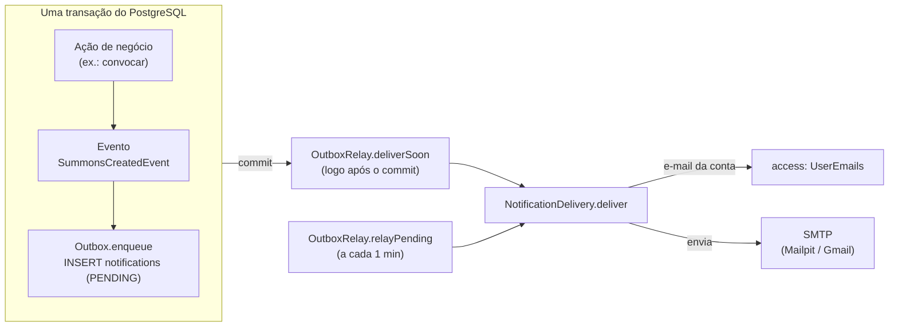
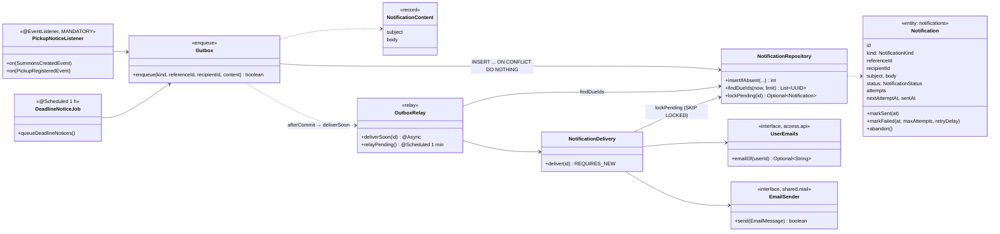
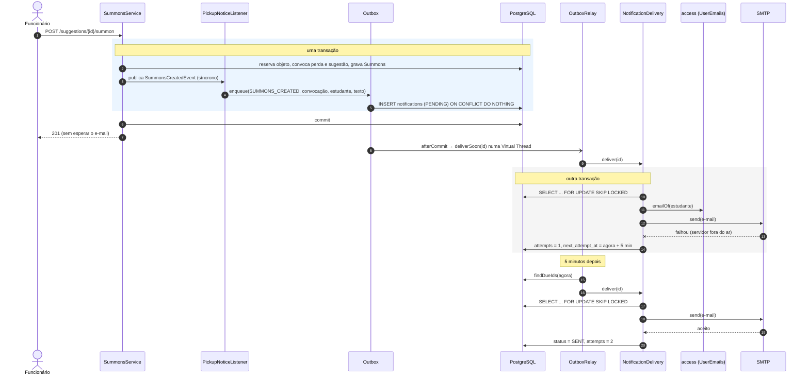
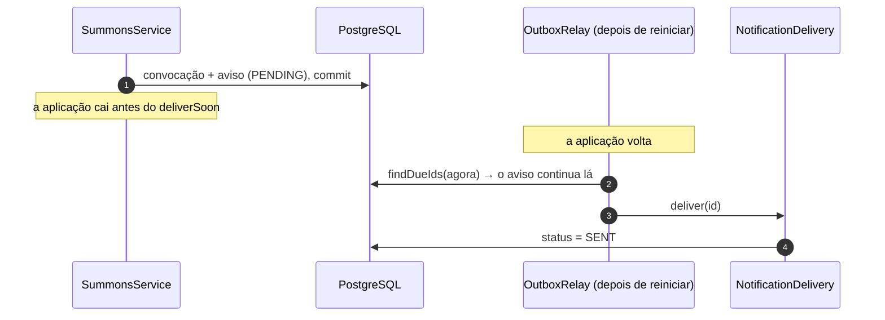
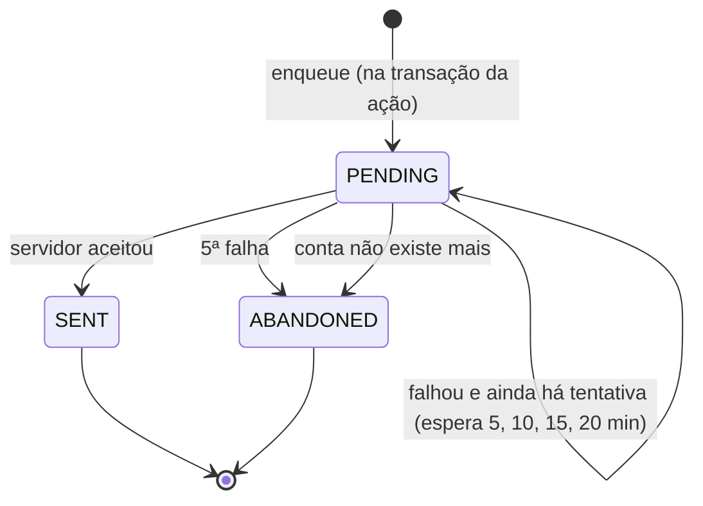
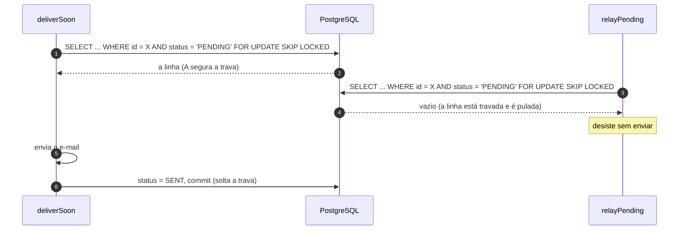
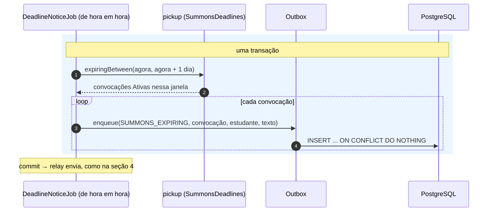

# Avisos por e-mail com Transactional Outbox (AVI-02)

Como o módulo `notifications` manda os e-mails ao estudante (RF34): na convocação, 1 dia antes de a convocação vencer e na retirada. A garantia é que **nenhum aviso se perde e nenhum sai em dobro**, mesmo com o servidor de e-mail fora do ar ou a aplicação caindo no meio do caminho (RNF08). Para isso, os avisos passam por uma **caixa de saída no banco**, o padrão *Transactional Outbox*. As escolhas estão na D30.

## 1. O problema

Quando o funcionário convoca um estudante, duas coisas precisam acontecer: **gravar a convocação** no PostgreSQL e **mandar o e-mail** pelo SMTP. São dois sistemas diferentes, e não existe uma transação que abranja os dois.

| Jeito | O que dá errado |
|---|---|
| Enviar o e-mail **dentro** da transação | O SMTP é lento e a requisição espera. Pior: se o commit falhar depois do envio, o estudante recebe um e-mail de uma convocação que não existe. |
| Enviar **depois** do commit, direto (`AFTER_COMMIT` + `@Async`, como o código de login) | Se o SMTP estiver fora, o e-mail se perde: só fica uma linha no log. Se a aplicação cair entre o commit e o envio, também se perde, sem rastro. |
| Enviar depois do commit e **gravar o aviso** para reenviar | Resolve a falha do SMTP, mas a gravação acontece noutra transação, depois do commit. Uma queda entre o commit e a gravação ainda perde o aviso. |
| **Gravar o aviso na mesma transação** e enviar depois (Outbox) | O aviso existe **se e somente se** a convocação existe. O envio pode falhar e ser repetido quantas vezes for preciso. |

A última linha é o Transactional Outbox. A transação do banco, que já garante a convocação, passa a garantir também o aviso. O envio vira uma tarefa separada, que pode ser repetida sem medo.

## 2. A ideia em uma figura

Três papéis, cada um numa pasta de `notifications.service.outbox`:

| Papel | Pasta | Classes | O que faz |
|---|---|---|---|
| A caixa | `persistence/outbox` | `Notification`, `NotificationRepository` | A tabela `notifications`: cada linha é um aviso esperando ou já enviado |
| A entrada | `service/outbox/enqueue` | `Outbox`, `NotificationContent` | Grava o aviso **na transação de quem chama** (`MANDATORY`) |
| A saída (o *relay*) | `service/outbox/relay` | `OutboxRelay`, `NotificationDelivery` | Tira da caixa e envia: logo após o commit e, de novo, a cada minuto |

## 3. Diagrama de classes

- **Quem escreve na caixa** são os ouvintes de evento (`PickupNoticeListener`) e a tarefa dos prazos (`DeadlineNoticeJob`). Eles só montam o texto e chamam `Outbox.enqueue`.
- **Quem lê da caixa** é só o relay. Ninguém mais chama o `EmailSender` para avisos.
- O código de login **não passa pela caixa**: ele vale 10 minutos e não deve ficar gravado no banco. Continua indo direto, como antes (`LoginCodeEmailListener`).

## 4. Sequência: o caminho normal, com uma falha e o reenvio

O funcionário recebe a resposta no passo 8, antes de qualquer tentativa de envio. Quando nada falha, o e-mail sai no mesmo segundo pelo `deliverSoon`, e o `relayPending` não tem trabalho. Ele existe para o que dá errado.

### E se a aplicação cair entre o commit e o envio?

Esse é o caso que só o Outbox resolve: o aviso foi gravado junto com a convocação, então sobrevive à queda.

## 5. Estados do aviso

- A espera **cresce** a cada falha (`retryDelay × tentativas`), para não insistir num servidor fora do ar.
- Os números vêm de `cade.notifications.*` no `application.yml`: 5 tentativas, 5 min de espera, reenvio a cada 1 min e 50 avisos por rodada.
- Um aviso `ABANDONED` fica na tabela para consulta: dá para saber quem não recebeu e por quê, olhando o log com o id.

## 6. As três garantias e quem cuida de cada uma

| Garantia | Como | Onde |
|---|---|---|
| **Nada se perde:** aviso gravado ⇔ ação gravada | `enqueue` com `Propagation.MANDATORY`, chamado por um ouvinte síncrono na transação da ação | `Outbox`, `PickupNoticeListener` |
| **Nada sai em dobro (mesmo aviso):** um evento repetido ou várias rodadas da tarefa dos prazos | Par (`kind`, `reference_id`) único + `INSERT ... ON CONFLICT DO NOTHING` | `Notification`, `NotificationRepository.insertIfAbsent` |
| **Nada sai em dobro (mesmo envio):** o `deliverSoon` e o `relayPending` pegam o mesmo aviso ao mesmo tempo, ou dois servidores rodam o relay | `SELECT ... FOR UPDATE SKIP LOCKED`: quem chega depois recebe vazio e desiste | `NotificationRepository.lockPending`, `NotificationDelivery` |

### A disputa pelo mesmo aviso, em detalhe

Sem o `SKIP LOCKED`, o B esperaria a trava e depois encontraria `status = SENT`. Funcionaria igual, mas prenderia uma thread à toa. O teste `twoDeliveriesOfTheSameNotificationAtTheSameTimeSendItOnce` dispara duas entregas simultâneas em Virtual Threads e confere que sai um e-mail só.

## 7. Por que a linha guarda o texto, mas não o endereço

- **O texto é montado na transação da ação**, a partir do evento. É uma função pura dos dados do evento, e não falha. Montar depois exigiria guardar os dados do evento e reconstruí-los.
- **O endereço é buscado na hora do envio** (`UserEmails`, no `access`). Assim, nada que dependa de outro módulo ou possa falhar roda dentro da transação da convocação. Se o e-mail da conta mudar, o aviso vai para o endereço atual.
- Por isso o texto **nunca leva segredo**: ele fica gravado no banco. O código de login é o único e-mail com segredo, e não passa pela caixa.

## 8. Lembretes de prazo (`DeadlineNoticeJob`)

Uma convocação fica até 24 h dentro da janela, então aparece em várias rodadas. **A tarefa não guarda o que já avisou.** Quem garante um lembrete só é a unicidade da caixa: da segunda rodada em diante, o `INSERT` não grava nada. Se a aplicação ficar fora do ar numa rodada, a seguinte cobre.

O lembrete de **registro de perda perto de vencer** (RF35) já está pronto (`LossReportDeadlines`, `LossReportExpiringNotice`), mas fica **desligado** (`cade.notifications.deadlines.loss-report-notice-enabled: false`) até o PER-06. Hoje o registro ainda não vence nem é renovado, e o e-mail avisaria de algo que não acontece (D30).

## 9. Quais e-mails existem

| Tipo (`NotificationKind`) | Quando | Referência | Texto |
|---|---|---|---|
| `SUMMONS_CREATED` | na convocação (RF34) | a convocação | onde, horário, até quando e o que levar |
| `SUMMONS_EXPIRING` | menos de 1 dia para a convocação vencer (RF34) | a convocação | os mesmos dados, com o prazo em destaque |
| `SUGGESTION_CLOSED` | com a retirada, uma análise de objeto para o registro foi encerrada (RF33, RET-06) | a sugestão encerrada | texto neutro: uma análise foi encerrada e o registro continua aberto; não cita o objeto (RN03) |
| `SUMMONS_EXPIRED` | a convocação venceu sem retirada (RF27, RET-02) | a convocação | o prazo terminou, o objeto deixou de ficar reservado e o registro continua aberto; não cita o objeto |
| `PICKUP_REGISTERED` | na retirada (RF34) | a retirada | data e hora; "se não foi você, procure a sala" |
| `LOSS_REPORT_EXPIRING` | 3 dias antes de o registro vencer (RF35), **desligado até o PER-06** | o registro | a descrição do próprio estudante e a data |

Nenhum e-mail fala do objeto achado: nem foto, nem descrição interna, nem detalhes reservados, nem local (RN03). Os testes conferem que esses dados não aparecem no texto.

**Fora deste card:**
- **E-mail do pedido de mais informações (RF35):** o pedido ainda não existe; entra no PER-06.
- **Aviso das sugestões encerradas pelo atalho de balcão (D29):** não existe de propósito. O estudante nunca vê as sugestões, e avisar que uma foi encerrada revelaria que apareceu na sala um objeto parecido com o dele (RN03). Quem ainda procura é lembrado pelo aviso de registro perto de vencer.

## 10. Onde está testado

- [`OutboxTest`](../../src/test/java/br/ucsal/cade/notifications/service/outbox/enqueue/OutboxTest.java), a entrada:
  - fora de transação, é recusado;
  - uma ação desfeita não deixa aviso nem e-mail;
  - uma ação gravada envia logo após o commit;
  - o mesmo aviso entra uma vez só;
  - uma falha fica Pendente, e o relay só tenta de novo quando a espera passa.
- [`NotificationDeliveryTest`](../../src/test/java/br/ucsal/cade/notifications/service/outbox/relay/NotificationDeliveryTest.java), a saída:
  - a espera cresce, e o aviso é abandonado na 5ª falha;
  - uma conta inexistente é abandonada sem envio;
  - duas entregas simultâneas mandam um e-mail só.
- [`PickupNoticeListenerTest`](../../src/test/java/br/ucsal/cade/notifications/service/pickup/PickupNoticeListenerTest.java), com a convocação e a retirada de verdade:
  - o e-mail chega ao estudante, sem dados do objeto;
  - uma convocação recusada (409) não deixa aviso.
- [`DeadlineNoticeJobTest`](../../src/test/java/br/ucsal/cade/notifications/service/deadline/DeadlineNoticeJobTest.java) e `DeadlineNoticeJobDefaultsTest`:
  - um lembrete só por convocação, mesmo com a tarefa rodando várias vezes;
  - o lembrete sai quando a convocação entra na janela;
  - nada para convocação concluída ou vencida;
  - o lembrete do registro desligado por padrão.
- `PickupNoticesTest` e `DeadlineNoticesTest`: os textos, com datas no horário de Salvador.
