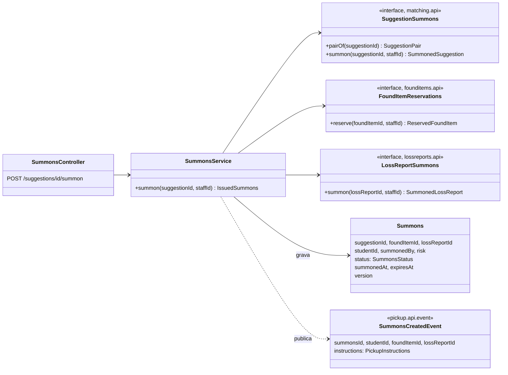
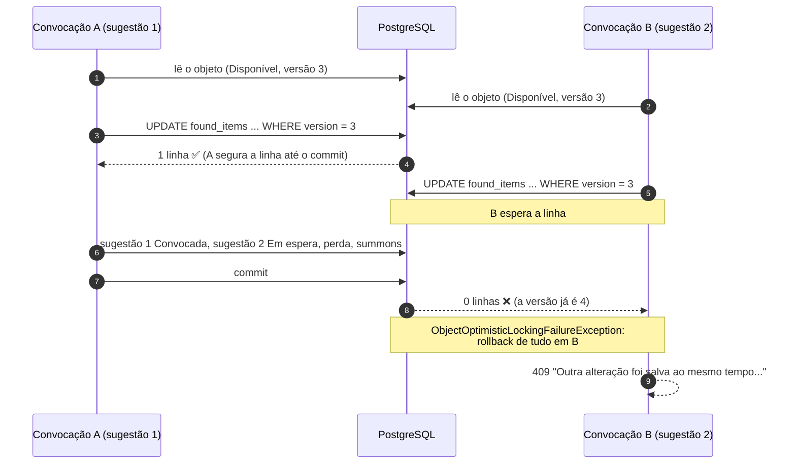

# Convocação (RET-01)

Como o `SummonsService` (`pickup.service.summons`) convoca o estudante a partir de uma sugestão (RF26): o objeto fica Reservado, o registro de perda Convocado e a sugestão Convocada, na mesma transação (seção 7.1), e um objeto nunca tem duas convocações ativas (RN18), mesmo quando dois funcionários convocam ao mesmo tempo. As escolhas que os requisitos não definiam estão na D25.

## 1. Classes envolvidas

A convocação muda dados de três módulos. Como o `pickup` só alcança os outros pela `api` (D10), cada módulo expõe uma interface com a sua parte da mudança, e é o próprio módulo que muda a sua entidade e grava o seu histórico.



As três implementações (`SuggestionSummonsService`, `FoundItemReservationsService`, `LossReportSummonsService`) usam `Propagation.MANDATORY`: só funcionam dentro da transação da convocação. Chamadas fora dela falham na hora, em vez de gravar só um pedaço.

| Entidade | Transição | Histórico |
|---|---|---|
| `FoundItem` | Disponível ou Não reclamado → Reservado | `FOUND_ITEM_RESERVED` |
| `MatchSuggestion` (a convocada) | Nova → Convocada | `MATCH_SUMMONED` |
| `MatchSuggestion` (as outras Novas do mesmo objeto) | Nova → Em espera (RN18) | `MATCH_ON_HOLD`, uma por sugestão |
| `LossReport` | Aberto → Convocado (a descrição e o detalhe travam, RN06) | `LOSS_REPORT_SUMMONED` |
| `Summons` (nova) | nasce Ativa, com prazo de 7 dias (RN15) | `SUMMONS_CREATED` |

Todos os registros do histórico têm o funcionário como autor. Se qualquer passo falhar, a transação inteira é desfeita e nada disso fica gravado.

## 2. Sequência

```mermaid
sequenceDiagram
    autonumber
    actor F as Funcionário
    participant S as SummonsService
    participant M as SuggestionSummons
    participant A as FoundItemReservations
    participant P as LossReportSummons
    participant DB as PostgreSQL

    F->>S: POST /suggestions/{id}/summon
    S->>M: pairOf(id)
    M->>DB: SELECT da sugestão (404 se não existe)
    S->>A: reserve(objeto)
    A->>DB: UPDATE found_items SET status = 'RESERVED', version = N+1 WHERE version = N (flush imediato)
    S->>M: summon(id)
    M->>DB: sugestão → Convocada; outras Novas do objeto → Em espera
    S->>P: summon(perda)
    P->>DB: perda → Convocado
    S->>DB: INSERT summons (prazo = agora + 7 dias)
    S->>S: publica AuditEvent (gravados na hora) e SummonsCreatedEvent
    Note over S,DB: commit
    S-->>F: 201 com local, horário, prazo e o que levar
```

O `SummonsCreatedEvent` é o `convocacao.criada` da seção 7.2. O e-mail ao estudante (AVI-02) vai ouvi-lo depois do commit; uma falha no e-mail não desfaz a convocação (RNF08). O evento já leva as `PickupInstructions` (local, horário, prazo e o que levar), para o módulo de avisos não precisar montar nada.

## 3. Duas convocações ao mesmo tempo

A RN18 permite uma convocação ativa por objeto. Dois funcionários podem convocar ao mesmo tempo a partir de sugestões diferentes do mesmo objeto (duas perdas que combinam), ou os dois podem clicar na mesma sugestão.

O `FoundItem` ganhou `@Version`, e a linha do objeto é o ponto de disputa:



Se B lê o objeto **depois** do commit de A, ele já o vê Reservado e é recusado pela própria situação (409 "Não é possível convocar um objeto na situação Reservado."). Os dois caminhos terminam do mesmo jeito: uma convocação passa e a outra não grava nada.

### Por que o objeto é gravado primeiro

Sem o flush imediato, a ordem dos `UPDATE` ficaria por conta do Hibernate, e as sugestões poderiam ser gravadas antes do objeto. Aí A atualizaria a sugestão 1 e depois a 2 (pondo em espera), enquanto B atualizaria a 2 (convocando) e esperaria a 1, e cada uma ficaria esperando uma linha que a outra segura. O PostgreSQL desfaria uma delas como deadlock, que chegaria ao funcionário como erro 500.

Com o objeto gravado primeiro (`saveAndFlush` no `FoundItemReservationsService`), toda convocação do mesmo objeto disputa a mesma linha antes de tocar em qualquer sugestão. Quem chega depois espera ali e perde no `@Version`, sem chance de deadlock. Por isso o `SummonsService` pede primeiro o par da sugestão (`pairOf`), sem mudar nada, e só depois reserva o objeto.

### Os outros `@Version`

| Linha | Protege contra |
|---|---|
| `FoundItem.version` | duas convocações do mesmo objeto (RN18) |
| `MatchSuggestion.version` | convocar e descartar a mesma sugestão ao mesmo tempo (CRU-03) |
| `LossReport.version` | duas convocações da mesma perda, a partir de objetos diferentes |
| `Summons.version` | duas decisões sobre a mesma convocação (retirada, recusa, vencimento; RET-02, RET-03) |

## 4. O que pode dar errado

| Situação | Resposta | O que fica gravado |
|---|---|---|
| Sugestão não existe | 404 "Sugestão não encontrada." | nada |
| Objeto já Reservado, Devolvido ou Destinado | 409 "Não é possível convocar um objeto na situação …" | nada |
| Sugestão Descartada, Em espera ou já Convocada | 409 "Não é possível convocar uma sugestão na situação …" | nada (a reserva do objeto é desfeita) |
| Perda já Convocada por outro objeto, Cancelada ou Vencida | 409 "Não é possível convocar um registro de perda na situação …" | nada |
| Convocação simultânea do mesmo objeto | 409 "Outra alteração foi salva ao mesmo tempo…" | só a primeira |
| Estudante tentando convocar | 403 | nada |

Uma perda Aguardando informações também é recusada: a seção 6.2 só permite convocar a partir de Aberto.

## 5. Onde está testado

- [`SummonsServiceTest`](../../src/test/java/br/ucsal/cade/pickup/service/summons/SummonsServiceTest.java): as três transições e a convocação gravada, o histórico com o funcionário como autor, as outras sugestões em espera (e as de outros objetos intactas), a descrição travada, o prazo e o que levar, o evento, as recusas sem nada gravado e as convocações simultâneas em Virtual Threads (6 sugestões do mesmo objeto e 3 cliques na mesma sugestão terminam com exatamente uma convocação).
- [`SummonsControllerTest`](../../src/test/java/br/ucsal/cade/pickup/controller/summons/SummonsControllerTest.java): a rota com MockMvc, 201, 404, 409, 403 e 401.
- [`SummonsStatusTest`](../../src/test/java/br/ucsal/cade/pickup/persistence/status/SummonsStatusTest.java) e [`WhatToBringTest`](../../src/test/java/br/ucsal/cade/pickup/service/summons/WhatToBringTest.java): situações da convocação e o texto de cada risco.
