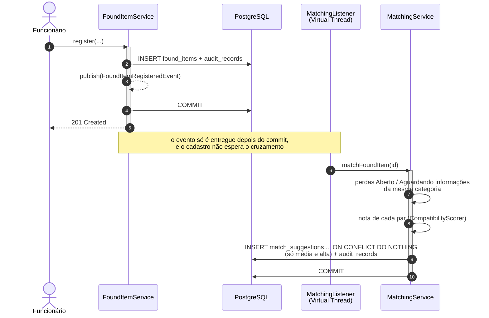

# Cruzamento por evento (CRU-02)

Como um objeto cadastrado ou uma perda registrada viram sugestões para o funcionário, sem que o cadastro espere o cálculo. As regras estão nos requisitos (RF20, RNF08, seções 6.3, 7.1 e 7.2) e nas decisões D05, D10 e D23. A nota em si (critérios, pesos e faixas) é do CRU-01: ver a D22 e a seção "Strategy + Composite" de [pooa-no-projeto.md](../entrega/pooa-no-projeto.md).

## 1. Classes envolvidas

```mermaid
classDiagram
    direction LR

    class EventPublisher {
        <<interface>>
        +publish(Object)
    }
    class FoundItemService
    class LossReportService
    class MatchingListener {
        ~on(FoundItemRegisteredEvent)
        ~on(LossReportRegisteredEvent)
    }
    class MatchingService {
        +matchFoundItem(UUID) List~MatchSuggestion~
        +matchLossReport(UUID) List~MatchSuggestion~
    }
    class MatchableFoundItems {
        <<interface>>
        +find(UUID) Optional
        +findByCategory(UUID) List
    }
    class MatchableLossReports {
        <<interface>>
        +find(UUID) Optional
        +findByCategory(UUID) List
    }
    class CompatibilityScorer {
        +score(MatchCandidate) Compatibility
    }
    class MatchSuggestionRepository {
        +saveIfAbsent(MatchSuggestion) boolean
    }

    FoundItemService --> EventPublisher : FoundItemRegisteredEvent
    LossReportService --> EventPublisher : LossReportRegisteredEvent
    EventPublisher ..> MatchingListener : depois do commit, @Async
    MatchingListener --> MatchingService
    MatchingService --> MatchableFoundItems : api de founditems
    MatchingService --> MatchableLossReports : api de lossreports
    MatchingService --> CompatibilityScorer
    MatchingService --> MatchSuggestionRepository
```

`MatchableFoundItems` e `MatchableLossReports` ficam na `api` de cada módulo e são implementadas nos serviços deles: o `matching` não enxerga as entidades nem as tabelas dos outros (D10). Elas devolvem só o que a nota usa, sem foto, detalhe reservado, detalhe secreto nem estudante.

## 2. Sequência: objeto cadastrado

A perda registrada segue o mesmo caminho, com `LossReportRegisteredEvent` e `matchLossReport`, contra os objetos Disponível ou Não reclamado.

## 3. O que pode dar errado

| Situação | O que acontece |
|---|---|
| O cadastro é desfeito (erro, rollback) | O evento não é entregue: o cruzamento só ouve depois do commit |
| O cruzamento falha (banco, bug) | O `MatchingListener` registra o erro no log; o cadastro já foi confirmado (RNF08). As sugestões daquela rodada se perdem |
| O back-end cai entre o commit e o cruzamento | O evento, que fica na memória, se perde (limitação da D05, declarada no README) |
| Objeto e perda do mesmo par cadastrados no mesmo instante | Os dois cruzamentos acham o par; a chave única e o `ON CONFLICT DO NOTHING` deixam uma sugestão só, sem erro |
| O objeto deixou de estar disponível antes de o cruzamento rodar | `find` devolve vazio e nada é gravado |

## 4. Onde está testado

- [`MatchingServiceTest`](../../src/test/java/br/ucsal/cade/matching/service/matching/MatchingServiceTest.java): de ponta a ponta com o banco do Testcontainers. O exemplo da RN07 (80, alta) nos dois sentidos, média gravada e baixa descartada, categoria diferente fora, par sem duplicar, falha sem desfazer o cadastro, e o cruzamento numa Virtual Thread que já enxerga o objeto confirmado.
- [`MatchingListenerTest`](../../src/test/java/br/ucsal/cade/matching/service/matching/MatchingListenerTest.java): a exceção do cruzamento não sobe para quem publicou.
- [`SuggestionStatusTest`](../../src/test/java/br/ucsal/cade/matching/persistence/status/SuggestionStatusTest.java): as 9 transições permitidas da seção 6.3 e as 55 proibidas.
