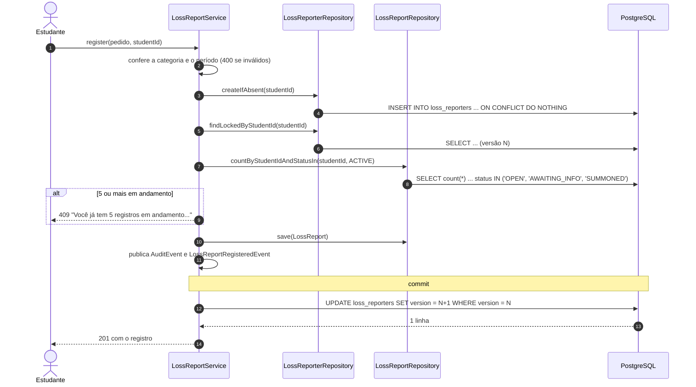
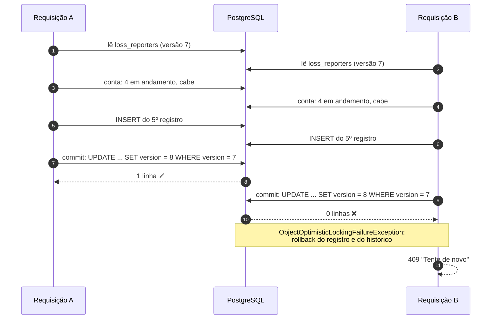
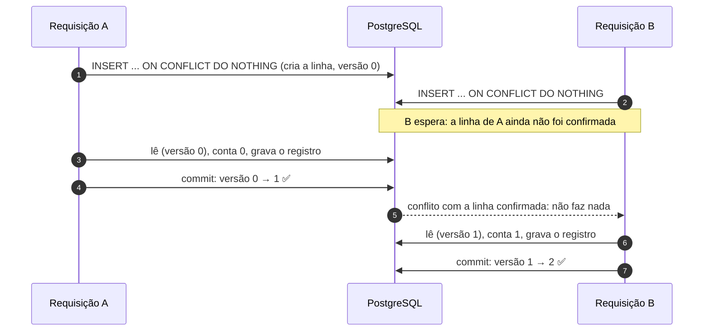

# Limite de registros abertos (lock otimista)

Como o `LossReportService` (`lossreports.service.report`) garante a RN05, que permite no máximo 5 registros de perda em andamento por estudante, mesmo quando dois registros chegam ao mesmo tempo. A escolha pelo lock otimista foi da equipe na discussão do PER-01. Contam como "em andamento" as situações Aberto, Aguardando informações e Convocado (`LossReportStatus.ACTIVE`).

## 1. O problema

A regra parece um `if` simples: contar os registros do estudante e recusar o sexto. O problema é o intervalo entre a contagem e a gravação.

Um estudante com 4 registros envia dois formulários quase juntos (dois cliques, duas abas, o celular e o computador). As duas requisições contam 4, as duas acham que cabe mais um e as duas gravam. Resultado: 6 registros, e a RN05 foi furada.

Nenhuma restrição do banco resolve isso sozinha. Um `UNIQUE` não sabe contar até 5, e as duas requisições **inserem** linhas novas, que não disputam nada entre si.

## 2. A solução: uma linha por estudante para disputar

A tabela `loss_reporters` tem uma linha por estudante que já registrou perda, com **só a versão**:

| Coluna | Conteúdo |
|---|---|
| `student_id` | id da conta do estudante (chave primária); sem chave estrangeira para `access` (D10) |
| `version` | número que sobe a cada registro do estudante (`@Version`) |

O registro de perda passa a **travar** essa linha antes de contar. O lock é otimista: ninguém fica esperando durante a transação, e o conflito só é conferido no commit.

- **Leitura com `OPTIMISTIC_FORCE_INCREMENT`** (`LossReporterRepository.findLockedByStudentId`): o Hibernate lê a linha e, no commit, executa `UPDATE loss_reporters SET version = N+1 WHERE student_id = ? AND version = N`, **mesmo sem alteração nenhuma** na linha. Sem o *force increment*, o Hibernate não faria `UPDATE` em uma linha que ninguém mudou, e não haveria conflito para detectar.
- **Se o `UPDATE` não encontra a linha**, outra transação já subiu a versão. O Hibernate lança `ObjectOptimisticLockingFailureException`, e a transação inteira é desfeita, incluindo o registro inserido e o histórico.

A linha não guarda um contador. A contagem vem sempre dos próprios registros (`countByStudentIdAndStatusIn`), então não há o que ficar dessincronizado quando um registro é cancelado, vence ou é concluído.

## 3. Fluxo: um registro sozinho

## 4. Fluxo: dois registros ao mesmo tempo

O estudante tem 4 registros em andamento e envia A e B juntos.

Se B começar a contar **depois** do commit de A, ele já vê 5 registros e é recusado pela própria contagem, com a mensagem do limite. Os dois caminhos terminam do mesmo jeito: só um registro passa.

Para o estudante, a falha de B aparece como 409 com uma mensagem pedindo para tentar de novo (`ApiExceptionHandler`). Se ele tentar, a contagem mostra 5 registros e explica o limite.

## 5. Fluxo: o primeiro registro do estudante

No primeiro registro, a linha em `loss_reporters` ainda não existe. Se ela fosse criada com um `INSERT` comum, dois primeiros registros simultâneos tentariam inserir a mesma chave primária, e o segundo falharia com erro de chave duplicada, recusando um registro que estava dentro do limite.

Por isso a linha nasce por `createIfAbsent`, um `INSERT ... ON CONFLICT DO NOTHING` (um comando SQL só, como na D18):

Aqui o próprio PostgreSQL coloca as duas requisições em fila, e as duas passam, como deveriam.

## 6. Por que duas versões

O `LossReport` também tem `@Version`, mas ele protege outra coisa:

| | `LossReporter.version` | `LossReport.version` |
|---|---|---|
| Linha | uma por estudante | uma por registro |
| Protege contra | dois **registros novos** ao mesmo tempo | duas **alterações** no mesmo registro ao mesmo tempo |
| Exemplo | o 5º e o 6º registro enviados juntos | o estudante edita (PER-07) enquanto o funcionário convoca (CRU-03, RET-01) |
| Regra | RN05 | RN06 e as transições da seção 6.2 |

A versão do registro não serve para a RN05 porque, num cadastro, o registro ainda não existe. A versão do estudante não serve para as alterações porque amarraria operações sem relação: editar o registro A daria conflito com convocar o registro B.

## 7. Alternativas descartadas

| Alternativa | Por que não |
|---|---|
| Só contar, sem lock | É exatamente o problema da seção 1. |
| Lock pessimista (`SELECT ... FOR UPDATE` ou `pg_advisory_xact_lock`) | Funcionaria, com a segunda requisição esperando a primeira. A equipe preferiu o otimista: ninguém fica travado, e conflito de verdade é raro (o mesmo estudante enviando dois registros no mesmo instante). |
| Contador na linha do estudante | Precisaria descer a cada cancelamento, vencimento ou conclusão, em vários cards; qualquer esquecimento dessincroniza o número. |
| `@Version` só no `LossReport` | Não detecta nada no cadastro (seção 6). |

## 8. Testes

| Teste | O que confere |
|---|---|
| `LossReporterRepositoryTest` | a leitura com lock sobe a versão sem alteração; leitura comum não sobe; duas transações intercaladas: a segunda falha com `ObjectOptimisticLockingFailureException`; `createIfAbsent` numa linha existente não muda nada |
| `LossReportRepositoryTest` | a contagem considera só Aberto, Aguardando informações e Convocado, e só do estudante |
| `LossReportServiceTest` | o 6º registro é recusado; um registro encerrado libera vaga; o limite é por estudante; 8 registros simultâneos com 4 já gravados terminam com exatamente 5; dois primeiros registros simultâneos passam |
