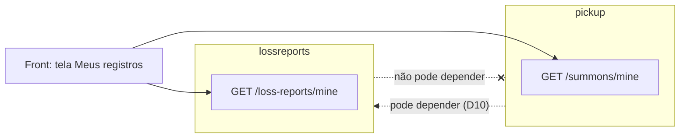
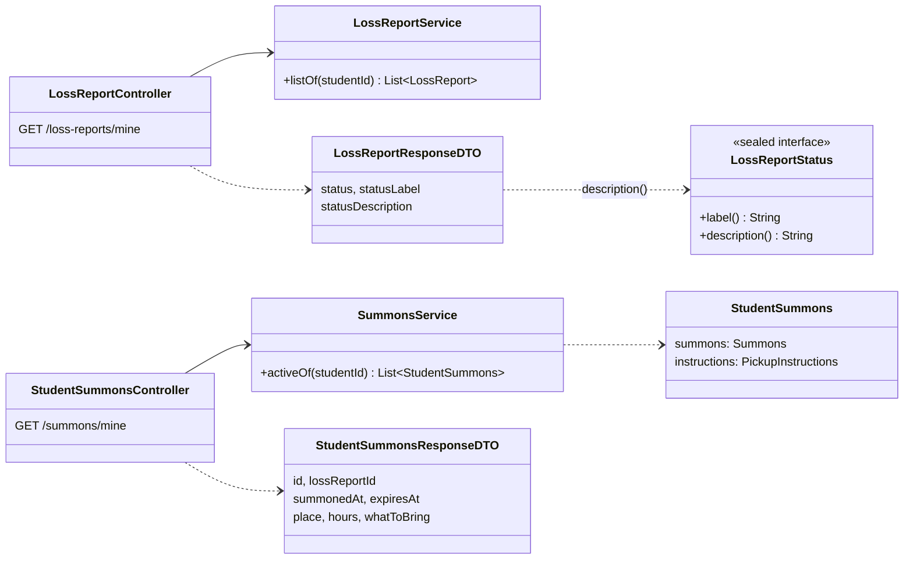

# Meus registros (PER-03)

Como o estudante acompanha os próprios registros de perda e a situação de cada um, em linguagem simples (RF16), sem ver nada de objeto achado (RN03). O registro Convocado precisa dizer onde e até quando retirar, e esse prazo fica na convocação, no módulo `pickup`. Por isso a tela "meus registros" usa duas rotas, uma de cada módulo, e o front junta as respostas pelo id do registro (D28).

## 1. As duas rotas

| Rota (só estudante) | Módulo | O que devolve |
|---|---|---|
| `GET /loss-reports/mine` | `lossreports` | Todos os registros do estudante, em qualquer situação, do mais recente para o mais antigo, com `statusLabel` e `statusDescription` |
| `GET /summons/mine` | `pickup` | Só as convocações Ativas do estudante, as que vencem primeiro no topo, com `lossReportId`, local, horário, prazo e o que levar |

As duas leem o estudante do token (claim `sub`), nunca de um parâmetro: não há como pedir os registros de outra pessoa. Funcionário e administrador recebem 403 nas duas, porque são telas do estudante.

## 2. Por que duas rotas, e não uma

O prazo da convocação (`Summons.expiresAt`) e o "o que levar" (que depende do risco gravado na convocação, D26) moram no `pickup`. A tabela da D10 só deixa o `pickup` depender do `lossreports`, e não o contrário.



| Opção | Por que não |
|---|---|
| `lossreports` perguntar o prazo ao `pickup` | Dependência proibida pela D10; o `ModuleBoundariesTest` quebra o build. |
| Copiar o prazo no `LossReport` ao convocar | Dado duplicado: o vencimento (RET-02), a retirada e a recusa teriam de limpar a cópia, e uma divergência viraria um prazo errado na tela sem nenhum erro. |
| Uma rota única no `pickup` que junta tudo | O `pickup` passaria a montar a resposta de registros de perda, que não são dele, e a lista de registros sem convocação ficaria no módulo errado. |

Com duas rotas, cada módulo responde pelo que é seu, o prazo existe num lugar só e, quando a convocação fecha, ela simplesmente sai de `GET /summons/mine`.

## 3. Classes envolvidas



- **`LossReportStatus.description()`** fica ao lado do `label()` e usa um `switch` exaustivo sobre a interface selada: uma situação nova que esqueça o texto não compila.
- **`LossReportService.listOf`** usa uma consulta com `@EntityGraph` (categoria e locais), para a lista não disparar uma consulta por registro.
- **`SummonsService.activeOf`** reaproveita a montagem do `PickupInstructions` da convocação (RET-01). O estudante vê na tela exatamente o que a convocação definiu: local e horário de `cade.pickup.*` e o que levar pela `VerificationRule` do risco.
- **`StudentSummonsController`** fica em `pickup.controller.student`, separado do `SummonsController` (convocar) e do `CounterController` (balcão), que são do funcionário. `GET /summons/mine` não conflita com `GET /summons/{id}` do balcão: o Spring prefere o caminho literal.

## 4. Fluxo da tela

```mermaid
sequenceDiagram
    autonumber
    actor E as Estudante
    participant F as Front
    participant LR as LossReportController
    participant SC as StudentSummonsController
    E->>F: abre "Meus registros"
    par
        F->>LR: GET /loss-reports/mine (token)
        LR-->>F: registros com statusDescription
    and
        F->>SC: GET /summons/mine (token)
        SC-->>F: convocações Ativas com lossReportId
    end
    F->>F: junta pelo lossReportId
    F-->>E: lista; no Convocado, "retire até ..., em ..., levando ..."
```

## 5. Texto de cada situação

| Situação | `statusDescription` |
|---|---|
| Aberto | Estamos de olho: quando chegar à sala um objeto parecido, o funcionário confere e você é avisado. |
| Aguardando informações | O funcionário precisa de mais detalhes sobre a sua perda. Responda para o registro continuar. |
| Convocado | Encontramos um objeto que pode ser seu. Veja onde e até quando retirar. |
| Concluído | Você retirou o objeto. Este registro está encerrado. |
| Vencido | O registro passou de 30 dias sem renovação e foi encerrado. Se ainda procura, registre de novo. |
| Cancelado | Você cancelou este registro. |
| Recusado | A conferência no balcão não confirmou que o objeto era seu. O registro foi encerrado. |

No Convocado, o "veja onde e até quando" é preenchido pelo item de `GET /summons/mine` com o mesmo `lossReportId`.

## 6. Privacidade (RN03)

- `GET /loss-reports/mine` devolve o registro inteiro, inclusive o detalhe secreto e a foto (pelo `photoPath`), porque é do próprio dono (RF14). Não traz sugestão, nota de compatibilidade nem nada do objeto achado.
- `GET /summons/mine` não traz nem o id do objeto: só onde, até quando e o que levar.
- Os testes `theListBringsNothingAboutFoundItems` (`LossReportControllerTest`) e `bringsNothingAboutTheFoundItem` (`StudentSummonsControllerTest`) conferem a lista exata de campos de cada resposta. Um campo novo nelas quebra o teste e obriga a pensar na privacidade.

## 7. Testes

| Teste | O que garante |
|---|---|
| `LossReportStatusTest.everyStatusHasItsOwnPlainLanguageDescription` | Toda situação tem texto, e textos diferentes |
| `LossReportRepositoryTest.listsOnlyTheReportsOfTheStudent...` | Só os do estudante, do mais recente, com categoria e locais carregados |
| `LossReportServiceTest.listsTheReportsOfTheStudentInEveryStatus...` | Registros em qualquer situação, do mais recente; lista vazia sem registros |
| `LossReportControllerTest` (4 testes novos) | 200 só com os do dono, lista vazia, campos sem nada de objeto, 401 e 403 |
| `StudentSummonsControllerTest` | Só as Ativas e do dono, as que vencem primeiro, o que levar pelo risco, campos sem nada de objeto, 401 e 403 |
