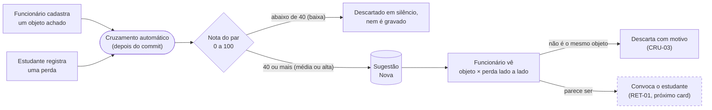
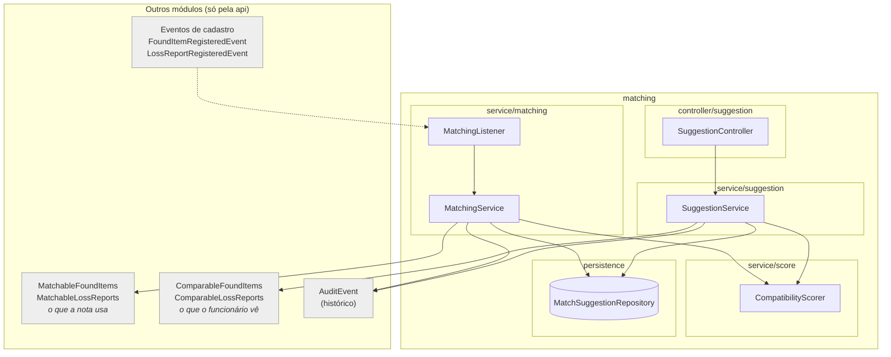
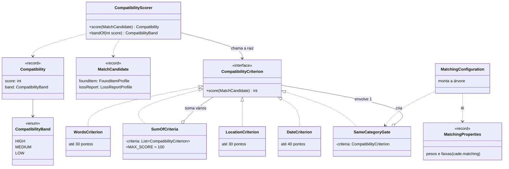
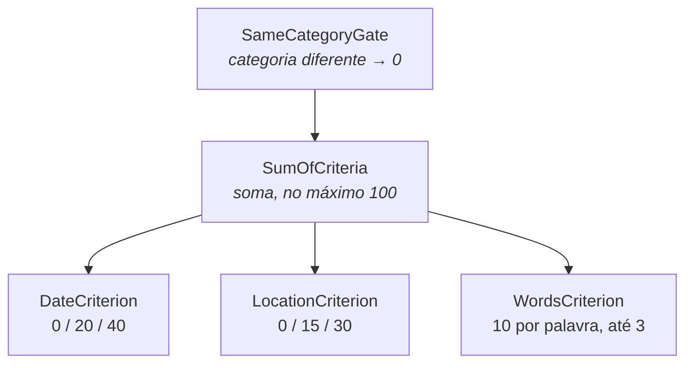
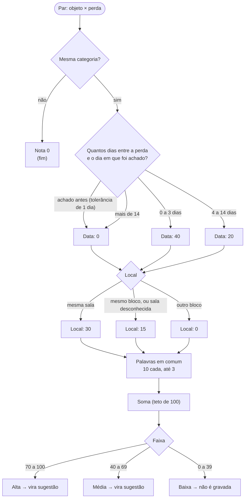
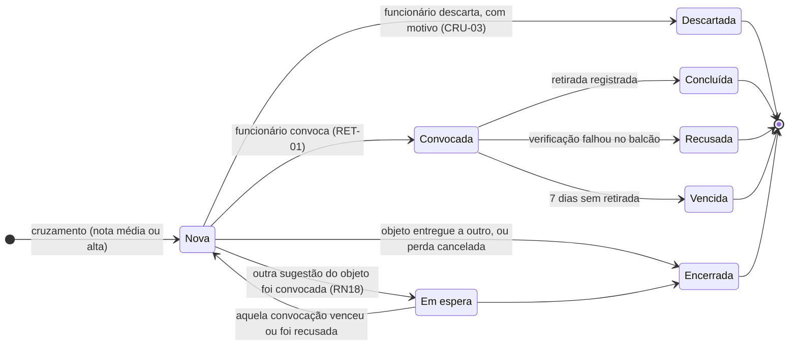
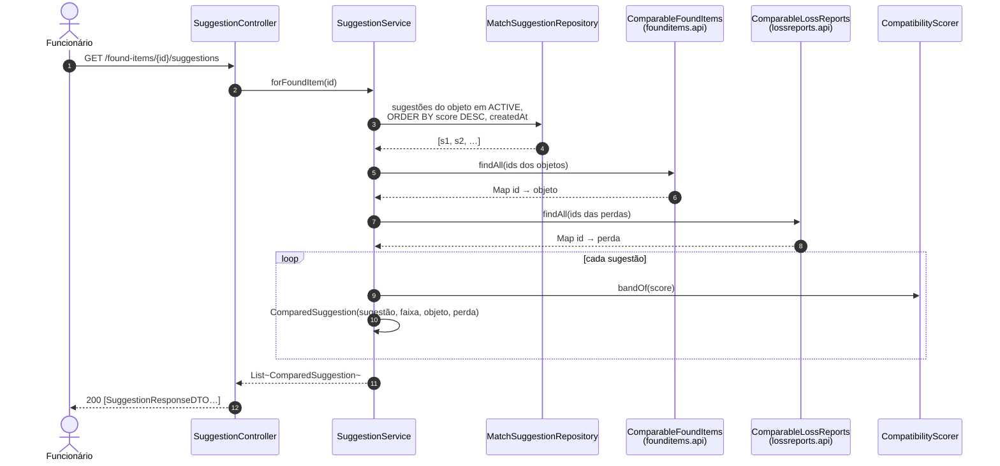
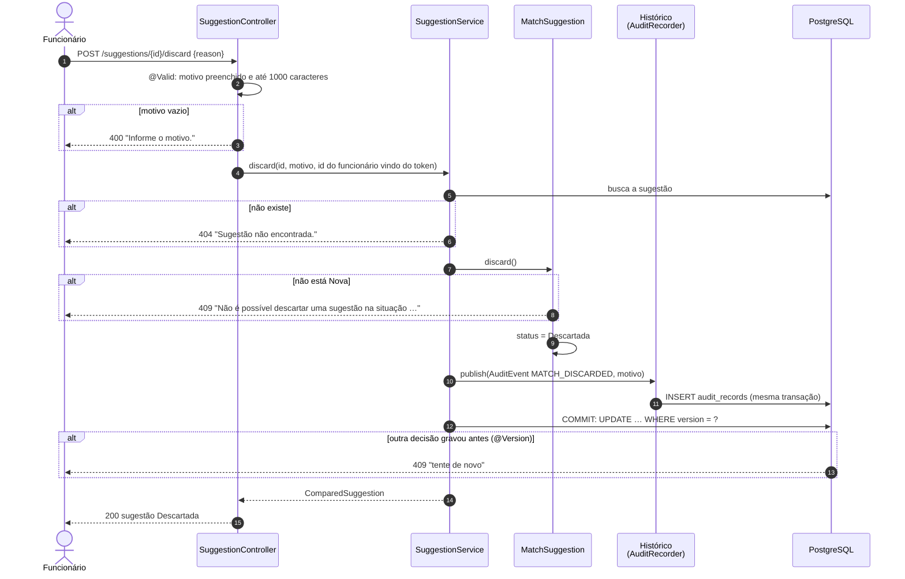

# Módulo de cruzamento (`matching`): guia de leitura

O módulo tem cerca de 30 classes. Este guia diz **para que serve cada pasta**, **como as peças conversam** e **por onde começar a ler**. Os detalhes de cada parte ficam em outros lugares, e cada seção indica onde:

- o cruzamento automático depois do cadastro (eventos, Virtual Thread, falhas) está em [cruzamento.md](cruzamento.md) (CRU-02, D23);
- as regras da nota estão na RN07 dos [requisitos](../requisitos.md) e na D22;
- os padrões (Strategy, Composite, State) estão em [pooa-no-projeto.md](../entrega/pooa-no-projeto.md).

## 1. A ideia em uma frase

> Sempre que um objeto achado ou uma perda é cadastrado, o sistema **compara** o registro com os do outro lado, **dá uma nota** de 0 a 100 a cada par e **guarda como sugestão** os pares com nota média ou alta. O funcionário **vê as sugestões lado a lado** e **decide**: convoca o estudante ou descarta a sugestão com um motivo. A sugestão é só apoio; quem decide é sempre o funcionário (RN08).



## 2. Mapa das pastas

```
matching/
├── controller/suggestion/      ← as rotas HTTP do funcionário
│   ├── SuggestionApi              documentação do Swagger (só anotações)
│   ├── SuggestionController       rotas: listar, detalhar, descartar
│   └── dto/                       o JSON que entra e o que sai
├── exception/                  ← erros próprios do módulo
│   └── SuggestionNotFoundException   404 "Sugestão não encontrada."
├── persistence/                ← o que vai para o banco
│   ├── suggestion/                MatchSuggestion (a entidade) e o repositório
│   └── status/                    SuggestionStatus (máquina de estados) e o conversor
└── service/
    ├── matching/               ← 1) CRIAR sugestões (automático)
    │   ├── MatchingListener       ouve "objeto cadastrado" e "perda registrada"
    │   └── MatchingService        busca os candidatos, dá a nota e grava
    ├── score/                  ← 2) DAR A NOTA (cálculo puro, sem banco)
    │   ├── CompatibilityScorer    ponto de entrada: recebe um par, devolve a nota
    │   ├── candidate/             o par avaliado (objeto × perda)
    │   ├── criterion/             um critério por classe: data, local, palavras
    │   ├── composite/             combina os critérios: porta da categoria + soma
    │   ├── result/                a nota e a faixa (alta, média, baixa)
    │   └── config/                pesos e faixas lidos do application.yml
    └── suggestion/             ← 3) DECIDIR sobre sugestões (funcionário)
        ├── SuggestionService      listar, detalhar e descartar
        └── ComparedSuggestion     sugestão + objeto + perda, prontos para a tela
```

**Por onde começar a ler:**
1. Para entender **a nota**, comece pelo `CompatibilityScorer` e depois veja `config/MatchingConfiguration`, que monta a árvore de critérios.
2. Para entender **de onde vêm as sugestões**, comece pelo `MatchingListener` e siga para o `MatchingService`.
3. Para entender **o que o funcionário faz**, comece pelo `SuggestionController` e siga para o `SuggestionService`.

### Quem chama quem

As setas apontam de quem chama para quem é chamado. As caixas cinza são de outros módulos; o `matching` só fala com elas pela `api` (D10).



**Por que duas "janelas" para os outros módulos?** São dois públicos com necessidades diferentes:

| Janela | Quem usa | O que traz | O que **não** traz |
|---|---|---|---|
| `Matchable*` | o cálculo da nota | categoria, data, local e descrição; só registros que ainda podem casar | foto, detalhes reservados, detalhe secreto, estudante |
| `Comparable*` | a tela do funcionário | tudo o que o funcionário confere, inclusive descrição interna, detalhes reservados e detalhe secreto; registros em qualquer situação | o estudante (só importa a partir da convocação) |

## 3. A nota (`service/score`)

### 3.1 Como as classes se encaixam

Cada critério é uma classe com um método só, `score(par)` (padrão **Strategy**). A nota inteira também é um critério: uma "porta" que envolve uma "soma" de critérios (padrão **Composite**). Quem calcula chama `score` na raiz da árvore e não sabe quantos critérios existem.



A árvore que a `MatchingConfiguration` monta é esta:



### 3.2 O cálculo passo a passo



Detalhes que costumam gerar dúvida (D22):

- **Período de perda:** se o estudante informou "entre o dia 1 e o dia 10", conta o tamanho do período. Um período longo é vago e pontua menos.
- **Vários locais:** a perda pode ter até 5 locais. Vale o que mais pontua.
- **Comparação de texto:** ignora maiúsculas, acentos e espaços extras ("Sala 421" = "sala  421").
- **Palavras que não contam:** palavras com menos de 3 letras, palavras vazias ("com", "para", "meu", "cor"...) e o nome da categoria. Numa perda da categoria Fone, a palavra "fone" não diferencia nada.

**Exemplo da RN07** (está no `CompatibilityScorerTest`):

| | Perda | Objeto | Pontos |
|---|---|---|---|
| Categoria | Fone | Fone | libera |
| Data | 04/11 | achado em 04/11 | **40** |
| Local | Bloco 400, Sala 421 | Bloco 400, Sala 421 | **30** |
| Palavras | "Fone **JBL** **preto**" | "Fone **preto**" | "preto" = **10** ("fone" é a categoria; "JBL" só de um lado) |
| **Total** | | | **80, Alta** |

Os pesos e as faixas ficam em `cade.matching.*` no `application.yml` e são conferidos na subida: um valor inválido impede a aplicação de subir.

## 4. A vida de uma sugestão

Cada sugestão tem uma situação, e só muda pelas transições da seção 6.3 (padrão **State**, em `SuggestionStatus`). Uma ação fora da tabela responde 409.



| Situação | Aparece nas listas do funcionário? |
|---|---|
| Nova, Em espera, Convocada | Sim (`SuggestionStatus.ACTIVE`) |
| Descartada, Concluída, Recusada, Vencida, Encerrada | Não; só por `GET /suggestions/{id}` |

Hoje o código **cria** sugestões (CRU-02) e **descarta** (CRU-03). As outras transições já existem na máquina de estados e vão ser usadas pelos próximos cards (RET-01 convoca, RET-02 vence, RET-03 conclui ou recusa).

## 5. O que o funcionário faz (CRU-03)

### 5.1 Rotas

Todas exigem o perfil de **funcionário** (o administrador também passa, D20). Estudante recebe 403.

| Rota | O que faz | Erros |
|---|---|---|
| `GET /found-items/{id}/suggestions` | Sugestões ativas do objeto, da maior nota para a menor | — (lista vazia se não houver) |
| `GET /loss-reports/{id}/suggestions` | Sugestões ativas da perda, da maior nota para a menor | — (lista vazia se não houver) |
| `GET /suggestions/{id}` | Uma sugestão, em qualquer situação | 404 |
| `POST /suggestions/{id}/discard` com `{"reason": "..."}` | Nova → Descartada; o motivo vai para o histórico | 400 sem motivo · 404 · 409 se não estiver Nova |

As rotas ficam no `SuggestionController`, e a documentação do Swagger fica na `SuggestionApi` (seção "Sugestões" em `/swagger-ui.html`).

### 5.2 Exemplo de resposta (lado a lado)

```json
{
  "id": "…",
  "score": 80,
  "band": "HIGH",            "bandLabel": "Alta",
  "status": "NEW",           "statusLabel": "Nova",
  "createdAt": "2026-11-04T15:00:00Z",
  "foundItem": {
    "id": "…", "categoryName": "Fone", "foundOn": "2026-11-04",
    "block": "Bloco 400", "room": "Sala 421", "storageBox": "Caixa Novembro/2026",
    "risk": "MEDIUM", "riskLabel": "Médio", "statusLabel": "Disponível",
    "internalDescription": "Fone preto",
    "reservedDetails": "Arranhão na haste",
    "photoPath": "/found-items/…/photo"
  },
  "lossReport": {
    "id": "…", "categoryName": "Fone", "lostFrom": "2026-11-04", "lostUntil": "2026-11-04",
    "shift": "Noite", "locations": [{ "block": "Bloco 400", "room": "Sala 421" }],
    "description": "Fone JBL preto",
    "secretDetail": "Adesivo de estrela no estojo",
    "statusLabel": "Aberto", "registeredAt": "…"
  }
}
```

O front pede a foto do objeto em `photoPath`, com o token. Foto nunca tem URL pública (D21).

### 5.3 Listar: como fica rápido

Uma lista de N sugestões custa **3 consultas**, não 2N+1: uma para as sugestões, uma para todos os objetos e uma para todas as perdas.



A faixa não fica gravada: ela sai da nota pelas faixas **atuais** do `application.yml`. Se as faixas mudarem lá, as sugestões antigas passam a mostrar a faixa nova.

### 5.4 Descartar: o que acontece por dentro



Três garantias:

1. **Tudo ou nada:** o descarte e o histórico estão na mesma transação. Se a gravação do histórico falhar, o descarte é desfeito (RF43).
2. **Sem decisão dupla:** a sugestão tem `@Version`. Se dois funcionários decidirem ao mesmo tempo (um descarta e outro convoca), só a primeira decisão vale e a outra recebe 409.
3. **O motivo não se perde:** ele fica no histórico, que nunca é alterado nem apagado (RN19), com o autor, a data e a hora.

## 6. Privacidade: o que aparece para quem

| Dado | Funcionário (sugestões) | Estudante |
|---|---|---|
| Nota e faixa | ✅ | ❌ |
| Descrição interna e detalhes reservados do objeto | ✅ | ❌ (RN03) |
| Foto do objeto | ✅ pela rota do objeto, com token | ❌ (RN03) |
| Descrição e detalhe secreto da perda | ✅ (é o que ele confere) | só os do próprio registro |
| Quem é o estudante da perda | ❌ (não precisa antes da convocação) | — |

## 7. Como estender

**Um critério novo na nota** (por exemplo, a IA do CRU-05):
1. Crie uma classe em `score/criterion/` que implemente `CompatibilityCriterion`.
2. Acrescente-a na lista da `MatchingConfiguration`.
3. Se tiver pesos, coloque-os em `MatchingProperties` e no `application.yml`.

Nenhuma outra classe muda: a soma, a porta e o `CompatibilityScorer` continuam iguais.

**Uma decisão nova sobre a sugestão** (por exemplo, convocar, na RET-01):
1. A transição já existe no `SuggestionStatus` (`summon()`).
2. Crie um método na entidade `MatchSuggestion`, como o `discard()`.
3. Crie a operação no service, com o histórico na mesma transação, e a rota no controller com `@RequiresRole`.

## 8. Onde está testado

| Teste | O que garante |
|---|---|
| `score/criterion/*CriterionTest` | Cada critério sozinho: limites de dias, sala × bloco, palavras ignoradas |
| `score/composite/CompositeCriteriaTest` | Soma, teto de 100 e categoria diferente zerando a nota |
| `score/CompatibilityScorerTest` | Os exemplos da RN07 com os pesos reais do `application.yml` |
| `persistence/status/SuggestionStatusTest` | As 9 transições permitidas e as 55 proibidas |
| `persistence/suggestion/MatchSuggestionTest` | Criação, nota fora de 0 a 100, descarte e segundo descarte recusado |
| `service/matching/MatchingServiceTest` | Cruzamento de ponta a ponta, depois do commit e numa Virtual Thread |
| `service/suggestion/SuggestionServiceTest` | Ordem por nota, descartadas fora da lista, motivo no histórico, `@Version`, 404 e 409 |
| `controller/suggestion/SuggestionControllerTest` | As rotas com MockMvc: 200, 400, 401, 403, 404 e 409, e a perda sem o estudante |
| `founditems/…/ComparableFoundItemsServiceTest`, `lossreports/…/ComparableLossReportsServiceTest` | As "janelas" de comparação devolvem todos os campos e ignoram ids que não existem |
