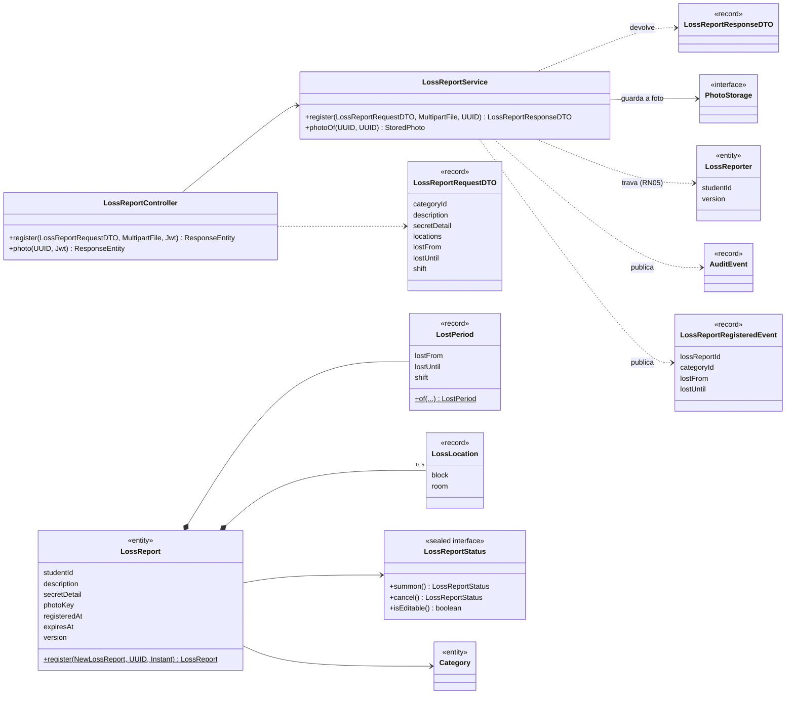
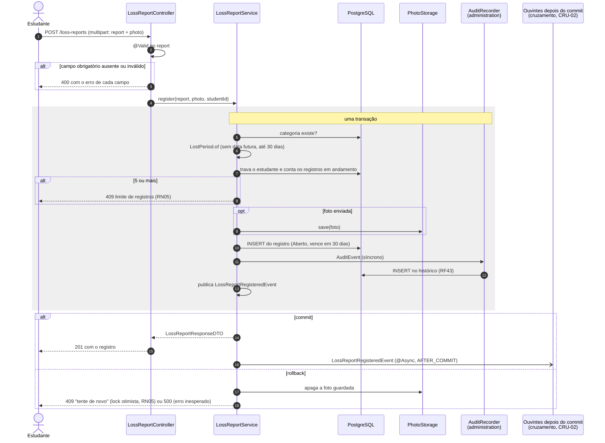
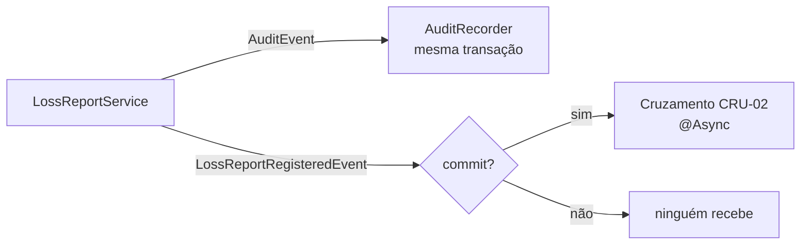
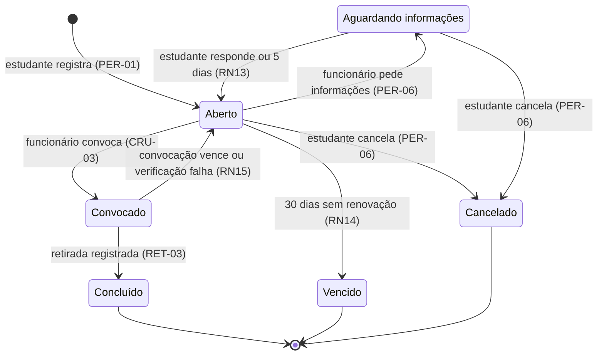

# Registro de perda (PER-01)

O caminho de um registro de perda, do formulário do estudante até os eventos que o resto do sistema ouve. As regras estão nos requisitos (RF13, RF14, RN05, RN14, seção 6.2). O limite de 5 registros, com o lock otimista, tem o próprio documento: [limite-registros-abertos.md](limite-registros-abertos.md).

## 1. Classes envolvidas

- `LostPeriod` e `LossLocation` ficam dentro da tabela do registro (`@Embeddable`); os locais, numa tabela própria (`loss_report_locations`).
- O `LossReportRegisteredEvent` fica em `lossreports.api.event`, o único pacote que outros módulos podem ver (D10).

## 2. Fluxo do registro

## 3. Os dois eventos

O registro publica dois eventos, e cada um é ouvido de um jeito:

| Evento | Quem ouve | Quando | Se o ouvinte falhar |
|---|---|---|---|
| `AuditEvent` | `AuditRecorder` (`administration`) | Na hora, na **mesma transação** | O registro é desfeito: nenhuma ação sem histórico (RF43) |
| `LossReportRegisteredEvent` | Cruzamento (CRU-02, ainda não implementado) | **Depois do commit**, em outra thread (`@Async`, Virtual Threads) | O registro continua salvo: o cruzamento nunca desfaz nem atrasa o estudante (D05) |

Por que evento e não chamada direta: pela D10, `lossreports` não depende de ninguém. Quem conhece as perdas é o `matching` (e o `administration` conhece só o `AuditEvent` do `shared`). O evento deixa o registro sem saber quem reage, e um ouvinte novo (um aviso por e-mail, por exemplo) entra sem mudar o `LossReportService`.

O evento só leva ids e datas: a descrição, o detalhe secreto e a foto não saem do módulo (RF14).

## 4. Situações do registro

As transições da seção 6.2, implementadas no `LossReportStatus`. O PER-01 cria o registro em Aberto; as outras transições são usadas pelos cards indicados.

- **Em andamento** (contam para o limite de 5, RN05): Aberto, Aguardando informações e Convocado.
- **Editáveis** (RN06, edição no PER-07): Aberto e Aguardando informações.

## 5. Foto

- Opcional, na parte `photo` do multipart: JPEG, PNG ou WebP, até 5 MB (mesmas regras do cadastro de objetos).
- Guardada na pasta pela `PhotoStorage` (D21), só **depois** de todas as regras conferidas; se a transação for desfeita, é apagada.
- `GET /loss-reports/{id}/photo`: só o dono. Registro de outro estudante responde 404, igual a um inexistente (RF14).
