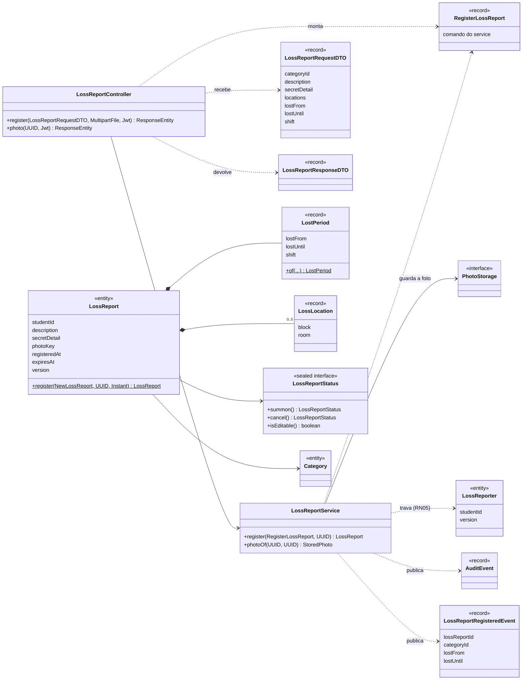
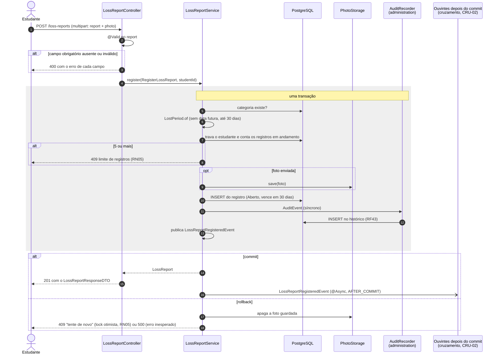
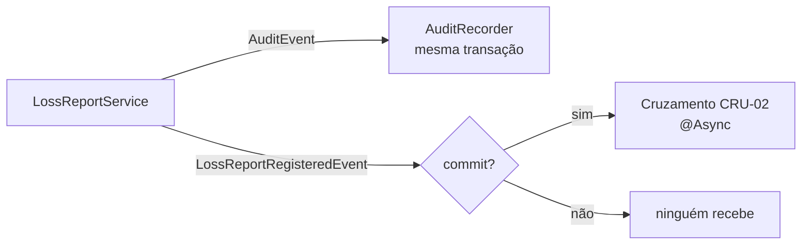
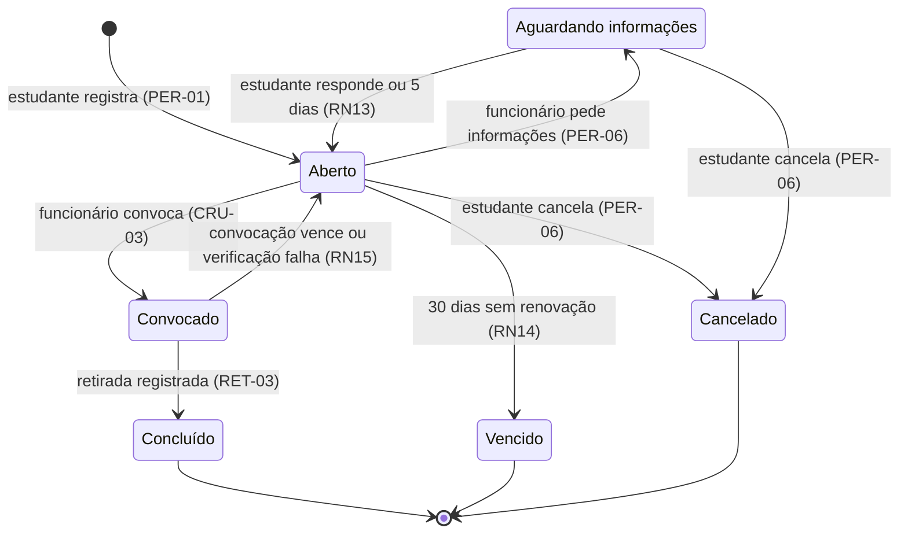

# Registro de perda (PER-01)

O caminho de um registro de perda, do formulário do estudante até os eventos que o resto do sistema ouve. As regras estão nos requisitos (RF13, RF14, RN05, RN14, seção 6.2). O limite de 5 registros, com o lock otimista, tem o próprio documento: [limite-registros-abertos.md](limite-registros-abertos.md).

## 1. Classes envolvidas

- `LostPeriod` e `LossLocation` ficam dentro da tabela do registro (`@Embeddable`); os locais, numa tabela própria (`loss_report_locations`).
- Os DTOs ficam em `controller.report.dto`, como no módulo de achados: o controller converte o `LossReportRequestDTO` no comando `RegisterLossReport` e a entidade devolvida no `LossReportResponseDTO`. O service não conhece o formato da API.
- O `LossReportRegisteredEvent` fica em `lossreports.api.event`, o único pacote que outros módulos podem ver (D10).

## 2. Fluxo do registro

## 3. Os dois eventos

O registro publica dois eventos, e cada um é ouvido de um jeito:

| Evento | Quem ouve | Quando | Se o ouvinte falhar |
|---|---|---|---|
| `AuditEvent` | `AuditRecorder` (`administration`) | Na hora, na **mesma transação** | O registro é desfeito: nenhuma ação sem histórico (RF43) |
| `LossReportRegisteredEvent` | Cruzamento (CRU-02, ainda não implementado) | **Depois do commit**, em outra thread (`@Async`, Virtual Threads) | O registro continua salvo: o cruzamento nunca desfaz nem atrasa o estudante (D05) |

Por que evento e não chamada direta: pela D10, `lossreports` não depende de ninguém. Quem conhece as perdas é o `matching` (e o `administration` conhece só o `AuditEvent` do `shared`). O evento deixa o registro sem saber quem reage, e um ouvinte novo (um aviso por e-mail, por exemplo) entra sem mudar o `LossReportService`.

O evento só leva ids e datas: a descrição, o detalhe secreto e a foto não saem do módulo (RF14).

## 4. Situações do registro

As transições da seção 6.2, implementadas no `LossReportStatus`. O PER-01 cria o registro em Aberto; as outras transições são usadas pelos cards indicados.

- **Em andamento** (contam para o limite de 5, RN05): Aberto, Aguardando informações e Convocado.
- **Editáveis** (RN06, edição no PER-07): Aberto e Aguardando informações.

## 5. Foto

- Opcional, na parte `photo` do multipart: JPEG, PNG ou WebP, até 5 MB (mesmas regras do cadastro de objetos).
- Guardada na pasta pela `PhotoStorage` (D21), só **depois** de todas as regras conferidas; se a transação for desfeita, é apagada.
- `GET /loss-reports/{id}/photo`: só o dono. Registro de outro estudante responde 404, igual a um inexistente (RF14).

## 8. Prova do registro (PER-05)

O estudante pode anexar uma prova de que o objeto é dele (RF15): uma **foto** (foto antiga com o objeto, nota fiscal) e/ou o **número de série**.

| Rota | Quem | O que faz |
|---|---|---|
| `POST /loss-reports/{id}/proof` | estudante, dono | `multipart/form-data` com a parte `proof` (JSON `{"serialNumber": "..."}`) e/ou a parte `file` (JPEG, PNG ou WebP, até 5 MB). Pelo menos um dos dois; o que não vier continua como estava |
| `GET /loss-reports/{id}/proof` | estudante, dono, ou funcionário/administrador | devolve a foto da prova, com `Cache-Control: no-store`. O funcionário lê a de qualquer registro, para conferir no balcão (RF23) |
| `GET /suggestions/{id}` | funcionário | o lado do registro na comparação ganhou `proofSerialNumber` e `proofPath` |

- **A foto passa pela `PhotoStorage`** (D21), como a foto do registro: guardada só depois das regras conferidas, apagada se a transação for desfeita e **nunca com URL pública** (RN03). Ao trocar a foto, a antiga é apagada depois do commit.
- **PDF não é aceito:** a `PhotoStorage` só entende JPEG, PNG e WebP. Uma nota fiscal em PDF precisa virar foto; é uma limitação declarada (D34).
- **Em que situações:** qualquer uma que não seja final (Aberto, Aguardando informações e Convocado). Concluído, Vencido, Cancelado e Recusado respondem 409. A prova não altera a descrição nem o detalhe, então a RN06 continua valendo.
- **Registro de outro estudante responde 404**, igual a inexistente (RF14). Quem pede a foto de um registro sem foto de prova também recebe 404.
- **O histórico diz que a prova foi anexada, não o conteúdo** (`LOSS_REPORT_PROOF_ATTACHED`): o número de série é um dado pessoal do estudante.

Testes: `LossReportProofControllerTest` (foto e série, só uma, entradas inválidas, troca de foto, outro estudante, situações, leitura pelo dono e pelo funcionário, comparação do funcionário e perfis).
