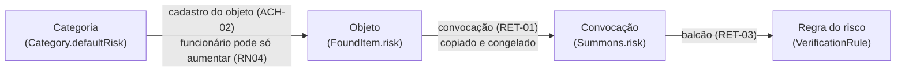
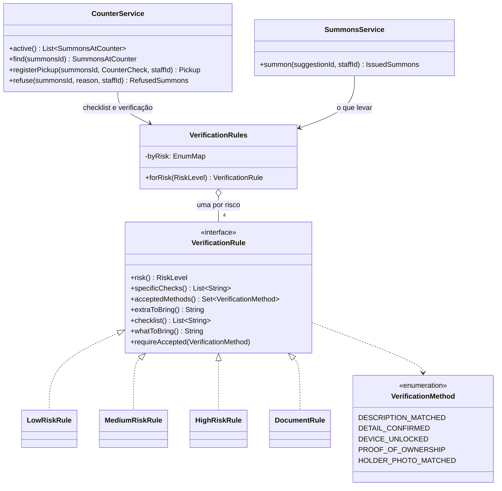
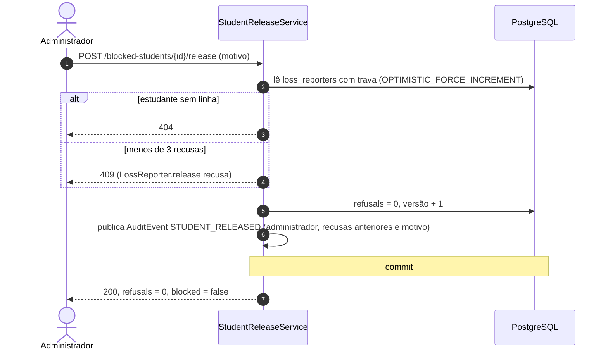
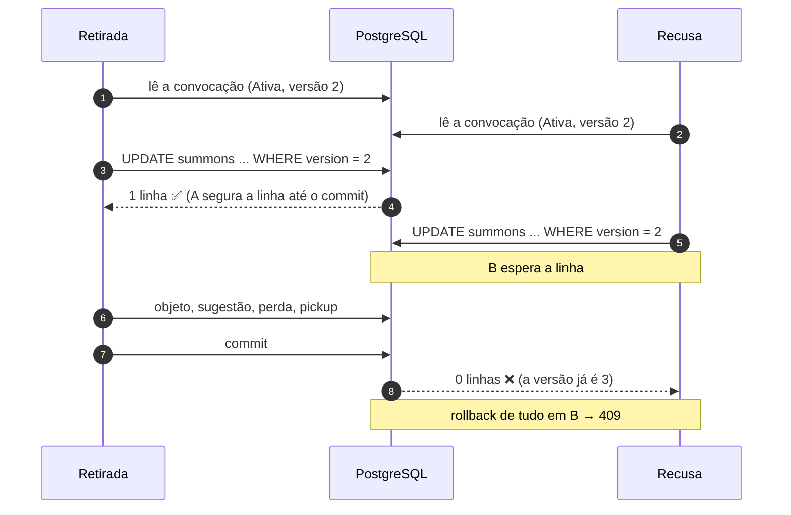
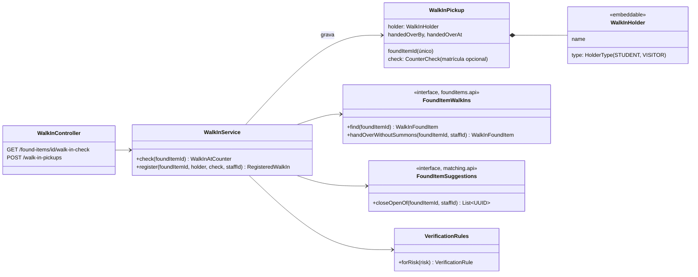
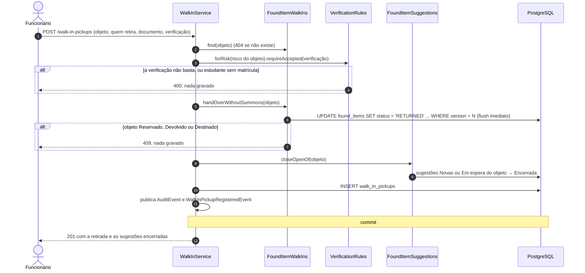

# Retirada e recusa no balcão (RET-03) e atalho de balcão (RET-04)

O estudante convocado (RET-01, [`convocacao.md`](convocacao.md)) vai à sala. O funcionário abre a convocação, vê **o que conferir conforme o risco do objeto** (RF28) e registra a **retirada** (RF29) ou, se a verificação falhar, a **recusa** (RF31). Tudo fica no `CounterService` (`pickup.service.counter`). As escolhas que os requisitos não definiam estão na D26. Quem vai direto à sala, sem registro de perda, é atendido pelo **atalho de balcão** (seção 9, D29).

## 1. De onde vem o risco



Quem escolhe a categoria do objeto é o funcionário. A categoria que o estudante põe na perda serve só para o cruzamento e não muda o risco, então o estudante não consegue facilitar a conferência.

## 2. Regras de conferência por risco (Strategy)

Cada risco da RN09 é uma estratégia que responde três perguntas, que mudam juntas com o risco:

| Risco | O que o funcionário confere (além do documento com foto e da matrícula, RN10) | Verificações que bastam | O que o estudante leva |
|---|---|---|---|
| Baixo | a descrição combina com o objeto | descrição coerente **ou** detalhe que não aparece na foto | documento com foto |
| Médio | um detalhe que não aparece na foto, ou o detalhe reservado | detalhe que não aparece na foto | documento + "esteja pronto para descrever um detalhe" |
| Alto | desbloqueio na frente do funcionário; sem ele, nota fiscal ou número de série | desbloqueio **ou** prova | documento + desbloqueio ou prova |
| Documento | o documento achado é de quem retira | foto do documento confere com o titular | documento + "entregue só ao titular" |



- `checklist()`, `whatToBring()` e `requireAccepted()` são métodos `default` da interface: o documento com foto entra sempre primeiro (RN10), e cada regra só diz o que é dela.
- As quatro regras são `@Component`. O `VerificationRules` recebe todas do Spring e **recusa subir** se um risco ficar sem regra ou com duas. Um risco novo no `RiskLevel` sem regra quebra a aplicação na subida, e não no balcão.
- O "o que levar" da convocação (RF26) também vem daqui. O `WhatToBring` do RET-01 saiu, como a D25 previa.

## 3. Retirada (RF29)

```mermaid
sequenceDiagram
    autonumber
    actor F as Funcionário
    participant C as CounterService
    participant R as VerificationRules
    participant A as FoundItemReservations
    participant M as SuggestionSummons
    participant P as LossReportSummons
    participant DB as PostgreSQL

    F->>C: POST /summons/{id}/pickup (documento, matrícula, verificação)
    C->>DB: SELECT da convocação (404 se não existe)
    C->>R: forRisk(risco).requireAccepted(verificação)
    alt a verificação não basta para o risco
        R-->>F: 400, nada gravado
    end
    C->>DB: UPDATE summons SET status = 'COMPLETED' ... WHERE version = N (flush imediato)
    C->>A: handOver(objeto)
    A->>DB: objeto → Devolvido
    C->>M: complete(sugestão)
    M->>DB: sugestão → Concluída; as outras Novas ou Em espera da perda → Encerrada
    C->>P: complete(perda)
    P->>DB: perda → Concluído
    C->>DB: INSERT pickups (documento, matrícula, verificação, funcionário, data e hora)
    C->>C: publica AuditEvent (gravados na hora) e PickupRegisteredEvent
    Note over C,DB: commit
    C-->>F: 201 com a retirada
```

O `PickupRegisteredEvent` é o `retirada.registrada` da seção 7.2. Quem vai ouvi-lo depois do commit são o encerramento das outras sugestões do objeto (RF33, RET-06) e o e-mail de confirmação (AVI-02). Os dois entraram depois: o encerramento no RET-06 (seção 10) e o e-mail no AVI-02 ([avisos](avisos.md)).

## 4. Recusa (RF31)

```mermaid
sequenceDiagram
    autonumber
    actor F as Funcionário
    participant C as CounterService
    participant A as FoundItemReservations
    participant M as SuggestionSummons
    participant P as LossReportSummons
    participant E as StudentRefusals
    participant DB as PostgreSQL

    F->>C: POST /summons/{id}/refusal (motivo)
    C->>DB: UPDATE summons SET status = 'REFUSED', refusal_reason = ... WHERE version = N (flush imediato)
    C->>A: release(objeto)
    A->>DB: objeto → Disponível
    C->>M: refuse(sugestão)
    M->>DB: sugestão → Recusada; as Em espera do objeto → Nova (RN18); as outras da perda → Encerrada
    C->>P: refuse(perda)
    P->>DB: perda → Recusado (encerrada)
    C->>E: record(estudante)
    E->>DB: loss_reporters.refusals + 1 (na 3ª, bloqueado: RN12)
    Note over C,DB: commit
    C-->>F: 200 com as recusas do estudante, se ficou bloqueado, as sugestões retomadas e as encerradas
```

Com o objeto Disponível e as sugestões Em espera de volta a Nova, o funcionário pode convocar a próxima perda que combina (RN18).

### A perda recusada se encerra

A seção 6.2 manda a perda voltar a Aberto depois da recusa, mas aí ela ficaria editável de novo, e a RN06 diz que a descrição não muda mais depois de uma convocação. Quem foi recusado poderia ajustar o texto ao que viu no balcão. Por isso, a perda passa a **Recusado**, uma situação final nova (D26), e as outras sugestões dela, com outros objetos, passam a Encerrada. Se o estudante ainda procura o objeto, ele registra a perda de novo, e o limite de 5 registros (RN05) e o bloqueio (RN12) continuam valendo.

O vencimento da convocação (RET-02) não muda: lá ninguém viu o objeto, então a perda volta a Aberto como a seção 6.2 manda.

### Bloqueio depois de 3 recusas (RN12)

As recusas ficam na linha do estudante em `loss_reporters`, a mesma do limite de 5 registros (RN05, [`limite-registros-abertos.md`](limite-registros-abertos.md)). O registro de perda já lê essa linha com trava antes de contar, e agora também recusa o estudante bloqueado (409, `StudentBlockedException`). Uma recusa e um registro simultâneos do mesmo estudante disputam a mesma versão, então não passam os dois com a contagem antiga.

### 4.1 Liberação pelo administrador (ADM-07)

O bloqueio só sai pelas mãos do administrador (RN12), no `StudentReleaseService` (`lossreports.service.reporter`). Primeiro ele vê quem está bloqueado e, depois de conversar com o estudante, libera com um motivo:

| Rota (só administrador) | O que faz | Respostas |
|---|---|---|
| `GET /blocked-students` | estudantes com 3 recusas ou mais, os com mais recusas primeiro | 200 |
| `POST /blocked-students/{studentId}/release` com `{"reason": "..."}` | as recusas voltam a zero, e o estudante volta a registrar perdas | 200, 400 (sem motivo), 404, 409 |



- **A regra fica na entidade:** `LossReporter.release()` zera as recusas e recusa o estudante que não está bloqueado (`StudentNotBlockedException`, 409).
- **A mesma trava:** a liberação lê a linha com a mesma trava do registro de perda e da recusa. Uma liberação e uma recusa simultâneas do mesmo estudante disputam a versão, e a segunda recebe 409, em vez de uma apagar a outra.
- **Depois da liberação, as recusas contam do começo:** o estudante só volta a ser bloqueado com mais 3.
- **A resposta traz o id da conta, não o e-mail:** o `lossreports` não pode depender do `access` (D10). O front encontra o e-mail na lista de usuários do administrador (`GET /users`).
- Testado em [`StudentReleaseServiceTest`](../../src/test/java/br/ucsal/cade/lossreports/service/reporter/StudentReleaseServiceTest.java) (o liberado volta a registrar perda, histórico com motivo, recusas do zero, lista só dos bloqueados, 404 e 409 sem gravar nada) e [`BlockedStudentsControllerTest`](../../src/test/java/br/ucsal/cade/lossreports/controller/reporter/BlockedStudentsControllerTest.java) (200, 400, 404, 409, 401 e 403 para funcionário e estudante).

## 5. Como cada entidade muda

| Entidade | Retirada | Recusa | Histórico |
|---|---|---|---|
| `Summons` | Ativa → Concluída | Ativa → Recusada, com motivo | `SUMMONS_COMPLETED` / `SUMMONS_REFUSED` (com o motivo) |
| `FoundItem` | Reservado → Devolvido | Reservado → Disponível | `FOUND_ITEM_HANDED_OVER` / `FOUND_ITEM_RELEASED` |
| `MatchSuggestion` (a convocada) | Convocada → Concluída | Convocada → Recusada | `MATCH_COMPLETED` / `MATCH_REFUSED` |
| `MatchSuggestion` (Em espera do objeto) | continuam (RF33 é o RET-06) | Em espera → Nova | — / `MATCH_RESUMED` |
| `MatchSuggestion` (Novas ou Em espera da perda, com outros objetos) | → Encerrada | → Encerrada | `MATCH_CLOSED` / `MATCH_CLOSED` |
| `LossReport` | Convocado → Concluído | Convocado → Recusado (final) | `LOSS_REPORT_COMPLETED` / `LOSS_REPORT_REFUSED` |
| `Pickup` (nova) | gravada | — | `PICKUP_REGISTERED` |
| `LossReporter` | — | recusas + 1 | `STUDENT_REFUSAL_RECORDED`; na 3ª, também `STUDENT_BLOCKED` (a liberação, seção 4.1, grava `STUDENT_RELEASED`) |

Todos os registros têm o funcionário como autor. As interfaces dos outros módulos usam `Propagation.MANDATORY`: se qualquer passo falhar, nada fica gravado.

## 6. Retirada e recusa ao mesmo tempo

Dois funcionários podem decidir sobre a mesma convocação ao mesmo tempo, um registrando a retirada e o outro a recusa. Mais tarde, o vencimento do RET-02 também vai disputar com eles. A `Summons` tem `@Version` e é **gravada primeiro** (`saveAndFlush`), antes de qualquer outro módulo:



É a mesma ideia da D25: todas as decisões sobre a mesma convocação disputam primeiro a mesma linha, numa ordem fixa, sem deadlock.

## 7. Rotas (funcionário e administrador)

| Rota | O que faz | Respostas |
|---|---|---|
| `GET /summons` | convocações Ativas, das que vencem primeiro para as últimas, cada uma com o checklist | 200 |
| `GET /summons/{id}` | uma convocação com o risco, o checklist e as verificações aceitas (RF28) | 200, 404 |
| `POST /summons/{id}/pickup` | registra a retirada | 201, 400 (campo ou verificação), 404, 409 |
| `POST /summons/{id}/refusal` | registra a recusa com motivo | 200, 400, 404, 409 |

As respostas não trazem o id do estudante, o texto da perda nem os dados reservados do objeto (RN03). O detalhe reservado, o funcionário já vê na ficha do objeto.

## 8. Onde está testado

- [`VerificationRulesTest`](../../src/test/java/br/ucsal/cade/pickup/service/verification/VerificationRulesTest.java): uma regra por risco, documento com foto sempre primeiro, verificações aceitas e recusadas de cada risco, e a subida recusada com risco sem regra ou com regra duplicada.
- [`CounterServiceTest`](../../src/test/java/br/ucsal/cade/pickup/service/counter/CounterServiceTest.java):
  - as transições nos quatro módulos e o histórico, na retirada e na recusa;
  - a verificação insuficiente que não grava nada;
  - as sugestões Em espera que voltam a Nova, e as outras da perda que são encerradas, na recusa e na retirada;
  - o bloqueio na 3ª recusa, com o registro de perda recusado depois;
  - a convocação encerrada que não aceita outra decisão;
  - a retirada e a recusa simultâneas, em Virtual Threads, das quais só uma passa.
- [`CounterControllerTest`](../../src/test/java/br/ucsal/cade/pickup/controller/counter/CounterControllerTest.java): rotas com 200, 201, 400, 401, 403, 404 e 409.
- [`LossReportServiceTest`](../../src/test/java/br/ucsal/cade/lossreports/service/report/LossReportServiceTest.java): estudante com 3 recusas não registra perda; com 2, registra.

## 9. Atalho de balcão (RET-04, RF32)

Quem vai direto à sala, sem registro de perda e sem convocação, é atendido como hoje (seção 3.2 dos requisitos). Pode ser um estudante ou uma **pessoa sem conta**, identificada por nome e documento (RN20). Tudo fica no `WalkInService` (`pickup.service.walkin`). As escolhas que os requisitos não definiam estão na D29.

### 9.1 Classes envolvidas



- As regras por risco são as mesmas da retirada com convocação (seção 2). O risco vem do objeto, porque não há convocação que o tenha congelado.
- `handOverWithoutSummons` usa a transição nova `FoundItemStatus.handOverWithoutSummons()`, que aceita só Disponível e Não reclamado. O `handOver()` comum aceita também Reservado, porque é o da retirada com convocação.
- `FoundItemSuggestions` e `handOverWithoutSummons` usam `Propagation.MANDATORY`, como as outras interfaces do balcão.

### 9.2 Fluxo



### 9.3 Atalho e convocação ao mesmo tempo

Um funcionário pode convocar um estudante para o objeto no mesmo instante em que outro entrega o objeto pelo atalho. Os dois gravam primeiro a linha do objeto, que tem `@Version` (D25): a reserva da convocação e a entrega do atalho disputam a mesma linha, e quem chega depois perde (409) sem mudar nada. Se a convocação passou primeiro, o objeto fica Reservado e o atalho é recusado. Se o atalho passou primeiro, o objeto está Devolvido e a convocação é recusada.

### 9.4 Como cada entidade muda

| Entidade | Atalho | Histórico |
|---|---|---|
| `FoundItem` | Disponível ou Não reclamado → Devolvido | `FOUND_ITEM_HANDED_OVER_AT_COUNTER` |
| `MatchSuggestion` (Novas ou Em espera do objeto) | → Encerrada (RF33) | `MATCH_CLOSED`, uma por sugestão |
| `WalkInPickup` (nova) | gravada | `WALK_IN_PICKUP_REGISTERED` |
| `LossReport` | não muda (D29) | — |

### 9.5 Rotas (funcionário e administrador)

| Rota | O que faz | Respostas |
|---|---|---|
| `GET /found-items/{id}/walk-in-check` | se o objeto pode sair pelo atalho, o risco, o checklist e as verificações aceitas (RF28) | 200, 404 |
| `POST /walk-in-pickups` | registra a retirada pelo atalho | 201, 400 (campo, matrícula ou verificação), 404, 409 |

O `GET` não traz descrição interna, detalhes reservados nem foto: o funcionário já os vê na ficha do objeto.

### 9.6 Onde está testado

- [`FoundItemStatusTest`](../../src/test/java/br/ucsal/cade/founditems/persistence/status/FoundItemStatusTest.java): a ação "entregar sem convocação" entra na tabela de transições permitidas e proibidas.
- [`FoundItemWalkInsServiceTest`](../../src/test/java/br/ucsal/cade/founditems/service/port/FoundItemWalkInsServiceTest.java): entrega de Disponível e Não reclamado com histórico, Reservado recusado e a exigência de transação.
- [`FoundItemSuggestionsServiceTest`](../../src/test/java/br/ucsal/cade/matching/service/suggestion/FoundItemSuggestionsServiceTest.java): só as Novas e Em espera do objeto são encerradas.
- [`WalkInServiceTest`](../../src/test/java/br/ucsal/cade/pickup/service/walkin/WalkInServiceTest.java):
  - estudante e pessoa sem conta (sem matrícula);
  - verificação insuficiente e estudante sem matrícula, sem gravar nada;
  - objeto Reservado e objeto já entregue (409);
  - o histórico com o funcionário como autor;
  - atalho e convocação simultâneos, em Virtual Threads, dos quais só um passa.
- [`WalkInControllerTest`](../../src/test/java/br/ucsal/cade/pickup/controller/walkin/WalkInControllerTest.java): rotas com 200, 201, 400, 401, 403, 404 e 409.

## 10. Confirmação do estudante e encerramento das outras sugestões (RET-06)

### Encerramento das outras sugestões do objeto (RF33)

Na mesma transação da retirada, o `CounterService.registerPickup` chama `FoundItemSuggestions.closeOthersOf`: as sugestões **Novas e Em espera** do objeto passam a **Encerradas**, cada uma no histórico (`MATCH_CLOSED`, "retirado pela convocação de outra sugestão"). A sugestão convocada já está Concluída, as Descartadas ficam como estão e as de outros objetos não são tocadas. Se houve alguma, o balcão publica o `OtherSuggestionsClosedEvent`.

**Aviso aos estudantes (D35):** o `ClosedSuggestionNoticeListener` põe na caixa de saída um e-mail `SUGGESTION_CLOSED` para o dono de cada sugestão encerrada, **no máximo um por estudante e por retirada**, em nome da referência da sugestão. O texto é **neutro** de propósito: não diz qual objeto, como ele é nem para quem foi: só que uma análise foi encerrada e que o registro continua aberto (RN03). Pode ser desligado com `cade.notifications.closed-suggestion-notice-enabled=false`. O atalho de balcão (D29) continua sem aviso.

### Confirmação no celular (RF30)

| Rota | O que faz |
|---|---|
| `GET /pickups/mine` | as retiradas que o funcionário registrou para o estudante, da mais recente para a mais antiga, cada uma com `confirmed` e `confirmedAt`; não traz nada do objeto |
| `POST /pickups/{id}/confirmation` | o estudante confirma a retirada, no lugar da assinatura no papel |

- **Registro à parte:** a confirmação é a `PickupConfirmation`, que só se grava; a `Pickup` continua intacta (RN19). A coluna `pickupId` é única, então duas confirmações simultâneas terminam com exatamente uma e as outras recebem 409.
- **Só o próprio estudante:** retirada de outro estudante responde 404 (RF14). Retirada do atalho de balcão (D29) não tem conta e, portanto, não tem confirmação.
- **No histórico:** `PICKUP_CONFIRMED`, com o estudante como autor.

Testes: `PickupConfirmationTest` (encerramento, aviso único e neutro, confirmação, retirada intacta, 409 duplo, corrida em Virtual Threads) e `StudentPickupControllerTest` (rotas, campos devolvidos, perfis).
