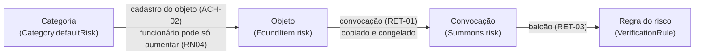
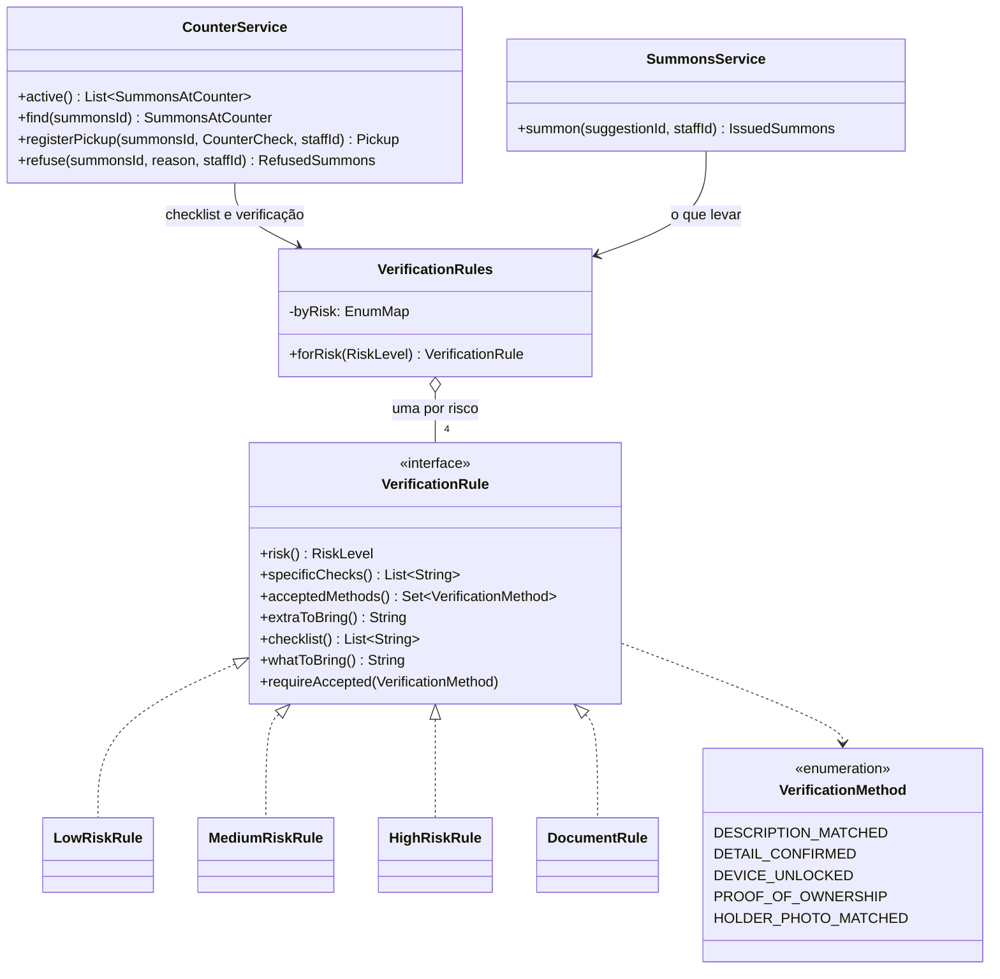
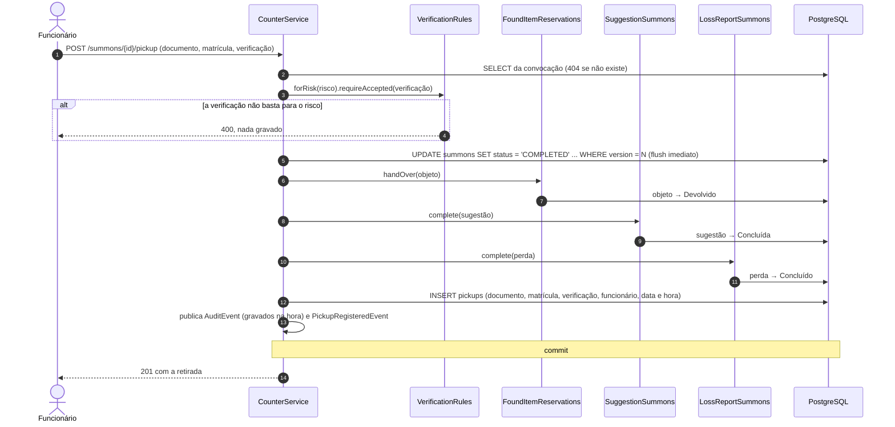
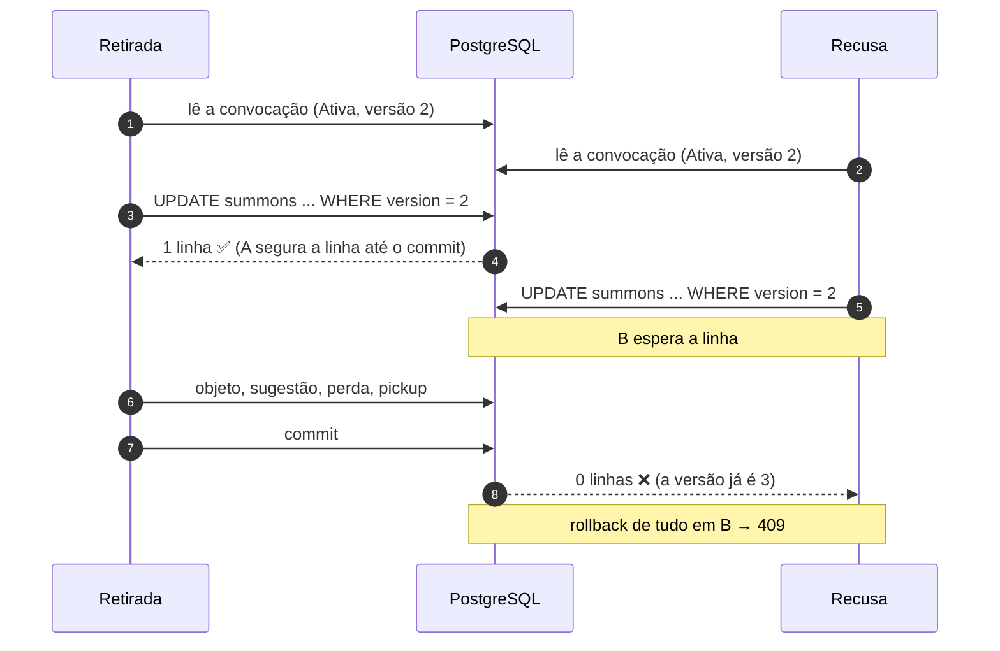

# Retirada e recusa no balcão (RET-03)

O estudante convocado (RET-01, [`convocacao.md`](convocacao.md)) vai à sala. O funcionário abre a convocação, vê **o que conferir conforme o risco do objeto** (RF28) e registra a **retirada** (RF29) ou, se a verificação falhar, a **recusa** (RF31). Tudo fica no `CounterService` (`pickup.service.counter`). As escolhas que os requisitos não definiam estão na D26.

## 1. De onde vem o risco



Quem escolhe a categoria do objeto é o funcionário. A categoria que o estudante põe na perda serve só para o cruzamento e não muda o risco, então o estudante não consegue facilitar a conferência.

## 2. Regras de conferência por risco (Strategy)

Cada risco da RN09 é uma estratégia que responde três perguntas, que mudam juntas com o risco:

| Risco | O que o funcionário confere (além do documento com foto e da matrícula, RN10) | Verificações que bastam | O que o estudante leva |
|---|---|---|---|
| Baixo | a descrição combina com o objeto | descrição coerente **ou** detalhe que não aparece na foto | documento com foto |
| Médio | um detalhe que não aparece na foto, ou o detalhe reservado | detalhe que não aparece na foto | documento + "esteja pronto para descrever um detalhe" |
| Alto | desbloqueio na frente do funcionário; sem ele, nota fiscal ou número de série | desbloqueio **ou** prova | documento + desbloqueio ou prova |
| Documento | o documento achado é de quem retira | foto do documento confere com o titular | documento + "entregue só ao titular" |



- `checklist()`, `whatToBring()` e `requireAccepted()` são métodos `default` da interface: o documento com foto entra sempre primeiro (RN10), e cada regra só diz o que é dela.
- As quatro regras são `@Component`. O `VerificationRules` recebe todas do Spring e **recusa subir** se um risco ficar sem regra ou com duas. Um risco novo no `RiskLevel` sem regra quebra a aplicação na subida, e não no balcão.
- O "o que levar" da convocação (RF26) também vem daqui. O `WhatToBring` do RET-01 saiu, como a D25 previa.

## 3. Retirada (RF29)



O `PickupRegisteredEvent` é o `retirada.registrada` da seção 7.2. Quem vai ouvi-lo depois do commit são o encerramento das outras sugestões do objeto (RF33, RET-06) e o e-mail de confirmação (AVI-02). Nenhum dos dois é deste card.

## 4. Recusa (RF31)

```mermaid
sequenceDiagram
    autonumber
    actor F as Funcionário
    participant C as CounterService
    participant A as FoundItemReservations
    participant M as SuggestionSummons
    participant P as LossReportSummons
    participant E as StudentRefusals
    participant DB as PostgreSQL

    F->>C: POST /summons/{id}/refusal (motivo)
    C->>DB: UPDATE summons SET status = 'REFUSED', refusal_reason = ... WHERE version = N (flush imediato)
    C->>A: release(objeto)
    A->>DB: objeto → Disponível
    C->>M: refuse(sugestão)
    M->>DB: sugestão → Recusada; as Em espera do objeto → Nova (RN18)
    C->>P: release(perda)
    P->>DB: perda → Aberto
    C->>E: record(estudante)
    E->>DB: loss_reporters.refusals + 1 (na 3ª, bloqueado: RN12)
    Note over C,DB: commit
    C-->>F: 200 com as recusas do estudante, se ficou bloqueado e as sugestões retomadas
```

Com o objeto Disponível e as sugestões Em espera de volta a Nova, o funcionário pode convocar a próxima perda que combina (RN18).

### Bloqueio depois de 3 recusas (RN12)

As recusas ficam na linha do estudante em `loss_reporters`, a mesma do limite de 5 registros (RN05, [`limite-registros-abertos.md`](limite-registros-abertos.md)). O registro de perda já lê essa linha com trava antes de contar, e agora também recusa o estudante bloqueado (409, `StudentBlockedException`). Uma recusa e um registro simultâneos do mesmo estudante disputam a mesma versão, então não passam os dois com a contagem antiga.

O desbloqueio pelo administrador não faz parte deste card (D26).

## 5. Como cada entidade muda

| Entidade | Retirada | Recusa | Histórico |
|---|---|---|---|
| `Summons` | Ativa → Concluída | Ativa → Recusada, com motivo | `SUMMONS_COMPLETED` / `SUMMONS_REFUSED` (com o motivo) |
| `FoundItem` | Reservado → Devolvido | Reservado → Disponível | `FOUND_ITEM_HANDED_OVER` / `FOUND_ITEM_RELEASED` |
| `MatchSuggestion` (a convocada) | Convocada → Concluída | Convocada → Recusada | `MATCH_COMPLETED` / `MATCH_REFUSED` |
| `MatchSuggestion` (Em espera do objeto) | continuam (RF33 é o RET-06) | Em espera → Nova | — / `MATCH_RESUMED` |
| `LossReport` | Convocado → Concluído | Convocado → Aberto | `LOSS_REPORT_COMPLETED` / `LOSS_REPORT_RELEASED` |
| `Pickup` (nova) | gravada | — | `PICKUP_REGISTERED` |
| `LossReporter` | — | recusas + 1 | `STUDENT_REFUSAL_RECORDED`; na 3ª, também `STUDENT_BLOCKED` |

Todos os registros têm o funcionário como autor. As interfaces dos outros módulos usam `Propagation.MANDATORY`: se qualquer passo falhar, nada fica gravado.

## 6. Retirada e recusa ao mesmo tempo

Dois funcionários podem decidir sobre a mesma convocação ao mesmo tempo, um registrando a retirada e o outro a recusa. Mais tarde, o vencimento do RET-02 também vai disputar com eles. A `Summons` tem `@Version` e é **gravada primeiro** (`saveAndFlush`), antes de qualquer outro módulo:



É a mesma ideia da D25: todas as decisões sobre a mesma convocação disputam primeiro a mesma linha, numa ordem fixa, sem deadlock.

## 7. Rotas (funcionário e administrador)

| Rota | O que faz | Respostas |
|---|---|---|
| `GET /summons` | convocações Ativas, das que vencem primeiro para as últimas, cada uma com o checklist | 200 |
| `GET /summons/{id}` | uma convocação com o risco, o checklist e as verificações aceitas (RF28) | 200, 404 |
| `POST /summons/{id}/pickup` | registra a retirada | 201, 400 (campo ou verificação), 404, 409 |
| `POST /summons/{id}/refusal` | registra a recusa com motivo | 200, 400, 404, 409 |

As respostas não trazem o id do estudante, o texto da perda nem os dados reservados do objeto (RN03). O detalhe reservado, o funcionário já vê na ficha do objeto.

## 8. Onde está testado

- [`VerificationRulesTest`](../../src/test/java/br/ucsal/cade/pickup/service/verification/VerificationRulesTest.java): uma regra por risco, documento com foto sempre primeiro, verificações aceitas e recusadas de cada risco, e a subida recusada com risco sem regra ou com regra duplicada.
- [`CounterServiceTest`](../../src/test/java/br/ucsal/cade/pickup/service/counter/CounterServiceTest.java):
  - as transições nos quatro módulos e o histórico, na retirada e na recusa;
  - a verificação insuficiente que não grava nada;
  - as sugestões Em espera que voltam a Nova;
  - o bloqueio na 3ª recusa, com o registro de perda recusado depois;
  - a convocação encerrada que não aceita outra decisão;
  - a retirada e a recusa simultâneas, em Virtual Threads, das quais só uma passa.
- [`CounterControllerTest`](../../src/test/java/br/ucsal/cade/pickup/controller/counter/CounterControllerTest.java): rotas com 200, 201, 400, 401, 403, 404 e 409.
- [`LossReportServiceTest`](../../src/test/java/br/ucsal/cade/lossreports/service/report/LossReportServiceTest.java): estudante com 3 recusas não registra perda; com 2, registra.
